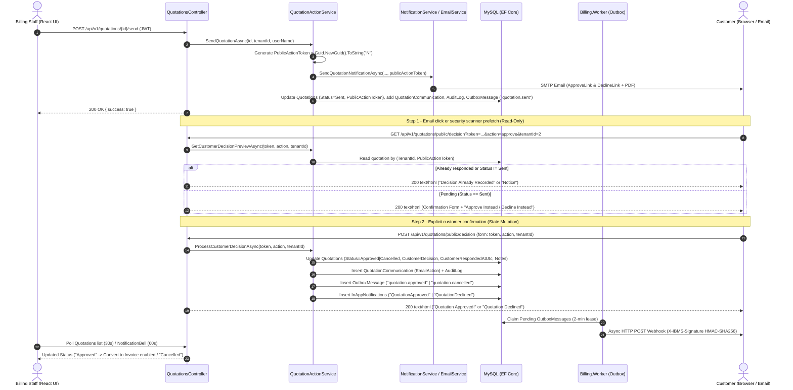

# IBMS Customer Quotation Approval & Decline — Complete Technical Handover Document

**Target Audience:** Backend, Frontend, Database, Email, and QA engineers reproducing the Customer Quotation Approval/Decline email & public confirmation workflow in another application.  
**Scope & Verification:**
- **Sections 1–16** document what is **actually implemented** in the IBMS repository today (every entity, table, migration, route, method, HTML snippet, DTO, payload, and unit test was verified directly against IBMS source code), alongside IBMS's existing limitations.
- **Sections 17–19** provide a **Recommended Secure Implementation for Other Projects**, **Information Required from the Receiving Project**, and **Role-Based Implementation Checklists** so another team can build a hardened, production-ready version without inheriting IBMS's known gaps. All recommendations are explicitly marked `[Recommended — Not Implemented in IBMS]`.

---

## 1. Feature Overview

### Purpose
The Customer Quotation Approval and Decline feature allows an external customer to accept (`Approve`) or reject (`Decline`) a sales quotation directly from their email inbox **without logging into IBMS** and without requiring a customer portal account.

### Customer Experience
1. The customer receives an HTML quotation email (with an optional PDF quotation attachment) containing two call-to-action buttons: **Approve** and **Decline**.
2. Clicking either button opens a server-rendered confirmation web page (not an immediate state mutation) showing the company name, quotation number, customer name, total amount, and explicit confirmation buttons (**Confirm & Approve Quotation** or **Confirm & Decline Quotation**, plus an **Approve Instead** / **Decline Instead** switch button).
3. After clicking the confirmation submit button, an HTTP `POST` records the decision once and renders a server-side result page confirming **Quotation Approved!** or **Quotation Declined**.
4. Re-opening the email link or clicking the other button afterward renders a read-only **Decision Already Recorded** screen showing the originally recorded decision and UTC timestamp, without modifying the quotation again.

### End-to-End Lifecycle Summary
1. A billing user creates a `Draft` quotation and triggers **Send** (`POST /api/v1/quotations/{id}/send`).
2. The backend generates a `PublicActionToken` (if not already present), constructs public `ApproveLink` and `DeclineLink` URLs using `AppUrlResolver.GetApiBaseUrl()`, sends the email via SMTP (`MailKit`), and marks the quotation `Sent`.
3. The customer clicks a button in the email (`GET /api/v1/quotations/public/decision?...`), which performs a **read-only preview** to protect against email security scanners/link prefetchers and renders a confirmation form.
4. Submitting the confirmation form triggers `POST /api/v1/quotations/public/decision`, which validates the token and single-use lock, updates `Quotations.Status`, `CustomerDecision`, `CustomerRespondedAtUtc` (and appends `Notes` on decline), writes `QuotationCommunications` and `audit_logs` records, enqueues an `OutboxMessage` webhook event, and publishes an `InAppNotification` to tenant staff.
5. The IBMS React frontend refreshes quotation data (via manual refresh, window focus/visibility change, or 30-second list polling) and reflects `Approved` (unlocking **Convert to Invoice**) or `Cancelled` (with customer decline notes, `EmailAction` communication entry, and `Approved`/`Declined` audit log).

---

## 2. Complete End-to-End Workflow

### Sequential Flow
1. **User creates a quotation:** Staff creates a `Draft` quotation (`POST /api/v1/quotations`) with customer, items, validity date (`ValidUntil`), and positive `TotalAmount`.
2. **User sends the quotation:** Staff clicks **Send** in the UI (`POST /api/v1/quotations/{id}/send`).
3. **Backend validates & generates token:** `QuotationActionService.SendQuotationAsync` verifies `Status == QuotationStatus.Draft`, items exist, `TotalAmount > 0`, `ValidUntil.Date >= DateTime.UtcNow.Date`, and customer email exists. If `PublicActionToken` is empty, it generates `Guid.NewGuid().ToString("N")` (32 lowercase hex characters).
4. **Backend generates Approve and Decline URLs:** Using `AppUrlResolver.GetApiBaseUrl()`, both `QuotationActionService.BuildQuotationHtmlEmail` and `NotificationService.SendQuotationNotificationAsync` generate:
   - `approveLink`: `{apiBaseUrl}/api/v1/quotations/public/decision?token={actionToken}&action=approve&tenantId={tenantId}`
   - `declineLink`: `{apiBaseUrl}/api/v1/quotations/public/decision?token={actionToken}&action=decline&tenantId={tenantId}`
5. **Email service dispatches email:** `NotificationService.SendQuotationNotificationAsync` (or `QuotationActionService` fallback if `_notificationService` is null) renders the HTML body + QuestPDF attachment and sends via `EmailService.SendEmailAsync` (`MailKit` SMTP). Quotation status transitions to `Sent`, saving `PublicActionToken`, a `QuotationCommunication` (`CommunicationType = "Email"`), an `AuditLog` (`Action = "Sent"`), and an Outbox event (`"quotation.sent"`).
6. **Customer clicks Approve or Decline:** Browser (or email link scanner) opens `GET /api/v1/quotations/public/decision?token=...&action=...&tenantId=...`.
7. **Confirmation page opens (Read-Only):** `QuotationsController.PublicProcessQuotationDecision` calls `GetCustomerDecisionPreviewAsync`, which runs `PrepareCustomerDecisionAsync(..., readOnly: true)`. **No database state is mutated.** If valid and pending, the controller returns an HTML form (`RenderDecisionConfirmationHtmlPage`). If already responded, it returns the locked **Decision Already Recorded** HTML page (`RenderDecisionHtmlPage`).
8. **Customer confirms decision:** Customer clicks **Confirm & Approve Quotation** (or **Confirm & Decline Quotation** / the alternate switch button), submitting an `application/x-www-form-urlencoded` `POST` to `/api/v1/quotations/public/decision`.
9. **Backend validates token & single-use state:** `QuotationsController.PublicConfirmQuotationDecision` delegates to `ProcessCustomerDecisionAsync`, which validates non-empty token, action (`approve` or `decline`), tenant-scoped quotation lookup, and verifies `!quotation.CustomerRespondedAtUtc.HasValue && quotation.Status == QuotationStatus.Sent`.
10. **Backend updates quotation & records customer decision:**
    - If `approve`: `Status = QuotationStatus.Approved`, `CustomerDecision = "Approved"`, `CustomerRespondedAtUtc = now`.
    - If `decline`: `Status = QuotationStatus.Cancelled`, `CustomerDecision = "Declined"`, `CustomerRespondedAtUtc = now`, and appends `"Declined by customer via email link on {now:yyyy-MM-dd HH:mm:ss} UTC."` to `Notes`.
11. **Communication history & audit log created:** Adds a `QuotationCommunication` (`CommunicationType = "EmailAction"`, `Status = "Recorded"`, `SentBy = "Customer (via Email)"`) and inserts an `AuditLog` (`EntityName = "Quotation"`, `Action = "Approved"` or `"Declined"`).
12. **In-app notification & Outbox webhook events published:** Enqueues `"quotation.approved"` or `"quotation.cancelled"` into `outboxmessages` and publishes `"QuotationApproved"` or `"QuotationDeclined"` to `InAppNotifications`.
13. **Frontend reflects updated status:** `NotificationBell` polls every 60s for unread notifications; `QuotationManagement` polls the quotations list every 30s (while visible) and refreshes on tab focus/visibility change or manual open. `Approved` quotations show the **Convert to Invoice** button.

### Workflow Diagram



---

## 3. Database Documentation

IBMS uses **MySQL 8** (`Pomelo.EntityFrameworkCore.MySql` 9.0.0) configured in `Backend/Billing.Infrastructure/Data/BillingDbContext.cs`.

### 3.1 Core Table: `Quotations`
- **Entity Class:** `Billing.Domain.Entities.Quotation` (`Backend/Billing.Domain/Entities/Quotation.cs`)
- **Enum:** `Billing.Domain.Enums.QuotationStatus`:
  - `Draft = 1`
  - `Sent = 2`
  - `Approved = 3`
  - `Cancelled = 4`
  - `Converted = 5`

| Column | .NET Property | MySQL Type (Migration / Model) | Nullable | Default / Constraint | Purpose in Feature |
| :--- | :--- | :--- | :--- | :--- | :--- |
| `Id` | `Id` | `int` (`AUTO_INCREMENT`) | No | Primary Key | Quotation identifier (also accepted as legacy fallback in lookup) |
| `TenantId` | `TenantId` | `int` | No | FK -> `Tenants(Id)` (`ON DELETE RESTRICT`) | Multi-tenant isolation scope |
| `QuoteNumber` | `QuoteNumber` | `varchar(64)` | No | Unique index `(TenantId, QuoteNumber)` | Human-readable quote number shown in email & HTML pages |
| `CustomerId` | `CustomerId` | `int` | No | FK -> `Customers(Id)` (`ON DELETE RESTRICT`) | Links to customer email, name, and currency |
| `QuotationDate` | `QuotationDate` | `datetime(6)` | No | Required | Quotation issue date |
| `ValidUntil` | `ValidUntil` | `datetime(6)` | No | Required | Checked during **Send** (`ValidUntil.Date >= DateTime.UtcNow.Date`); **not** checked on customer click |
| `Status` | `Status` | `int` | No | Stored as `int` (`QuotationStatus` conversion) | `Sent (2)` -> `Approved (3)` or `Cancelled (4)` |
| `TotalAmount` | `TotalAmount` | `decimal(18,2)` | No | Precision `(18,2)` | Displayed in email and confirmation portal |
| `Notes` | `Notes` | `longtext` | Yes | Nullable | On decline, appends `"Declined by customer via email link on ... UTC."` |
| `ConvertedInvoiceId` | `ConvertedInvoiceId` | `int` | Yes | Nullable | Populated when an `Approved` quotation is converted to an invoice |
| `PublicActionToken` | `PublicActionToken` | `varchar(64)` | Yes | `MaxLength(64)`; Indexed with `TenantId` | Stores `Guid.NewGuid().ToString("N")` generated on send |
| `CustomerDecision` | `CustomerDecision` | `varchar(32)` | Yes | `MaxLength(32)` | Stores `"Approved"` or `"Declined"` |
| `CustomerRespondedAtUtc` | `CustomerRespondedAtUtc` | `datetime(6)` | Yes | Nullable | UTC timestamp of first decision; acts as single-use lock flag |
| `RowVersion` | `RowVersion` | `datetime(6)` (EF concurrency token) | Yes | `.IsRowVersion()`, manually assigned `DateTime.UtcNow` in `UpdateAsync` | EF Core optimistic concurrency token |
| `CreatedAtUtc` | `CreatedAtUtc` | `datetime(6)` | No | `DateTime.UtcNow` | Record creation time |
| `UpdatedAtUtc` | `UpdatedAtUtc` | `datetime(6)` | Yes | Updated to `DateTime.UtcNow` on save | Last modification time |

**Indexes on `Quotations`:**
- `PK_Quotations`: `(Id)`
- `IX_Quotations_TenantId_QuoteNumber`: `(TenantId, QuoteNumber)` — **UNIQUE**
- `IX_Quotations_TenantId_PublicActionToken`: `(TenantId, PublicActionToken)` — **Non-unique** composite index (added in migration `20261106101422_AddPlatformSettingsTenantIdempotencyAndAuditProvenance`)
- `IX_Quotations_CustomerId`: `(CustomerId)`

> **Note:** `PublicActionToken` is indexed **non-uniquely** in EF Core/MySQL and does **not** have a separate `TokenExpiresAtUtc` column.

---

### 3.2 Related Tables

#### `QuotationCommunications` (`Billing.Domain.Entities.QuotationCommunication`)
| Column | MySQL Type | Constraints / MaxLength | Purpose |
| :--- | :--- | :--- | :--- |
| `Id` | `int` | PK (`AUTO_INCREMENT`) | Record ID |
| `QuotationId` | `int` | FK -> `Quotations(Id)` (`ON DELETE CASCADE`) | Parent quotation |
| `CommunicationType` | `varchar(64)` | Required | `"Email"` on send; `"EmailAction"` on customer decision |
| `Recipient` | `varchar(256)` | Required | Customer email (or `"Customer"` fallback) |
| `Subject` | `varchar(256)` | Required | Email subject on send; `"Quotation Approved/Declined by Customer"` on response |
| `Message` | `longtext` | Required | Summary text of email sent or recorded decision timestamp |
| `Status` | `varchar(64)` | Required | `"Sent"` on send; `"Recorded"` on decision |
| `SentAt` | `datetime(6)` | Required | UTC timestamp |
| `SentBy` | `varchar(128)` | Required (`SentBy` from user on send; `"Customer (via Email)"` on decision) | Actor description |

#### `audit_logs` (`Billing.Domain.Entities.AuditLog`)
- Configured via `entity.ToTable("audit_logs")` in `BillingDbContext.cs`.
- **Primary Key:** `Id` (`bigint`, `AUTO_INCREMENT`).
- **Key Columns:** `TenantId` (`int`, FK -> `Tenants` `RESTRICT`), `CustomerId` (`int?`, FK -> `Customers` `SET NULL`), `EntityName` (`varchar(100)` = `"Quotation"`), `EntityId` (`varchar(100)` = `quotation.Id.ToString()`), `Action` (`varchar(50)` = `"Sent"`, `"NotificationSent"`, `"Approved"`, `"Declined"`), `UserName` (`varchar(200)` = `"Customer (via Email)"` for public decision), `Changes` (`text`), `Timestamp` (`datetime(6)` forced UTC), plus provenance columns `ActorUserId`, `ActorRole`, `CorrelationId`, `ResultStatus`, `OldValues`, `NewValues`.
- **Indexes:** `IX_AuditLogs_TenantId_CustomerId`, `IX_AuditLogs_TenantId_Timestamp`, `IX_AuditLogs_TenantId_Entity` (`TenantId, EntityName, EntityId`).

#### `InAppNotifications` (`Billing.Domain.Entities.InAppNotification`)
- **Primary Key:** `Id` (`bigint`, `AUTO_INCREMENT`).
- **Key Columns:** `TenantId` (`int`), `RecipientUserId` (`int`, FK -> `Users(Id)` `CASCADE`), `EventType` (`varchar(100)` = `"QuotationApproved"` or `"QuotationDeclined"`), `EventDeduplicationId` (`varchar(160)`), `Title` (`varchar(200)`), `Message` (`varchar(500)`), `ActionModule` (`varchar(64)` = `"quotations"`), `ActionEntityId` (`varchar(64)` = `quotation.Id.ToString()`), `IsRead` (`tinyint(1)`), `ReadAtUtc` (`datetime(6)` nullable), `CreatedAtUtc` (`datetime(6)`), `ExpiresAtUtc` (`datetime(6)` = `CreatedAtUtc + 90 days`).
- **Unique Constraint:** `IX_InAppNotifications_Tenant_Recipient_Dedup` on `(TenantId, RecipientUserId, EventDeduplicationId)` prevents duplicate bell notifications per user.

#### `outboxmessages` (`Billing.Domain.Entities.OutboxMessage`)
- Configured via `entity.ToTable("outboxmessages")` in `BillingDbContext.cs`.
- **Primary Key:** `Id` (`int`, `AUTO_INCREMENT`).
- **Key Columns:** `TenantId` (`int`, FK -> `Tenants` `CASCADE`), `EventId` (`varchar(64)`), `EventType` (`varchar(100)` = `"quotation.sent"`, `"quotation.approved"`, `"quotation.cancelled"`), `PayloadJson` (`longtext`), `Status` (`varchar(32)`, default `"Pending"`), `RetryCount` (`int`, default `0`), `Error` (`varchar(1000)` nullable), `LockedByInstance` (`varchar(100)` nullable), `LockedUntilUtc` (`datetime(6)` nullable), `CreatedAtUtc` (`datetime(6)`), `ProcessedAtUtc` (`datetime(6)` nullable).
- **Unique Constraint:** `(TenantId, EventId)`. Indexes on `(TenantId, Status, CreatedAtUtc)` and `(Status, LockedUntilUtc, CreatedAtUtc)`.

---

### 3.3 Exact EF Core Migrations
1. `20260923070807_AddQuotationManagement` (`Backend/Billing.Infrastructure/Data/Migrations/20260923070807_AddQuotationManagement.cs`)
   - Creates `Quotations`, `QuotationItems`, and `QuotationCommunications` tables and baseline indexes.
2. `20261103090458_AddInAppNotificationInbox` (`Backend/Billing.Infrastructure/Data/Migrations/20261103090458_AddInAppNotificationInbox.cs`)
   - Creates `InAppNotifications` table and `IX_InAppNotifications_Tenant_Recipient_Dedup`.
3. `20261106101422_AddPlatformSettingsTenantIdempotencyAndAuditProvenance` (`Backend/Billing.Infrastructure/Data/Migrations/20261106101422_AddPlatformSettingsTenantIdempotencyAndAuditProvenance.cs`)
   - Adds `PublicActionToken` (`varchar(64)` nullable), `CustomerDecision` (`varchar(32)` nullable), `CustomerRespondedAtUtc` (`datetime(6)` nullable), and index `IX_Quotations_TenantId_PublicActionToken` on `Quotations`, plus provenance columns on `audit_logs`.
4. *(Outbox & Webhook security schema)* `20261112091147_AddPhase1WebhookOutboxSecurityAndLeases` (`Backend/Billing.Infrastructure/Data/Migrations/20261112091147_AddPhase1WebhookOutboxSecurityAndLeases.cs`)
   - Maintains lease columns on `outboxmessages` and webhook delivery tables used when publishing `"quotation.approved"` / `"quotation.cancelled"`.

---

### 3.4 Sample Database Records (Before and After)

#### State 1: After `POST /api/v1/quotations/41/send` (Pending Customer Decision)
**`Quotations` row:**
```json
{
  "Id": 41,
  "TenantId": 2,
  "QuoteNumber": "QT-2026-041",
  "CustomerId": 410,
  "Status": 2,
  "TotalAmount": 4500.00,
  "Notes": "Standard 14-day validity.",
  "ConvertedInvoiceId": null,
  "PublicActionToken": "7e9c2f4b8a1d4c3ea9f6120b4c8d1e2f",
  "CustomerDecision": null,
  "CustomerRespondedAtUtc": null
}
```
**`QuotationCommunications` row added:**
```json
{
  "QuotationId": 41,
  "CommunicationType": "Email",
  "Recipient": "customer@example.com",
  "Subject": "Quotation QT-2026-041 from Acme Corp",
  "Message": "Quotation QT-2026-041 sent to customer@example.com. Items: 2, Total: 4500.00 INR. PDF attached: Yes.",
  "Status": "Sent",
  "SentAt": "2026-11-12T10:00:00Z",
  "SentBy": "admin@acmetech.com"
}
```

#### State 2A: After Customer Confirms **Approve**
**`Quotations` row:**
```json
{
  "Id": 41,
  "TenantId": 2,
  "QuoteNumber": "QT-2026-041",
  "Status": 3,
  "Notes": "Standard 14-day validity.",
  "ConvertedInvoiceId": null,
  "PublicActionToken": "7e9c2f4b8a1d4c3ea9f6120b4c8d1e2f",
  "CustomerDecision": "Approved",
  "CustomerRespondedAtUtc": "2026-11-12T10:15:30Z",
  "UpdatedAtUtc": "2026-11-12T10:15:30Z"
}
```
**`QuotationCommunications` row added:**
```json
{
  "QuotationId": 41,
  "CommunicationType": "EmailAction",
  "Recipient": "customer@example.com",
  "Subject": "Quotation Approved by Customer",
  "Message": "Customer recorded Approved via secure email button at 2026-11-12 10:15:30 UTC.",
  "Status": "Recorded",
  "SentAt": "2026-11-12T10:15:30Z",
  "SentBy": "Customer (via Email)"
}
```
**`audit_logs` row added:**
```json
{
  "TenantId": 2,
  "CustomerId": 410,
  "EntityName": "Quotation",
  "EntityId": "41",
  "Action": "Approved",
  "UserName": "Customer (via Email)",
  "Changes": "Status changed to Approved. Decision recorded by customer via email link.",
  "Timestamp": "2026-11-12T10:15:30Z"
}
```

#### State 2B: After Customer Confirms **Decline**
**`Quotations` row:**
```json
{
  "Id": 41,
  "TenantId": 2,
  "QuoteNumber": "QT-2026-041",
  "Status": 4,
  "Notes": "Standard 14-day validity.\nDeclined by customer via email link on 2026-11-12 10:15:30 UTC.",
  "ConvertedInvoiceId": null,
  "PublicActionToken": "7e9c2f4b8a1d4c3ea9f6120b4c8d1e2f",
  "CustomerDecision": "Declined",
  "CustomerRespondedAtUtc": "2026-11-12T10:15:30Z",
  "UpdatedAtUtc": "2026-11-12T10:15:30Z"
}
```
**`QuotationCommunications` row added:**
- `CommunicationType = "EmailAction"`, `Subject = "Quotation Declined by Customer"`, `Message = "Customer recorded Declined via secure email button at 2026-11-12 10:15:30 UTC."`, `Status = "Recorded"`, `SentBy = "Customer (via Email)"`.

**`audit_logs` row added:**
- `EntityName = "Quotation"`, `EntityId = "41"`, `Action = "Declined"`, `UserName = "Customer (via Email)"`, `Changes = "Status changed to Cancelled. Decision recorded by customer via email link."`.

---

## 4. Token Generation and Validation

### How the Token Is Generated & Stored
- **Method:** `QuotationActionService.SendQuotationAsync` (`Backend/Billing.Application/Services/QuotationActionService.cs`)
- **Code:**
  ```csharp
  if (string.IsNullOrWhiteSpace(quotation.PublicActionToken))
  {
      quotation.PublicActionToken = Guid.NewGuid().ToString("N");
  }
  ```
- **Format:** 32-character lowercase hexadecimal GUID without hyphens (122 bits of randomness from UUIDv4; e.g., `7e9c2f4b8a1d4c3ea9f6120b4c8d1e2f`).
- **Storage:** Persisted on `Quotations.PublicActionToken` (`varchar(64)`) in the same `UpdateAsync(quotation)` call that transitions `Status` to `QuotationStatus.Sent`.
- **Re-send behavior:** If `PublicActionToken` is already populated, it is preserved rather than rotated.

### Tenant Linking & Token Lookup
- Both email links carry `&tenantId={quotation.TenantId}` alongside `?token={actionToken}&action=approve|decline`.
- `QuotationRepository.GetByPublicActionTokenAsync(string token, int tenantId)` (`Backend/Billing.Infrastructure/Repositories/QuotationRepository.cs`) queries:
  `q.TenantId == tenantId && q.PublicActionToken == normalized` (including `Customer`, `Items`, and `Tenant`).
- **Note on numeric ID fallback:** Inside `QuotationActionService.PrepareCustomerDecisionAsync`, if `GetByPublicActionTokenAsync` returns `null` and `int.TryParse(token.Trim(), out var quotationId)` succeeds, the backend falls back to `GetByIdForUpdateAsync(quotationId, tenantId)` (or `GetByIdAsync` for read-only preview). Additionally, `GET /api/v1/quotations/public/{id:int}/approve` passes `id.ToString()` directly as `token`.

### Validation Steps (`PrepareCustomerDecisionAsync`)
1. Checks `!string.IsNullOrWhiteSpace(token)` -> else returns failure (`ErrorCode = "INVALID_TOKEN"`).
2. Normalizes `action`: only `"approve"` and `"decline"` (case-insensitive) are allowed -> else returns failure (`ErrorCode = "INVALID_ACTION"`).
3. Looks up quotation scoped by `tenantId` (`PublicActionToken` match, or numeric `Id` fallback). If `null`, returns failure (`ErrorCode = "NOT_FOUND"`).
4. **Single-use check:**
   ```csharp
   if (quotation.CustomerRespondedAtUtc.HasValue || quotation.Status != QuotationStatus.Sent)
   ```
   Returns `Success = true` with `IsAlreadyRecorded = true`, preserving `ExistingDecision` (falls back to `"Approved"` if `Status == Approved`, `"Declined"` if `Status == Cancelled`, otherwise `Status.ToString()`) and `RespondedAtUtc`.

### Expiration, Repeated Clicks, and Concurrency
- **Does the token expire?** **No.** There is no `TokenExpiresAtUtc` column on `Quotations`, and `PrepareCustomerDecisionAsync` does **not** check `quotation.ValidUntil`. A customer can still click an older sent quotation after `ValidUntil` has passed (`ValidUntil.Date < DateTime.UtcNow.Date` is only validated when *sending* in `SendQuotationAsync`).
- **Is it single-use?** **Yes.** Once `CustomerRespondedAtUtc` is populated or `Status` is no longer `Sent` (e.g., cancelled or approved manually by staff), all subsequent `GET` and `POST` calls return `IsAlreadyRecorded = true` and perform **zero** mutations.
- **Repeated clicks / scanner prefetches:**
  - `GET /api/v1/quotations/public/decision` executes with `readOnly: true`, never locking or updating the database.
  - Double-clicking the submit button on the HTML confirmation page is mitigated on the client by a JavaScript `submit` listener disabling `#confirm-btn`, and on the server by checking `CustomerRespondedAtUtc` / `Status != Sent` before updating.
- **Simultaneous approve and decline requests:** There is **no** database row lock (`SELECT ... FOR UPDATE`), atomic conditional SQL update (`UPDATE Quotations SET ... WHERE Status = 2 AND CustomerRespondedAtUtc IS NULL`), or `catch (DbUpdateConcurrencyException)` retry/graceful handler in `ProcessCustomerDecisionAsync`. While `Quotation.RowVersion` is configured with `.IsRowVersion()` and updated in `QuotationRepository.UpdateAsync`, two near-simultaneous POST requests would race; if EF Core detects a `RowVersion` mismatch, it throws an unhandled `DbUpdateConcurrencyException` rather than cleanly returning `"Decision Already Recorded"`.

### Missing Security Features (Actual Code Gaps)
1. **No Token Expiration:** `PublicActionToken` never expires, and `ValidUntil` is not enforced on decision submission.
2. **Numeric Quotation ID Fallback:** Passing a numeric `token=41` in the public URL bypasses GUID token secrecy if the caller knows or guesses `(tenantId, quotationId)`.
3. **Default Tenant Fallback (`?? 2`):** In `QuotationsController` (`PublicProcessQuotationDecision`, `PublicApproveQuotation`, `PublicConfirmQuotationDecision`), if `tenantId` query/form parameter is omitted on an unauthenticated request, the controller executes `tenantId ?? GetTenantId() ?? 2` instead of rejecting missing `tenantId` (or resolving tenant securely from a global unique token).
4. **No CSRF Token / Signed Action Token:** `POST /api/v1/quotations/public/decision` has no antiforgery token or HMAC-bound expiry/action signature.
5. **No Rate Limiting / Brute-Force Protection:** `[AllowAnonymous]` public endpoints have no endpoint-specific rate limiting policy applied in `QuotationsController`.
6. **Legacy Single-Click GET Route Still Present:** `GET /api/v1/quotations/public/{id:int}/approve` accepts an integer route parameter directly (though it now renders the POST confirmation page instead of mutating on GET).

---

## 5. Email Integration

### Services & Dispatch Path
- **Primary Orchestrator:** `QuotationActionService.SendQuotationAsync` (`Backend/Billing.Application/Services/QuotationActionService.cs`)
  - When `_notificationService` (`INotificationService`) is injected in DI, it calls `NotificationService.SendQuotationNotificationAsync(quotationId, tenantId, userId, pdfBytes, pdfFileName, quotation.PublicActionToken)`.
  - If `_notificationService` is `null` (e.g., certain unit test setups), it falls back to building HTML via `QuotationActionService.BuildQuotationHtmlEmail` and calling `_emailService.SendEmailAsync` directly.
- **Notification Service:** `NotificationService.SendQuotationNotificationAsync` (`Backend/Billing.Application/Services/NotificationService.cs`)
  - Checks for a custom tenant database template via `_templateRepository.GetActiveTemplateAsync(tenantId, "QuotationSent", "Email")` rendered by `_templateEngine.Render(template, variables)`.
  - If no custom template exists, uses the built-in HTML string template containing `Approve` and `Decline` buttons.
  - Sends synchronously via `_emailService.SendEmailAsync(...)`, saves a `NotificationLog` record (`Status = "Sent"` or `"Failed"` with 5-minute retry timestamp), and writes an `AuditLog` (`Action = "NotificationSent"`).
- **SMTP Transport Service:** `EmailService` (`Backend/Billing.Infrastructure/Services/EmailService.cs`)
  - Uses **MailKit** (`MailKit.Net.Smtp.SmtpClient`, `MimeKit`).
  - **Hardcoded SMTP server settings:** Connects to **`smtp.gmail.com`** on port **`587`** with `SecureSocketOptions.StartTls`.
  - Attaches quotation PDF bytes (`ContentType("application", "pdf")`) when provided by `QuestPdfQuotationEngine`.
  - Reads credentials solely from `EmailSettings:Email` and `EmailSettings:AppPassword`. There are **no** configurable SMTP host/port/TLS keys in `EmailService.cs`.

### Public Link & Base URL Configuration
- **Resolver:** `AppUrlResolver` (`Backend/Billing.Application/Common/AppUrlResolver.cs`)
- Configured at startup in `Backend/Program.cs`:
  ```csharp
  Billing.Application.Common.AppUrlResolver.Configure(
      builder.Configuration["AppUrls:FrontendBaseUrl"],
      builder.Configuration["AppUrls:ApiBaseUrl"]
  );
  ```
- **Resolution Precedence in `AppUrlResolver.GetApiBaseUrl()`:**
  1. `_configuredApiUrl` (`AppUrls:ApiBaseUrl` from `appsettings.json` / environment variables), if non-empty.
  2. `Environment.GetEnvironmentVariable("APP_API_URL")`.
  3. If the resolved URL points to `localhost` or `127.0.0.1` and a local LAN IPv4 address is detected (`GetLocalLanIp()`), `AppUrlResolver` automatically rewrites `localhost`/`127.0.0.1` to that LAN IP so mobile devices on the same Wi-Fi/LAN can open the confirmation link.
  4. Final fallback if unconfigured: `http://{GetLocalLanIp()}:5271`.

### Known Implementation Quirk in `NotificationService`
- In `NotificationService.SendQuotationNotificationAsync` (`Backend/Billing.Application/Services/NotificationService.cs`), currency is hardcoded as `const string currency = "INR";` whereas `QuotationActionService` uses `quotation.Customer.Currency ?? "INR"`. Multi-currency customers using the default `NotificationService` template will see `"INR"` in the email summary table unless a custom `NotificationTemplate` is configured or `NotificationService` is updated to read `quotation.Customer.Currency`.

### Email Template Variables & Default HTML Example
**Variables passed to custom `"QuotationSent"` `"Email"` templates in `NotificationService`:**
`CustomerName`, `CustomerEmail`, `CompanyName`, `SupportEmail`, `Currency`, `QuotationNumber`, `QuotationDate`, `ExpiryDate`, `TotalAmount`, `ApproveLink`, `DeclineLink`, `ReplyLink`.

**Actual Default HTML Template (`NotificationService.SendQuotationNotificationAsync`):**
```html
<div style='font-family:-apple-system,BlinkMacSystemFont,Segoe UI,Roboto,sans-serif;max-width:540px;margin:auto;padding:24px 16px;color:#334155;'>
    <div style='font-size:12px;font-weight:600;color:#64748b;text-transform:uppercase;letter-spacing:0.5px;'>{companyName}</div>
    <h2 style='color:#0f172a;margin:4px 0 16px;font-size:20px;'>Quotation {quotation.QuoteNumber}</h2>
    <p style='color:#334155;font-size:14px;margin:0 0 16px;'>Hello <strong>{quotation.Customer.Name}</strong>,<br/>Thank you for choosing us. Please find our formal quotation details below:</p>
    <table style='width:100%;border-collapse:collapse;background:#f8fafc;border:1px solid #e2e8f0;border-radius:8px;font-size:13px;margin:16px 0 24px;'>
        <tr><td style='padding:9px 14px;color:#64748b;'>Quotation Number</td><td style='padding:9px 14px;text-align:right;font-weight:600;color:#0f172a;'>{quotation.QuoteNumber}</td></tr>
        <tr><td style='padding:9px 14px;color:#64748b;border-top:1px solid #f1f5f9;'>Valid Until</td><td style='padding:9px 14px;text-align:right;color:#334155;border-top:1px solid #f1f5f9;'>{quotation.ValidUntil:dd MMM yyyy}</td></tr>
        <tr style='border-top:1px solid #e2e8f0;background:#f1f5f9;'><td style='padding:11px 14px;font-weight:600;color:#0f172a;font-size:14px;'>Total Amount</td><td style='padding:11px 14px;text-align:right;font-weight:700;color:#0f172a;font-size:15px;'>{currency} {quotation.TotalAmount:N2}</td></tr>
    </table>
    <div style='margin:20px 0;text-align:center;'>
        <p style='font-size:13px;color:#64748b;margin:0 0 12px;'>Please select your response:</p>
        <div style='display:inline-block;'>
            <a href='{approveLink}' style='background-color:#16a34a;color:#ffffff;padding:9px 20px;text-decoration:none;border-radius:6px;font-weight:600;font-size:13px;display:inline-block;margin:3px 6px;'>&#10003; Approve</a>
            <a href='{declineLink}' style='background-color:#ffffff;color:#dc2626;border:1px solid #fca5a5;padding:8px 18px;text-decoration:none;border-radius:6px;font-weight:600;font-size:13px;display:inline-block;margin:3px 6px;'>&#10006; Decline</a>
        </div>
        <div style='font-size:11px;color:#94a3b8;margin-top:10px;'>* Single-use link. Once clicked, your response is saved.</div>
    </div>
    <hr style='border:none;border-top:1px solid #e2e8f0;margin:24px 0 16px;'/>
    <p style='color:#94a3b8;font-size:12px;margin:0;line-height:1.6;'>Regards,<br/><strong>{companyName}</strong><br/>{supportEmail}</p>
</div>
```
*(Note: `QuotationActionService.BuildQuotationHtmlEmail` renders an itemized table plus the exact same green `#16a34a` Approve and outlined red `#dc2626` Decline button block when `_notificationService` is unavailable.)*

---

## 6. Complete API Documentation

Base controller route: `/api/v1/quotations` (`Backend/Billing.API/Controllers/QuotationsController.cs`).

### GET Preview vs POST Confirmation (Design Difference)
| Aspect | `GET /api/v1/quotations/public/decision` | `POST /api/v1/quotations/public/decision` |
| :--- | :--- | :--- |
| **Role** | Step 1: Safe Read-Only Preview | Step 2: Decision Commitment |
| **Service Call** | `GetCustomerDecisionPreviewAsync` (`readOnly: true`) | `ProcessCustomerDecisionAsync` (`readOnly: false`) |
| **Database Writes** | **None** (safe for Microsoft Defender SafeLinks, Gmail image/link prefetchers, Slack unfurlers) | **Writes:** `Quotations`, `QuotationCommunications`, `audit_logs`, `outboxmessages`, `InAppNotifications` |
| **Response Output** | Renders Confirmation HTML (`RenderDecisionConfirmationHtmlPage`) if pending; otherwise Locked/Error HTML | Always renders Final Result HTML (`RenderDecisionHtmlPage`) |
| **Cache Headers** | `Cache-Control: no-store, no-cache, must-revalidate`, `Pragma: no-cache`, `Expires: 0` | Same `no-store` headers |

---

### 6.1 `POST /api/v1/quotations/{id}/send`
- **Purpose:** Generates `PublicActionToken`, builds Approve/Decline URLs, generates PDF, sends customer email, transitions quotation from `Draft` to `Sent`, writes communication/audit logs, and publishes `"quotation.sent"` Outbox event.
- **Authentication:** Required (`[Authorize(Roles = "TenantAdmin,SuperAdmin,Admin,BillingManager,Accountant,User,Viewer,Customer")]`).
- **Path Parameters:** `id` (`int`, required).
- **Request Headers:** `Authorization: Bearer <jwt>`, optional `X-Tenant-Id` (evaluated only for `SuperAdmin` or resolved from JWT claims).
- **Request Body:** None (`[Consumes("application/json")]` on controller class).
- **Backend Method:** `QuotationsController.SendQuotation(int id)` -> `_actionService.SendQuotationAsync(id, tenantId.Value, GetUserName())`.
- **Database Changes:** Updates `Quotations` (`Status = Sent`, `PublicActionToken`), adds `QuotationCommunications` (`Email`/`Sent`), `NotificationLogs`, `audit_logs` (`Sent`, `NotificationSent`), `outboxmessages` (`quotation.sent`).
- **Sample Successful Response (`200 OK`):**
  ```json
  {
    "success": true,
    "message": "Quotation sent.",
    "data": true,
    "errorCode": null,
    "errors": []
  }
  ```
- **Sample Failure Response (`400 Bad Request` or `403 Forbidden`):**
  ```json
  {
    "success": false,
    "message": "Quotation validity has expired and cannot be sent.",
    "data": false,
    "errorCode": "EXPIRED_VALIDITY",
    "errors": []
  }
  ```

---

### 6.2 `GET /api/v1/quotations/public/decision`
- **Purpose:** Opens confirmation UI for an email button click without modifying quotation state.
- **Authentication:** `[AllowAnonymous]`.
- **Query Parameters:**
  - `token` (`string`, required): `PublicActionToken` GUID (or numeric ID fallback).
  - `action` (`string`, required): `"approve"` or `"decline"`.
  - `tenantId` (`int?`, optional in signature; defaults to `GetTenantId() ?? 2`).
- **Request Headers:** None required.
- **Backend Method:** `QuotationsController.PublicProcessQuotationDecision` -> `_actionService.GetCustomerDecisionPreviewAsync`.
- **Expected Database Changes:** None.
- **Sample Request:**
  `GET https://api.example.com/api/v1/quotations/public/decision?token=7e9c2f4b8a1d4c3ea9f6120b4c8d1e2f&action=approve&tenantId=2`
- **Sample Successful Response (`200 OK`, `Content-Type: text/html`):**
  Returns the **Confirm Quotation Approval** HTML page with hidden `form` fields (`token`, `action`, `tenantId`) posting to `/api/v1/quotations/public/decision`. If already responded, returns **Decision Already Recorded** HTML.
- **Sample Failure Response (`200 OK`, `Content-Type: text/html`):**
  Returns HTTP `200 OK` HTML Notice page containing the sanitized message (`"Action token is required."`, `"Invalid action requested..."`, or `"Quotation not found or the action link is invalid."`). *(HTTP 4xx JSON is NOT returned by this endpoint.)*

---

### 6.3 `POST /api/v1/quotations/public/decision`
- **Purpose:** Records the customer's final `Approve` or `Decline` decision and locks single-use links.
- **Authentication:** `[AllowAnonymous]`.
- **Content Types Accepted (`[Consumes]`):** `application/x-www-form-urlencoded` or `application/json` (parameters can also be supplied via query string; query parameters take precedence if non-empty).
- **Body Fields:**
  - `token` (`string`)
  - `action` (`string`: `"approve"` or `"decline"`)
  - `tenantId` (`int?`, optional; falls back to `GetTenantId() ?? 2`)
- **Backend Method:** `QuotationsController.PublicConfirmQuotationDecision` -> `_actionService.ProcessCustomerDecisionAsync`.
- **Expected Database Changes:** Updates `Quotations`; inserts `QuotationCommunications`, `audit_logs`, `outboxmessages`, and `InAppNotifications` (unless already recorded, in which case zero DB writes occur).
- **Sample Request (`application/x-www-form-urlencoded`):**
  ```http
  POST /api/v1/quotations/public/decision HTTP/1.1
  Content-Type: application/x-www-form-urlencoded

  token=7e9c2f4b8a1d4c3ea9f6120b4c8d1e2f&action=approve&tenantId=2
  ```
- **Sample Request (`application/json`):**
  ```json
  {
    "token": "7e9c2f4b8a1d4c3ea9f6120b4c8d1e2f",
    "action": "decline",
    "tenantId": 2
  }
  ```
- **Sample Successful Response (`200 OK`, `Content-Type: text/html`):**
  Returns HTML page titled `Quotation Approved` (`"Quotation Approved!"`), `Quotation Declined` (`"Quotation Declined"`), or `Decision Already Recorded` if locked.
- **Sample Failure Response (`200 OK`, `Content-Type: text/html`):**
  Returns HTTP `200 OK` HTML Notice page with error text (`"Action token is required."`, `"Invalid action requested..."`, or `"Quotation not found or the action link is invalid."`).

---

### 6.4 `GET /api/v1/quotations/public/{id:int}/approve`
- **Purpose:** Legacy/compatibility route for numeric quotation approval links; now delegates to the two-step GET preview confirmation page for `action = "approve"`.
- **Authentication:** `[AllowAnonymous]`.
- **Path Parameters:** `id` (`int`, passed as `safeToken = id.ToString()`).
- **Query Parameters:** `tenantId` (`int?`, falls back to `GetTenantId() ?? 2`).
- **Backend Method:** `QuotationsController.PublicApproveQuotation` -> `_actionService.GetCustomerDecisionPreviewAsync(id.ToString(), "approve", targetTenant)`.
- **Expected Database Changes:** None.
- **Responses (`200 OK`, `text/html`):** Identical HTML behavior to `GET /api/v1/quotations/public/decision` with `action=approve`.

---

### 6.5 Supporting Authenticated Endpoints Used by Staff / Frontend
| Endpoint | Method | Purpose | Backend Handler |
| :--- | :--- | :--- | :--- |
| `/api/v1/quotations` | `GET` | Paged quotation list (polled every 30s in React list view) | `QuotationsController.GetQuotations` -> `QuotationService.GetPagedListAsync` |
| `/api/v1/quotations/{id:int}` | `GET` | Fetch `QuotationDetailResponse` (note: omits `CustomerDecision` / `CustomerRespondedAtUtc`) | `QuotationsController.GetQuotation` -> `QuotationService.GetByIdAsync` |
| `/api/v1/quotations/{id:int}/communication` | `GET` | Fetch `QuotationCommunicationDto[]` (contains `"Email"` & `"EmailAction"` entries) | `QuotationsController.GetCommunicationHistory` -> `QuotationActionService.GetCommunicationHistoryAsync` |
| `/api/v1/quotations/{id:int}/audit` | `GET` | Fetch `AuditLog` entries for the quotation | `QuotationsController.GetAuditLogs` -> `QuotationActionService.GetAuditLogsAsync` |
| `/api/v1/quotations/{id:int}/convert` | `POST` | Converts `Approved` quotation to a tax `Invoice` | `QuotationsController.ConvertQuotation` -> `QuotationActionService.ConvertToInvoiceAsync` |

---

## 7. Backend Implementation Details

| Layer | File Path | Component / Symbols | Responsibility & Collaborations |
| :--- | :--- | :--- | :--- |
| **API Controller** | `Backend/Billing.API/Controllers/QuotationsController.cs` | `QuotationsController`: `SendQuotation`, `PublicProcessQuotationDecision`, `PublicApproveQuotation`, `PublicConfirmQuotationDecision`, `RenderDecisionConfirmationHtmlPage`, `RenderDecisionHtmlPage`, `SetNoCacheHeaders`, `GetTenantId` | Exposes authenticated and `[AllowAnonymous]` routes; extracts parameters from query/form/JSON; applies `no-store` cache headers; delegates business logic to `IQuotationActionService`; renders confirmation and result HTML pages. |
| **Application Interface** | `Backend/Billing.Application/Interfaces/IQuotationActionService.cs` | `IQuotationActionService`: `SendQuotationAsync`, `GetCustomerDecisionPreviewAsync`, `ProcessCustomerDecisionAsync`, `ApproveQuotationAsync`, `CancelQuotationAsync`, `ConvertToInvoiceAsync` | Contract decoupling controller from service implementation. |
| **Application Service** | `Backend/Billing.Application/Services/QuotationActionService.cs` | `QuotationActionService`: `SendQuotationAsync`, `BuildQuotationHtmlEmail`, `GetCustomerDecisionPreviewAsync`, `ProcessCustomerDecisionAsync`, `PrepareCustomerDecisionAsync`, `ConvertToInvoiceAsync` | Generates `PublicActionToken`, coordinates PDF + notification email dispatch, validates token/single-use state, applies status updates (`Approved` / `Cancelled`), appends notes/communications/audit logs, fires Outbox & In-App notifications. |
| **URL Helper** | `Backend/Billing.Application/Common/AppUrlResolver.cs` | `AppUrlResolver.Configure`, `AppUrlResolver.GetApiBaseUrl`, `GetFrontendBaseUrl` | Resolves public API base URL for `ApproveLink`/`DeclineLink` (config -> env var -> LAN IP rewrite for localhost -> port 5271 fallback). |
| **Contracts / DTOs** | `Backend/Billing.Contracts/Quotation/QuotationContracts.cs` | `QuotationPublicDecisionResult`, `QuotationDetailResponse`, `QuotationSummaryResponse`, `QuotationCommunicationDto`, `CancelQuotationRequest` | `QuotationPublicDecisionResult` carries `IsAlreadyRecorded`, `Decision`, `RespondedAtUtc`, `QuoteNumber`, `TotalAmount`, `Currency`, `CustomerName`, `CompanyName`, `Message`. *(Note: `QuotationDetailResponse` does not include `CustomerDecision` or `CustomerRespondedAtUtc`.)* |
| **Domain Entities** | `Backend/Billing.Domain/Entities/Quotation.cs`<br>`Backend/Billing.Domain/Entities/QuotationCommunication.cs`<br>`Backend/Billing.Domain/Enums/QuotationStatus.cs` | `Quotation`, `QuotationCommunication`, `QuotationStatus` | Core domain state, token/decision properties, communication child rows, and status enum. |
| **Repository** | `Backend/Billing.Infrastructure/Repositories/QuotationRepository.cs` | `QuotationRepository`: `GetByPublicActionTokenAsync`, `GetByIdAsync`, `GetByIdForUpdateAsync`, `UpdateAsync` | EF Core data access scoped by `TenantId`; `UpdateAsync` sets `UpdatedAtUtc = DateTime.UtcNow` and `RowVersion = DateTime.UtcNow` before `SaveChangesAsync`. |
| **Email & Notifications** | `Backend/Billing.Application/Services/NotificationService.cs`<br>`Backend/Billing.Infrastructure/Services/EmailService.cs`<br>`Backend/Billing.Application/Services/InAppNotificationService.cs` | `SendQuotationNotificationAsync`, `EmailService.SendEmailAsync`, `PublishTenantNotificationAsync` | `NotificationService` renders template + sends email + writes `NotificationLogs`/`AuditLogs`; `EmailService` connects via MailKit to Gmail SMTP; `InAppNotificationService` fans out notifications to eligible tenant users. |
| **Audit & Outbox** | `Backend/Billing.Domain/Entities/AuditLog.cs`<br>`Backend/Billing.Application/Services/OutboxService.cs`<br>`Backend/Billing.Application/Services/WebhookDeliveryJobService.cs`<br>`Backend/Billing.Infrastructure/Services/WebhookDispatcher.cs` | `AuditLog`, `OutboxService.PublishEventAsync`, `OutboxService.ProcessPendingOutboxMessagesAsync`, `WebhookDispatcher.DispatchDeliveryAsync` | `AuditLogRepository` persists audit entries; `OutboxService` writes `outboxmessages` synchronously and fans out webhook deliveries via `Billing.Worker` -> `WebhookDispatcher` with HMAC-SHA256 signing. |
| **DI Registration** | `Backend/Program.cs`<br>`Backend/Billing.Worker/Program.cs`<br>`Backend/Billing.Worker/Worker.cs` | Service container registrations, `UseForwardedHeaders`, `Billing.Worker.Worker` | Registers scoped services (`IQuotationActionService`, `IEmailService`, `IOutboxService`, `IInAppNotificationService`); removes `UseHttpsRedirection` to avoid 307 breaking reverse proxies (ngrok); `Billing.Worker` runs `WebhookDeliveryJob` every ~5 seconds. |

---

## 8. Customer Confirmation Page

The confirmation and result pages are **100% server-rendered HTML** returned directly by `QuotationsController` (`Content(html, "text/html")`)—no React/SPA route is loaded by the customer.

### What Appears on `RenderDecisionConfirmationHtmlPage`
- **Header:** Company Name (`data.CompanyName`), title `"Quotation Confirmation"`, and status pill:
  - Green (`#dcfce7`/`#166534`): `"Ready to Approve"`
  - Red (`#fee2e2`/`#991b1b`): `"Ready to Decline"`
- **Heading & Prompt:** `"Confirm Quotation Approval"` or `"Confirm Quotation Decline"`, plus prompt message (`"Please confirm that you want to approve/decline quotation QT-..."`).
- **Summary Card:** Table displaying `Quote Number`, `Customer`, and `Total Amount` (`{Currency} {TotalAmount:N2}`).
- **Two Separate HTML `<form method='post' action='/api/v1/quotations/public/decision'>` Forms:**
  1. Primary form (`id='decision-form'`): Hidden inputs `token`, `action`, `tenantId`; full-width submit button (`id='confirm-btn'`) labeled **"Confirm & Approve Quotation"** (green `#16a34a`) or **"Confirm & Decline Quotation"** (red `#dc2626`).
  2. Secondary alternate-action form: Hidden inputs `token`, alternate `action` (`decline` or `approve`), `tenantId`; secondary outlined button labeled **"Decline Instead"** or **"Approve Instead"**.
- **Client Double-Submit Guard:** Inline `<script>` attaches a `submit` listener to `#decision-form` setting `btn.disabled = true` and `btn.textContent = 'Recording Decision...'`. *(Note: the secondary alternate-action form does not share this JS disable script.)*

### Behavior on Subsequent States (`RenderDecisionHtmlPage`)
- **After Confirming Approve:** Shows green checkmark (`#16a34a`), `"Quotation Approved!"`, summary table including `Decision: Approved` and `Timestamp: dd MMM yyyy, hh:mm tt UTC`, and green `"Confirmation Finalized"` callout.
- **After Confirming Decline:** Shows red cross (`#dc2626`), `"Quotation Declined"`, summary table with `Decision: Declined` and timestamp, and red `"Decision Recorded"` callout.
- **Re-opening Same Link / Clicking Alternate Link Later:** `GetCustomerDecisionPreviewAsync` detects `CustomerRespondedAtUtc.HasValue || Status != QuotationStatus.Sent`, sets `IsAlreadyRecorded = true`, and `RenderDecisionHtmlPage` renders lock icon (`🔒`), `"Decision Already Recorded"`, original saved decision + UTC timestamp, and amber warning `"Buttons Permanently Inactive"`. The original decision **cannot** be changed via public links.

### Reusable HTML Confirmation Page Template (Exact IBMS Structure)
```html
<!DOCTYPE html>
<html lang="en">
<head>
  <meta charset="utf-8">
  <meta name="viewport" content="width=device-width, initial-scale=1.0">
  <title>Confirm Quotation Approval</title>
</head>
<body style="margin:0;padding:40px 16px;background:#f8fafc;font-family:-apple-system,BlinkMacSystemFont,'Segoe UI',Roboto,sans-serif;color:#1e293b;display:flex;justify-content:center;align-items:flex-start;min-height:100vh;box-sizing:border-box;">
  <div style="background:#ffffff;max-width:540px;width:100%;border-radius:16px;box-shadow:0 12px 35px rgba(0,0,0,0.06);border:1px solid #e2e8f0;overflow:hidden;">
    <div style="background:linear-gradient(135deg,#1e293b 0%,#0f172a 100%);padding:24px 32px;color:#ffffff;display:flex;justify-content:space-between;align-items:center;gap:12px;">
      <div>
        <div style="font-size:12px;text-transform:uppercase;letter-spacing:1.5px;color:#94a3b8;font-weight:600;">{{CompanyName}}</div>
        <div style="font-size:18px;font-weight:700;margin-top:2px;">Quotation Confirmation</div>
      </div>
      <div><span style="background:#dcfce7;color:#166534;padding:5px 12px;border-radius:20px;font-weight:700;font-size:12px;white-space:nowrap;">Ready to Approve</span></div>
    </div>
    <div style="padding:32px;text-align:center;">
      <h2 style="margin:0 0 10px;font-size:22px;font-weight:700;color:#0f172a;">Confirm Quotation Approval</h2>
      <p style="color:#64748b;font-size:14px;line-height:1.6;margin:0 0 22px;">Please confirm that you want to approve quotation {{QuoteNumber}}.</p>
      <div style="background:#f8fafc;border:1px solid #e2e8f0;border-radius:12px;padding:18px 20px;text-align:left;margin-bottom:22px;">
        <table style="width:100%;border-collapse:collapse;font-size:14px;">
          <tr><td style="color:#64748b;padding:6px 0;">Quote Number:</td><td style="font-weight:700;color:#0f172a;text-align:right;padding:6px 0;">{{QuoteNumber}}</td></tr>
          <tr><td style="color:#64748b;padding:6px 0;">Customer:</td><td style="font-weight:600;color:#0f172a;text-align:right;padding:6px 0;">{{CustomerName}}</td></tr>
          <tr><td style="color:#64748b;padding:6px 0;">Total Amount:</td><td style="font-weight:700;color:#0f172a;text-align:right;padding:6px 0;">{{Currency}} {{TotalAmount}}</td></tr>
        </table>
      </div>
      <form id="decision-form" method="post" action="/api/v1/quotations/public/decision" style="margin:0;">
        <input type="hidden" name="token" value="{{EncodedToken}}" />
        <input type="hidden" name="action" value="approve" />
        <input type="hidden" name="tenantId" value="{{TenantId}}" />
        <button id="confirm-btn" type="submit" style="width:100%;background:#16a34a;color:#ffffff;border:none;border-radius:10px;padding:13px 20px;font-size:15px;font-weight:700;cursor:pointer;">Confirm &amp; Approve Quotation</button>
      </form>
      <form method="post" action="/api/v1/quotations/public/decision" style="margin:10px 0 0;">
        <input type="hidden" name="token" value="{{EncodedToken}}" />
        <input type="hidden" name="action" value="decline" />
        <input type="hidden" name="tenantId" value="{{TenantId}}" />
        <button type="submit" style="width:100%;background:#ffffff;color:#475569;border:1px solid #cbd5e1;border-radius:10px;padding:10px 18px;font-size:13px;font-weight:600;cursor:pointer;">Decline Instead</button>
      </form>
      <div style="font-size:12px;color:#94a3b8;margin-top:16px;line-height:1.5;">Once confirmed, your quotation response is saved permanently and single-use buttons are locked.</div>
    </div>
  </div>
  <script>
    (function () {
      var form = document.getElementById('decision-form');
      var btn = document.getElementById('confirm-btn');
      if (!form || !btn) return;
      form.addEventListener('submit', function () {
        btn.disabled = true;
        btn.textContent = 'Recording Decision...';
      });
    })();
  </script>
</body>
</html>
```

---

## 9. Status Update and Business Logic

Executed in `QuotationActionService.ProcessCustomerDecisionAsync`:

### Status Mapping
- **Customer Approves (`action = "approve"`):**
  - `quotation.Status = QuotationStatus.Approved` (`3`)
  - `quotation.CustomerDecision = "Approved"`
  - `quotation.CustomerRespondedAtUtc = DateTime.UtcNow`
- **Customer Declines (`action = "decline"`):**
  - `quotation.Status = QuotationStatus.Cancelled` (`4`) *(Note: IBMS reuses the `Cancelled` enum state because `QuotationStatus` only defines `Draft, Sent, Approved, Cancelled, Converted` — there is no separate `Declined` or `Rejected` enum value.)*
  - `quotation.CustomerDecision = "Declined"`
  - `quotation.CustomerRespondedAtUtc = DateTime.UtcNow`
  - `quotation.Notes` has `"Declined by customer via email link on {now:yyyy-MM-dd HH:mm:ss} UTC."` appended (newline-separated if existing notes are present).

### Eligibility for Invoice Conversion
- `QuotationActionService.ConvertToInvoiceAsync` requires `quotation.Status == QuotationStatus.Approved` and `!quotation.ConvertedInvoiceId.HasValue`.
- Therefore, customer approval immediately makes the quotation eligible for staff to convert into a tax invoice (`POST /api/v1/quotations/{id}/convert`), which transitions `Status` to `QuotationStatus.Converted` (`5`).

### Communication & Audit History Persistence
- **Communication History:** Adds a child entity to `quotation.Communications` saved with `_quotationRepository.UpdateAsync(quotation)`:
  - `CommunicationType = "EmailAction"`
  - `Recipient = quotation.Customer?.Email ?? "Customer"`
  - `Subject = $"Quotation {decisionText} by Customer"`
  - `Message = $"Customer recorded {decisionText} via secure email button at {now:yyyy-MM-dd HH:mm:ss} UTC."`
  - `Status = "Recorded"`
  - `SentAt = now`
  - `SentBy = "Customer (via Email)"`
- **Audit Log:** Persisted immediately afterward via `_auditLogRepository.AddAsync(auditLog)`:
  - `TenantId = tenantId`, `CustomerId = quotation.CustomerId`, `EntityName = "Quotation"`, `EntityId = quotation.Id.ToString()`, `Action = decisionText` (`"Approved"` or `"Declined"`), `UserName = "Customer (via Email)"`, `Changes = $"Status changed to {quotation.Status}. Decision recorded by customer via email link."`, `Timestamp = now`.

---

## 10. Frontend Integration

### Involved Frontend Files
- `Frontend/billing-api-client/quotationApi.js` — wraps `GET /api/v1/quotations`, `GET /api/v1/quotations/{id}`, `/communication`, `/audit`, and action POSTs (`send`, `approve`, `cancel`, `convert`). Normalizes statuses, items, and communications (`normalizeCommunication`).
- `Frontend/billing-react/src/pages/Quotations/QuotationManagement.jsx` — orchestrates list/details/form screens and polls updates.
- `Frontend/billing-react/src/pages/Quotations/pages/QuotationDetails.jsx` — detail tabs (`Details`, `Items`, `Communication`), status badge, header action buttons, notes, and PDF preview.
- `Frontend/billing-react/src/pages/Quotations/components/QuotationStatusBadge.jsx` — renders status badges (`Draft`, `Sent`, `Approved`, `Cancelled`, `Converted`, plus `Email`/`Recorded` communication badges).
- `Frontend/billing-react/src/pages/Quotations/pages/QuotationList.jsx` — table view with audit category filters (`Approved`, `Cancelled`, etc.) and row actions.
- `Frontend/billing-react/src/pages/Quotations/components/QuotationAudit.jsx` — filters/displays audit entries (maps `Declined` or `"Status changed to Cancelled..."` into `Cancelled`, and `Approved` into `Approved`).
- `Frontend/billing-react/src/components/dashboard/NotificationBell.jsx` & `Frontend/billing-react/src/services/notificationInboxService.js` — polls in-app notification inbox and routes clicks.

### How Data Flows & Displays in the UI
1. **Fetching & Auto-Refresh:**
   - When the user is on the `list` screen, `QuotationManagement.jsx` polls `quotationApi.list` every **30 seconds** (`setInterval(refreshQuotes, 30000)` when `document.visibilityState === 'visible'`) and refreshes on window `focus` / `visibilitychange`.
   - Opening a quotation (`open('details', q)`) calls `refreshDetails(id)`, executing `quotationApi.get(id)` plus `Promise.allSettled([quotationApi.communication(id), quotationApi.audit(id)])`.
2. **Status Badge & Invoice Conversion:**
   - `QuotationDetails.jsx` renders `<QuotationStatusBadge status={quotation.status} />`.
   - When `quotation.status === 'Approved'`, line 330 of `QuotationDetails.jsx` renders `<button className="quote-btn primary" onClick={() => onAction('convert', quotation)}>Convert to Invoice</button>` (and `QuotationManagement.jsx` `action()` validates `allowed.convert = ['Approved']`).
3. **How Declined Decisions Are Displayed (Important Gap):**
   - `QuotationDetailResponse` (`QuotationContracts.cs` & `QuotationService.MapToDetailResponse`) does **not** return `CustomerDecision` or `CustomerRespondedAtUtc`.
   - Consequently, a customer-declined quotation displays a **`Cancelled`** status badge in the UI. Staff identify that it was specifically declined by the customer in three places:
     1. **Details tab -> Notes card:** displays `"Declined by customer via email link on yyyy-MM-dd HH:mm:ss UTC."`
     2. **Communication tab:** shows the `QuotationCommunication` table row with `Type = "EmailAction"`, `Subject = "Quotation Declined by Customer"`, `Status = "Recorded"`, and `Sent By = "Customer (via Email)"`.
     3. **Audit trail (list audit / API `/audit`):** shows `Action = "Declined"` / `"Status changed to Cancelled. Decision recorded by customer via email link."` performed by `"Customer (via Email)"`.
4. **Notification Bell Navigation Note:**
   - `NotificationBell.jsx` polls unread count every 60s. When `notificationDestination(item.action, user)` handles `module === "quotations"`, it navigates to `/quotations?id=<quotationId>` (requiring permission `quotations.view`). However, `QuotationManagement.jsx` currently only reads `location.state.quotationManagementReset` and does **not** read the `?id=` query parameter to auto-open that specific quotation detail screen.

---

## 11. Notifications and Webhooks

Both notifications and Outbox webhook events are triggered synchronously inside `ProcessCustomerDecisionAsync` wrapped in non-blocking `try { ... } catch {}` blocks (so notification/outbox failures never roll back the customer's recorded decision).

### 11.1 In-App Notifications (`InAppNotificationService`)
- **Service:** `InAppNotificationService.PublishTenantNotificationAsync` (`Backend/Billing.Application/Services/InAppNotificationService.cs`).
- **Recipient Resolution:** Sends to active users in the same `TenantId` who either hold roles `TenantAdmin`, `Admin`, `BillingManager`, `Accountant` or have role permissions starting with `billing.`, `admin.`, `quotations`, or `quotation` (falling back to all active tenant users if none match).
- **Per-User Deduplication Key:** `${command.EventDeduplicationId}-u${user.Id}` enforced by unique DB index `IX_InAppNotifications_Tenant_Recipient_Dedup`.

**Sample `PublishTenantNotificationCommand` — Approved:**
```json
{
  "tenantId": 2,
  "eventType": "QuotationApproved",
  "eventDeduplicationId": "quotation-41-approved",
  "title": "Quotation QT-2026-041 Approved",
  "message": "Customer Acme Buyer has approved quotation QT-2026-041 (INR 4,500.00) via email.",
  "actionModule": "quotations",
  "actionEntityId": "41"
}
```

**Sample `PublishTenantNotificationCommand` — Declined:**
```json
{
  "tenantId": 2,
  "eventType": "QuotationDeclined",
  "eventDeduplicationId": "quotation-41-declined",
  "title": "Quotation QT-2026-041 Declined",
  "message": "Customer Acme Buyer has declined quotation QT-2026-041 via email.",
  "actionModule": "quotations",
  "actionEntityId": "41"
}
```

---

### 11.2 Outbox & Webhook Publishing
- **Enqueueing:** `QuotationActionService` calls `_outboxService.PublishEventAsync(tenantId, eventType, payload)`:
  - Approval event name: **`"quotation.approved"`**
  - Decline event name: **`"quotation.cancelled"`** *(same webhook event name as manual cancellation, distinguished by `"Decision": "Declined"` and `"RespondedAtUtc"`)*
- **Outbox Persistence (`OutboxService.PublishEventAsync`):** Generates a 32-char `EventId = Guid.NewGuid().ToString("N")`, injects `EventId` into the JSON payload, and saves an `OutboxMessage` row (`Status = "Pending"`).
- **Background Fan-Out & HTTP Dispatch:**
  1. `Billing.Worker.Worker` (`Backend/Billing.Worker/Worker.cs`) runs `WebhookDeliveryJobService.ProcessPendingWebhooksAsync` on a 5-second loop.
  2. `OutboxService.ProcessPendingOutboxMessagesAsync` claims up to 50 pending `OutboxMessage` rows using a 2-minute instance lease (`ClaimPendingMessagesAsync`).
  3. For each active tenant `Webhook` subscribed to that `EventType` (and allowed by `IntegrationApplicationPolicy`), `OutboxRepository.FanOutAndMarkPublishedAsync` atomically creates `WebhookDelivery` rows and marks the `OutboxMessage` `Published` inside a DB transaction.
  4. Outside the DB transaction, `WebhookDispatcher.DispatchDeliveryAsync` validates destination URL SSRF rules and sends an HTTP `POST` signed with HMAC-SHA256 headers:
     - `User-Agent: IBMS-Webhook-Delivery/1.0`
     - `X-IBMS-Signature: t={unixTimestamp},v1={hmacSha256Signature}`
     - `X-IBMS-Timestamp: {unixTimestamp}`
     - `X-IBMS-Event: quotation.approved` (or `quotation.cancelled`)
     - `X-IBMS-Delivery-Id: {eventId}`
     - `Content-Type: application/json`

**Actual Payload Persisted by `OutboxService` (`PayloadJson`):**
```json
{
  "EventId": "a1b2c3d4e5f6478990123456789abcdef",
  "QuotationId": 41,
  "QuoteNumber": "QT-2026-041",
  "CustomerId": 410,
  "CustomerName": "Acme Buyer",
  "TotalAmount": 4500.00,
  "Currency": "INR",
  "Decision": "Approved",
  "RespondedAtUtc": "2026-11-12T10:15:30.1234567Z"
}
```
*(For decline, `"Decision": "Declined"` and `X-IBMS-Event: quotation.cancelled`.)*

---

## 12. Security and Error Handling

| Area | Existing IBMS Protection | Missing / Recommended Improvement |
| :--- | :--- | :--- |
| **Anonymous Public Endpoints** | `GET/POST /api/v1/quotations/public/decision` and `GET /public/{id}/approve` use `[AllowAnonymous]` and do not expose internal stack traces or DB internals in HTML output. | Add rate limiting (`[EnableRateLimiting]`) on public endpoints to mitigate token scanning and form flood attacks. |
| **Token Unpredictability** | `Guid.NewGuid().ToString("N")` produces 122-bit random hex strings; `PrepareCustomerDecisionAsync` rejects blank tokens (`INVALID_TOKEN`). | **Remove** numeric `int.TryParse` ID fallback in `PrepareCustomerDecisionAsync` and deprecate `/public/{id:int}/approve` so sequential IDs cannot be guessed; add a `UNIQUE` index on `PublicActionToken`. |
| **Token Expiry** | Checks `ValidUntil.Date >= DateTime.UtcNow.Date` before **sending** (`SendQuotationAsync`). | **Add** `PublicActionTokenExpiresAtUtc` (or enforce `quotation.ValidUntil` on customer `GET`/`POST` with a friendly `"Quotation Expired"` HTML page). |
| **Single-Use Validation** | Checks `quotation.CustomerRespondedAtUtc.HasValue || quotation.Status != QuotationStatus.Sent`; renders `"Decision Already Recorded"` without mutating. | Clear or revoke `PublicActionToken` upon completion if links need hard invalidation, or keep read-only status display while adding server-side concurrency control. |
| **Tenant Validation** | `QuotationRepository.GetByPublicActionTokenAsync` filters strictly by `q.TenantId == tenantId`. | **Remove** `?? 2` tenant fallback in `QuotationsController` (`tenantId ?? GetTenantId() ?? 2`). Reject missing/invalid `tenantId` (or resolve tenant securely from an HMAC-signed token or unique token lookup). |
| **Email Scanner / Link Prefetch** | Two-step GET (read-only preview) -> POST (HTML form submit), plus `Cache-Control: no-store, no-cache, must-revalidate`, `Pragma: no-cache`, `Expires: 0`. | Keep two-step GET -> POST pattern; optionally verify a short-lived signed `confirmNonce` embedded in the confirmation form. |
| **CSRF Considerations** | Confirmation page uses explicit `<form method="post">` rather than mutating on `GET`. | Add an anti-forgery / HMAC confirmation nonce binding `(token, action, issuedAt)` on the rendered page to prevent forged cross-site `POST` submissions if a token leaks in proxy logs. |
| **Simultaneous / Duplicate Requests** | UI JS disables primary submit button (`#confirm-btn`) during POST; entity has `RowVersion`. | Add explicit atomic DB guard (`WHERE Status = Sent AND CustomerRespondedAtUtc IS NULL`) or catch `DbUpdateConcurrencyException` in `ProcessCustomerDecisionAsync` and re-read to return `"Decision Already Recorded"` cleanly. Also apply double-submit JS lock to the alternate-action form. |
| **Invalid Token / Invalid Action** | Validation returns `INVALID_TOKEN`, `INVALID_ACTION`, or `NOT_FOUND` cleanly rendered as sanitized HTML Notice pages (`WebUtility.HtmlEncode`). | Consider returning appropriate HTTP `400`/`404` status codes alongside the HTML Notice body rather than HTTP `200 OK` on error pages. |
| **HTTPS & Reverse Proxy** | `Program.cs` calls `app.UseForwardedHeaders(...)` (`ForwardedHeaders.All`) and intentionally omits `UseHttpsRedirection()` so ngrok / reverse proxy HTTPS termination works without breaking preflights. | In production, configure `AppUrls:ApiBaseUrl` with `https://` and restrict `KnownProxies`/`KnownNetworks` in `ForwardedHeadersOptions`. |
| **Email / DB Failure Handling** | If SMTP send fails in `SendQuotationNotificationAsync`, logs `NotificationLog.Status = "Failed"` and does **not** advance quotation to `Sent`. Outbox & Bell failures inside `ProcessCustomerDecisionAsync` are caught so they don't break confirmation. | Wrap `Quotation`, `QuotationCommunication`, `AuditLog`, `OutboxMessage`, and `InAppNotification` writes in a single explicit `IDbContextTransaction` inside `ProcessCustomerDecisionAsync`. |

---

## 13. Testing Documentation

### 13.1 Existing Automated Unit Tests
- **File:** `Backend/Billing.Tests.Unit/QuotationCustomerDecisionTests.cs` (xUnit + Moq)
- **Verification Run Executed During Handover Inspection (`dotnet test Backend\Billing.Tests.Unit\Billing.Tests.Unit.csproj --filter QuotationCustomerDecisionTests --no-build`):**
  - **Result:** `Total: 6, Passed: 6, Failed: 0, Skipped: 0`.

| Test Method Name | What It Verifies |
| :--- | :--- |
| `ProcessCustomerDecision_Approve_MarksQuotationApproved_AndSetsDecision` | `ProcessCustomerDecisionAsync(token, "approve", 1)` sets `Status = QuotationStatus.Approved`, `CustomerDecision = "Approved"`, `CustomerRespondedAtUtc != null`, calls `UpdateAsync` once, and adds an `"Approved"` `AuditLog`. |
| `ProcessCustomerDecision_Decline_MarksQuotationCancelled_AndSetsDecision` | `ProcessCustomerDecisionAsync(token, "decline", 1)` sets `Status = QuotationStatus.Cancelled`, `CustomerDecision = "Declined"`, appends `"Declined by customer"` to `Notes`, and calls `UpdateAsync` once. |
| `ProcessCustomerDecision_SecondClick_IsSingleUseLocked_DoesNotChangeStatus` | Calling `ProcessCustomerDecisionAsync(token, "decline", 1)` on an already-approved quotation returns `IsAlreadyRecorded = true`, preserves `Decision = "Approved"`, keeps `Status = Approved` and original timestamp, and verifies `UpdateAsync` is **never** called. |
| `ProcessCustomerDecision_InvalidToken_Fails` | Unmatched token returns `Success = false` and `ErrorCode = "NOT_FOUND"`. |
| `GetCustomerDecisionPreview_PendingQuotation_DoesNotMutateOrLockQuotation` | Simulates email scanner/prefetch calling `GetCustomerDecisionPreviewAsync`: returns `IsAlreadyRecorded = false`, `Decision = "Approve"`, leaves `Status = Sent`, `CustomerRespondedAtUtc = null`, and verifies `UpdateAsync`, `AuditLog`, and `InAppNotification` are **never** called. |
| `QuotationsController_TwoStepPublicDecision_GetRendersConfirmation_AndPostFormCommits` | End-to-end controller test: `GET` (`PublicProcessQuotationDecision`) returns `Confirm Quotation Approval` HTML form with `method='post'` without mutating `Status == Sent`; subsequent `POST` (`PublicConfirmQuotationDecision` with `application/x-www-form-urlencoded`) commits `Approved`, returns `"Quotation Approved!"` HTML, and sets `CustomerRespondedAtUtc`. |

### 13.2 API Integration & Frontend Test Coverage Status
- **API Integration Tests (`Backend/Billing.Tests.Integration`):** **None exist** for `QuotationsController` customer approval/decline, `public/decision`, or real MySQL concurrency locking. (`Billing.Tests.Integration` only covers payment gateways, platform remediation, and reminder settings.)
- **Frontend Tests (`Frontend/billing-react/tests/`):** `quotation-contracts.test.mjs` and `quotation-state.test.mjs` test UI state labels/transitions for internal staff actions (`send`, `approve`, `cancel`, `convert`) using mocked API handlers; there are no Playwright/E2E tests for the customer email decision flow.

### 13.3 Manual QA Testing Checklist

| Scenario | Steps | Expected Result |
| :--- | :--- | :--- |
| **1. Email Delivery** | Create `Draft` quotation with valid customer email, items, total `> 0`, future `ValidUntil`. Click **Send**. | HTTP `200 OK`; customer receives email with PDF attachment and green **Approve** + red **Decline** links containing `AppUrls:ApiBaseUrl`, 32-char `token`, and `tenantId`; UI status becomes `Sent`; `Email` row appears in Communication tab. |
| **2. Approve Flow** | Click **Approve** link in email -> inspect confirmation page -> click **Confirm & Approve Quotation**. | `GET` opens **Confirm Quotation Approval** without changing DB status. `POST` renders **Quotation Approved!** HTML; DB `Status = 3 (Approved)`, `CustomerDecision = "Approved"`, `CustomerRespondedAtUtc` set; `Approved` audit log + `EmailAction` communication + `QuotationApproved` bell notification + `quotation.approved` outbox event created; UI shows `Approved` & **Convert to Invoice**. |
| **3. Decline Flow** | Send a new quotation -> click **Decline** link -> click **Confirm & Decline Quotation** (or click **Approve**, then click **Decline Instead**). | `POST` renders **Quotation Declined** HTML; DB `Status = 4 (Cancelled)`, `CustomerDecision = "Declined"`, `Notes` contains `"Declined by customer via email link..."`; `Declined` audit log + `EmailAction` communication + `QuotationDeclined` bell notification + `quotation.cancelled` outbox event created; UI shows `Cancelled`. |
| **4. Repeated Click / Decision Change Attempt** | Re-click either the **Approve** or **Decline** link from the same email after confirming. | Opens **Decision Already Recorded** page displaying original decision and UTC timestamp; no DB columns change and no duplicate `AuditLog`/`QuotationCommunication` rows are created. |
| **5. Invalid Token** | Open `GET /api/v1/quotations/public/decision?token=badtoken&action=approve&tenantId=2` or send malformed `action=maybe`. | Renders HTML Notice page (`Quotation not found or the action link is invalid.` or `Invalid action requested...`) with zero DB changes. |
| **6. Simultaneous Requests** | Send two concurrent `POST /api/v1/quotations/public/decision` requests (one `approve`, one `decline`) via `curl`/Intruder against a `Sent` quotation. | Verify whether one wins and the other gets `"Decision Already Recorded"` vs throwing a 500 `DbUpdateConcurrencyException` (recommended to add explicit concurrency handling before production). |

---

## 14. Implementation Guide for Another Project

This guide separates **Mandatory Core Functionality** (required to ship customer email Approve/Decline anywhere) from **Optional IBMS-Specific Integrations**.

### Architecture Scope Matrix
| Component | Classification | Why |
| :--- | :--- | :--- |
| Token & decision fields on `Quotations` | **Mandatory Core** | Stores cryptographic token, final decision, and single-use lock timestamp. |
| `GET` preview + `POST` commit public endpoints | **Mandatory Core** | Protects against email link scanners/prefetchers and records decision securely. |
| Server-rendered confirmation & result HTML | **Mandatory Core** | Allows customers to confirm without requiring an authenticated frontend app. |
| Email template with Approve/Decline links + SMTP | **Mandatory Core** | Delivers interactive decision buttons to the customer inbox. |
| Quotation status update (`Approved` / `Cancelled` or `Declined`) | **Mandatory Core** | Updates business state and unlocks downstream invoicing. |
| `QuotationCommunication` + `AuditLog` entries | **Mandatory Core (Recommended)** | Provides proof of when and how the customer responded. |
| Frontend status badge, Convert button & refresh | **Mandatory Core** | Surfaces customer decision to internal staff. |
| `InAppNotificationService` + `NotificationBell` | **Optional (IBMS-Specific)** | Real-time/polled bell alerts; replace with your project's alert system if any. |
| `OutboxService` + `Billing.Worker` + HMAC Webhooks | **Optional (IBMS-Specific)** | Only needed if third-party systems subscribe to `quotation.approved`/`quotation.cancelled` webhooks. |
| `QuestPDF` attachment & DB `NotificationTemplate` | **Optional (IBMS-Specific)** | Enhance emails; plain HTML works standalone. |

---

### Step-by-Step Implementation Instructions

#### Step 1: Database Schema Changes (**Mandatory Core**)
Add the following columns and index to your `Quotations` table:
- `PublicActionToken` (`VARCHAR(64) NULL`) — **make it `UNIQUE`** (`IX_Quotations_TenantId_PublicActionToken` or global unique index)
- `PublicActionTokenExpiresAtUtc` (`DATETIME NULL`) — *Recommended addition missing in IBMS*
- `CustomerDecision` (`VARCHAR(32) NULL`)
- `CustomerRespondedAtUtc` (`DATETIME NULL`)
- *(Optional but cleaner than IBMS)*: Consider adding `QuotationStatus.Declined` if your workflow separates manual cancellation from customer rejection, or map Decline -> `Cancelled` + `CustomerDecision = "Declined"` as IBMS does.

Create child/audit tables if not already present:
- `QuotationCommunications` (`Id`, `QuotationId`, `CommunicationType`, `Recipient`, `Subject`, `Message`, `Status`, `SentAt`, `SentBy`)
- `AuditLogs` (`TenantId`, `EntityName`, `EntityId`, `Action`, `UserName`, `Changes`, `Timestamp`)

#### Step 2: Entities and DTOs (**Mandatory Core**)
1. Extend your `Quotation` entity with `PublicActionToken`, `PublicActionTokenExpiresAtUtc`, `CustomerDecision`, and `CustomerRespondedAtUtc`.
2. Add `CustomerDecision` and `CustomerRespondedAtUtc` to your `QuotationDetailResponse` DTO (fixing the IBMS DTO omission so your UI can show a dedicated "Customer Declined" badge/timestamp!).
3. Create `QuotationPublicDecisionResult`:
   ```csharp
   public class QuotationPublicDecisionResult
   {
       public bool IsAlreadyRecorded { get; set; }
       public string Decision { get; set; } = string.Empty;
       public DateTime? RespondedAtUtc { get; set; }
       public string QuoteNumber { get; set; } = string.Empty;
       public decimal TotalAmount { get; set; }
       public string Currency { get; set; } = "INR";
       public string CustomerName { get; set; } = string.Empty;
       public string CompanyName { get; set; } = string.Empty;
       public string Message { get; set; } = string.Empty;
   }
   ```

#### Step 3: Token Generation Service (**Mandatory Core**)
Inside your `SendQuotationAsync` workflow:
1. Validate quotation is `Draft`, has items, `TotalAmount > 0`, `ValidUntil >= today`, and customer has an email.
2. Generate a cryptographically strong URL-safe token (`Guid.NewGuid().ToString("N")` or `RandomNumberGenerator.GetBytes(32)` Base64Url) and set expiration (`quotation.ValidUntil.Date.AddDays(1).AddTicks(-1)` or e.g. `+30 days`).
3. Persist `PublicActionToken` alongside changing `Status = Sent` (only after or transactionally coordinated with email send).

#### Step 4: Email Template and Email Integration (**Mandatory Core**)
1. Configure a reliable `AppUrls:ApiBaseUrl` setting (must be an externally reachable `https://` URL in staging/prod or LAN/tunnel URL during testing—never hardcode `localhost` in customer emails).
2. Build `approveLink` and `declineLink`:
   - `${apiBaseUrl}/api/v1/quotations/public/decision?token=${token}&action=approve&tenantId=${tenantId}`
   - `${apiBaseUrl}/api/v1/quotations/public/decision?token=${token}&action=decline&tenantId=${tenantId}`
3. Use an HTML email template with table/inline-CSS styling (matching Section 5) so Gmail/Outlook render both CTA buttons cleanly.
4. Send via your email provider abstraction (`IEmailService` using MailKit/SMTP, SendGrid, SES, etc., reading host/port/credentials from configuration—do not hardcode `smtp.gmail.com` like IBMS does).

#### Step 5: Public API Endpoints (**Mandatory Core**)
Create two `[AllowAnonymous]` endpoints on `QuotationsController` with `no-store` cache headers:
1. `GET /api/v1/quotations/public/decision?token=...&action=...&tenantId=...`
   - Validates `token`, `action`, and `tenantId` (reject missing `tenantId` instead of defaulting to `2`!).
   - Calls `GetCustomerDecisionPreviewAsync` (**read-only**, zero writes).
   - Returns confirmation HTML form if pending, or Locked/Error HTML page.
2. `POST /api/v1/quotations/public/decision`
   - Accepts `application/x-www-form-urlencoded` (from the confirmation page `<form>`) and optionally `application/json`.
   - Calls `ProcessCustomerDecisionAsync`.
   - Returns Final Result HTML page (`Approved`, `Declined`, `Decision Already Recorded`, or `Notice`).

#### Step 6: Confirmation Page (**Mandatory Core**)
Render a standalone responsive HTML page on the `GET` endpoint (see Section 8 template) containing:
- Quotation summary (`QuoteNumber`, `CustomerName`, `TotalAmount`) so the customer verifies what they are approving/declining.
- Primary `<form method="post" action="/api/v1/quotations/public/decision">` + hidden `token`, `action`, `tenantId`.
- Optional alternate-action `<form method="post">` ("Decline Instead" / "Approve Instead").
- JS double-submit protection disabling buttons upon form submission.

#### Step 7 & Step 8: Customer Decision Processing & Quotation Status Update (**Mandatory Core**)
Inside `ProcessCustomerDecisionAsync`:
1. Look up **strictly** by `(TenantId, PublicActionToken)`—**do not** allow numeric ID fallback.
2. Check expiry (`ValidUntil` / `PublicActionTokenExpiresAtUtc`).
3. Check single-use lock: if `CustomerRespondedAtUtc.HasValue || Status != QuotationStatus.Sent`, return `IsAlreadyRecorded = true` immediately with **no** writes.
4. Use an explicit DB transaction + optimistic concurrency (`DbUpdateConcurrencyException` catch -> re-read and return `"Decision Already Recorded"`) or atomic conditional SQL update (`WHERE Id = @id AND Status = @sent AND CustomerRespondedAtUtc IS NULL`).
5. Update:
   - Approve -> `Status = Approved`, `CustomerDecision = "Approved"`, `CustomerRespondedAtUtc = DateTime.UtcNow`.
   - Decline -> `Status = Cancelled` (or `Declined`), `CustomerDecision = "Declined"`, `CustomerRespondedAtUtc = DateTime.UtcNow`, append decline note.

#### Step 9: Audit and Communication History (**Mandatory Core**)
In the same transaction as Step 8:
1. Add `QuotationCommunication` (`CommunicationType = "EmailAction"`, `Status = "Recorded"`, `SentBy = "Customer (via Email)"`).
2. Add `AuditLog` (`EntityName = "Quotation"`, `Action = "Approved"` or `"Declined"`, `UserName = "Customer (via Email)"`).

#### Step 10: Optional Integrations (**Optional IBMS-Specific**)
- **In-App Notifications:** Publish `"QuotationApproved"` / `"QuotationDeclined"` with `ActionModule = "quotations"` and `ActionEntityId = quotation.Id.ToString()` to your notification inbox service for tenant billing/admin users.
- **Webhooks / Outbox:** Insert an `OutboxMessage` (`"quotation.approved"` / `"quotation.cancelled"`) in the same DB transaction so a background worker dispatches signed webhooks asynchronously.

#### Step 11: Frontend Status Display, Testing & Deployment (**Mandatory Core**)
1. Expose `CustomerDecision` and `CustomerRespondedAtUtc` in `GET /api/v1/quotations/{id}` so the UI can distinguish a customer decline from a staff cancellation cleanly.
2. Show **Convert to Invoice** action when `status === 'Approved'`; display the **Communication** tab (`Email` + `EmailAction`) and **Audit** tab; poll or subscribe (SignalR/SSE or 30s interval) for status updates.
3. Add both **unit tests** (porting the 6 tests from Section 13.1) and **API integration tests** covering concurrent double-POST race conditions.
4. Configure reverse-proxy `UseForwardedHeaders` and `AppUrls:ApiBaseUrl` (`https://...`) before testing from external email clients.

---

## 15. Configuration and Dependencies

*(All secrets, passwords, keys, and production connection strings are intentionally omitted.)*

### Required NuGet Packages (Observed in `Backend/*.csproj`)
| Project | Package | Version | Purpose |
| :--- | :--- | :--- | :--- |
| `Backend` / `Billing.API` / `Billing.Infrastructure` | `MailKit` | `4.17.0` | SMTP email sending (`SmtpClient`, `MimeMessage`) |
| `Billing.Infrastructure` | `Pomelo.EntityFrameworkCore.MySql` | `9.0.0` | MySQL 8 EF Core provider |
| `Billing.Infrastructure` | `Microsoft.EntityFrameworkCore.Design` | `9.0.0` | EF Core migrations |
| `Billing.Infrastructure` | `QuestPDF` | `2026.9.1` | Server-side quotation PDF generation attached to email |
| `Billing.Tests.Unit` / `Billing.Tests.Integration` | `xunit`, `xunit.runner.visualstudio`, `Moq`, `Microsoft.NET.Test.Sdk` | `2.9.3`, `3.1.4`, `4.20.72`, `17.14.1` | Unit & integration testing |

### Configuration Settings & Environment Variables
| Key / Env Var | Source File | Required? | Purpose & Notes |
| :--- | :--- | :--- | :--- |
| `ConnectionStrings:DefaultConnection` | `appsettings.json` / Env | Required | MySQL 8 connection string |
| `EmailSettings:Email` | User Secrets / Env / `appsettings` | Required for real SMTP | Sender Gmail address read by `EmailService.cs` |
| `EmailSettings:AppPassword` | User Secrets / Env | Required for real SMTP | Gmail App Password read by `EmailService.cs` *(SMTP host `smtp.gmail.com` & port `587` `StartTls` are hardcoded in code)* |
| `AppUrls:ApiBaseUrl` (or env `APP_API_URL`) | `appsettings.json` / `appsettings.Development.json` / Env | Recommended | Public base URL embedded in `ApproveLink` and `DeclineLink` (e.g., `https://api.yourdomain.com` or `https://xxxx.ngrok-free.app`). Defaults to LAN IP + `:5271` if unset/localhost. |
| `AppUrls:FrontendBaseUrl` | `appsettings.json` / `appsettings.Development.json` | Optional for this flow | Staff SPA URL passed to `AppUrlResolver.Configure` |

### Database & Deployment Requirements
- **Database:** MySQL `8.0.45` server version configured in `Backend/Program.cs` and `Backend/Billing.Worker/Program.cs`, with migrations up through `20261106101422_AddPlatformSettingsTenantIdempotencyAndAuditProvenance` (and `20261112091147_AddPhase1WebhookOutboxSecurityAndLeases` if using Outbox/Webhooks).
- **Reverse Proxy / HTTPS Termination:** `Backend/Program.cs` configures `app.UseForwardedHeaders` (`ForwardedHeaders.All`) and intentionally omits `app.UseHttpsRedirection()` so reverse proxies/tunnels (such as ngrok) terminating TLS do not hit `307` redirect loops or break browser form submissions.
- **Worker Process (Optional Webhooks):** Run `Billing.Worker` alongside the API so `OutboxMessage` records written on `quotation.approved` / `quotation.cancelled` are picked up every 5 seconds and delivered to subscribed webhooks.

---

## 16. Consolidated Limitations, Gaps, and Recommendations Checklist

### Quick Verification Checklist for Receiving Developers
- [ ] Columns `PublicActionToken`, `CustomerDecision`, `CustomerRespondedAtUtc` added to `Quotations` + unique token index.
- [ ] `AppUrls:ApiBaseUrl` set to a publicly reachable HTTPS origin (accessible from customer mobile/desktop networks).
- [ ] Email service sends HTML with `Approve` & `Decline` `<a href>` links pointing to `GET /api/v1/quotations/public/decision`.
- [ ] `GET` endpoint is strictly read-only (`readOnly: true`) with `Cache-Control: no-store` headers and renders an explicit `<form method="post">` confirmation page.
- [ ] `POST` endpoint enforces single-use check (`CustomerRespondedAtUtc != null || Status != Sent`) inside a concurrency-safe transaction.
- [ ] `QuotationCommunication`, `AuditLog`, and (optionally) Outbox + In-App Notifications are recorded.
- [ ] Unit tests + integration concurrency tests pass.

### Actual IBMS Limitations & Priority Recommendations
1. **No Token Expiration / Ignored `ValidUntil` on Click:** `PrepareCustomerDecisionAsync` does not check `ValidUntil` or a token TTL -> *Recommendation: Add `PublicActionTokenExpiresAtUtc` and reject expired links with a clear HTML message.*
2. **Default Tenant Fallback (`?? 2`) in Controller:** Omitted `tenantId` query/form parameters silently route to Tenant `2` -> *Recommendation: Fail closed (render error notice) if `tenantId` is missing/invalid, or make `PublicActionToken` globally unique and resolve tenant from the matched row.*
3. **Numeric Quotation ID Fallback:** `PrepareCustomerDecisionAsync` falls back to parsing `token` as an integer quotation ID, and `/public/{id:int}/approve` accepts raw IDs -> *Recommendation: Disable numeric fallback on public anonymous endpoints.*
4. **Concurrency Race Condition:** Simultaneous `approve` + `decline` POSTs lack an atomic SQL guard or `DbUpdateConcurrencyException` handler -> *Recommendation: Catch `DbUpdateConcurrencyException`, reload, and return `Decision Already Recorded`.*
5. **`QuotationDetailResponse` Missing Decision Fields:** UI cannot directly read `CustomerDecision` or `CustomerRespondedAtUtc` from `GET /api/v1/quotations/{id}`, forcing inference from `Cancelled` + `Notes` -> *Recommendation: Expose both properties on `QuotationDetailResponse`.*
6. **Hardcoded Gmail SMTP & `"INR"` in `NotificationService`:** `EmailService.cs` hardcodes `smtp.gmail.com:587` and `NotificationService.cs` hardcodes `"INR"` -> *Recommendation: Externalize SMTP host/port/TLS to configuration and read `quotation.Customer.Currency` consistently.*
7. **HTTP `200 OK` Returned on Public HTML Error Notices & Missing Rate Limit/CSRF:** Validation errors return HTTP `200` and anonymous endpoints have no CSRF nonce or rate limiter -> *Recommendation: Add rate limiting, signed confirmation form nonces, and explicit HTTP `400`/`404` status codes on error views.*
8. **Missing API Integration Tests & Notification Deep-Link Handling:** Zero integration tests exist for `public/decision`, and React `QuotationManagement.jsx` ignores the `?id=` query param opened by `NotificationBell.jsx` -> *Recommendation: Add WebApplicationFactory integration tests and handle `useSearchParams()` in `QuotationManagement.jsx`.*

---

## 17. Recommended Secure Implementation for Other Projects

> **Important Distinction:** Everything in this section labeled **`[Recommended — Not Implemented in IBMS]`** represents production-hardening improvements that the receiving project should build from day one. They are **not** present in the current IBMS codebase unless noted in the **"Current IBMS Implementation"** column below.

### 17.1 IBMS Current State vs. Limitations vs. Recommended Secure Design

| Area | Current IBMS Implementation | Current IBMS Limitation | Recommended Secure Implementation (`[Recommended — Not Implemented in IBMS]`) |
| :--- | :--- | :--- | :--- |
| **Token Format & Storage** | Generates `Guid.NewGuid().ToString("N")` (32-char hex) and stores plaintext in `Quotations.PublicActionToken`. Reuses token if already set. | No cryptographic hash at rest; plaintext DB dump or backup exposes active links. Non-unique index `(TenantId, PublicActionToken)`. | Generate 256-bit cryptographically random URL-safe tokens (`RandomNumberGenerator.GetBytes(32)` -> Base64Url). Store only a **SHA-256 hash** (`PublicActionTokenHash CHAR(64)`) with a **`UNIQUE`** index; send the raw token only in the outbound email link. Rotate token on resend. |
| **Token Expiration** | Checks `ValidUntil.Date >= DateTime.UtcNow.Date` only when **sending** (`SendQuotationAsync`). | No `PublicActionTokenExpiresAtUtc` column; `PrepareCustomerDecisionAsync` ignores `ValidUntil` on customer click. Links never expire. | Store `PublicActionTokenExpiresAtUtc = min(ValidUntil end-of-day UTC, SentAtUtc + configured TTL e.g. 14–30 days)`. Reject expired links on both `GET` and `POST` with HTTP `410 Gone` and a clear expired-quotation HTML screen. |
| **Numeric ID Fallback** | If `GetByPublicActionTokenAsync` returns `null`, `PrepareCustomerDecisionAsync` parses `token` as an integer `quotationId` (`int.TryParse`) and looks up by ID. Also exposes `GET /api/v1/quotations/public/{id:int}/approve`. | Attackers can enumerate sequential `(tenantId, quotationId)` pairs without knowing any secret token. | **Completely remove** numeric ID fallback and `/public/{id}/approve`. Public endpoints must resolve quotations strictly via the high-entropy token hash. |
| **Tenant Resolution & Validation** | Passes `&tenantId={id}` in URL. Controller uses `tenantId ?? GetTenantId() ?? 2`. | If `tenantId` is omitted, anonymous requests silently route to Tenant `2`. Internal tenant IDs are exposed in URLs. | **Remove all hardcoded default tenants (`?? 2` / `?? 1`) and never trust an anonymous client-supplied `tenantId`.** Hash the received token (`PublicActionTokenHash`), look up the quotation globally via `UX_Quotations_PublicActionTokenHash`, derive `TenantId` strictly from the matched quotation DB row (verifying the tenant is active), and use that DB-derived `TenantId` for all subsequent updates and child records. |
| **Single-Use & Concurrency Control** | Checks `CustomerRespondedAtUtc.HasValue || Status != Sent` in memory, then calls EF `UpdateAsync` with `RowVersion`. | No explicit atomic SQL condition or `DbUpdateConcurrencyException` handler. Simultaneous `Approve` + `Decline` POSTs can fail with HTTP `500`. | Execute an **atomic conditional SQL update** (`WHERE Id = @quotationId AND TenantId = @dbTenantId AND PublicActionTokenHash = @tokenHash AND PublicActionTokenExpiresAtUtc > @utcNow AND Status = @sentStatus AND CustomerRespondedAtUtc IS NULL`) inside a DB transaction, checking `rowsAffected == 1` (or catch `DbUpdateConcurrencyException` and reload state). Always return the committed **Decision Already Recorded** view to the losing concurrent request. |
| **HTTPS & Public URLs** | Uses `AppUrlResolver` with LAN IP fallback (`http://{lanIp}:5271`) in dev; `UseForwardedHeaders` enabled; `UseHttpsRedirection` omitted. | Local LAN HTTP links can leak into non-dev emails if `AppUrls:ApiBaseUrl` is misconfigured. | Enforce `https://` scheme validation on `PublicLinks:BaseUrl` at startup when not in Development. Restrict `ForwardedHeadersOptions` to trusted `KnownProxies`/`KnownNetworks` and enable HSTS in production. |
| **Rate Limiting & CSRF** | `[AllowAnonymous]` endpoints have no rate limiter and no anti-CSRF nonce; only primary button has a JS double-click disable listener. | Vulnerable to brute-force probing, POST floods, and cross-site POST forgery if a token leaks via logs/referrers; alternate button lacks JS lock. | Apply fixed/sliding-window IP + token rate limiting (`429 Too Many Requests`). Embed a **stateless HMAC-SHA256 confirmation proof** (`tokenHash\|action\|issuedAt\|nonce`) with hidden fields (`token`, `action`, `issuedAt`, `nonce`, `confirmProof`) inside the `GET` HTML form, verify it in constant time on `POST`, set `X-Frame-Options: DENY` and `CSP: frame-ancestors 'none'`, and lock **all** submit buttons on form submit. |
| **Log & Referrer Leakage Protection** | `SetNoCacheHeaders()` sets `Cache-Control: no-store, no-cache, must-revalidate`, `Pragma: no-cache`, `Expires: 0`. | Query param `?token=...` appears in web server access logs, reverse proxy logs, and browser history; no `Referrer-Policy` header. | Redact `token`, `nonce`, and `confirmProof` in HTTP request logging middleware, never log raw tokens in application/audit logs (log only `QuotationId` or a short hash prefix), send `Referrer-Policy: no-referrer` + `<meta name="referrer" content="no-referrer">`, and load **zero** external scripts/fonts/CDN assets on public HTML pages. |
| **Error Status Codes** | Public HTML errors return HTTP `200 OK` with `"Notice"` HTML. | Automated monitors/API tests see `200 OK` on invalid tokens or malformed requests. | Return semantic HTTP status codes alongside the user-friendly HTML body: `400 Bad Request` (invalid action/missing input), `404 Not Found` (unknown token), `410 Gone` (expired token), `409 Conflict` or `200 OK` (already recorded), `429 Too Many Requests` (rate-limited). |
| **Email Transport** | `EmailService.cs` hardcodes `smtp.gmail.com:587` (`StartTls`) and `NotificationService.cs` hardcodes `const string currency = "INR"`. | Tightly coupled to Gmail App Passwords; multi-currency default emails display `"INR"`. | Use a provider-independent `IEmailSender` configuration (`Host`, `Port`, `SecurityMode`, `Username`, `Password`, `FromAddress`, `FromName` or REST API adapter) and always read currency from the quotation/customer record. |
| **Frontend Decision Visibility** | `QuotationDetailResponse` omits `CustomerDecision` and `CustomerRespondedAtUtc`; `NotificationBell` links to `/quotations?id=...` which `QuotationManagement.jsx` ignores. | UI cannot distinguish customer decline from manual staff cancel without inspecting Notes/Communication/Audit. | Include `CustomerDecision` and `CustomerRespondedAtUtc` directly on `QuotationDetailResponse` & `QuotationSummaryResponse`, and support `/quotations?id={id}` deep-linking in the frontend. |

---

### 17.2 Core Functionality vs. Optional IBMS-Specific Modules
The receiving project **does not need** IBMS's custom infrastructure to implement Customer Quotation Approval/Decline cleanly:

- **Mandatory Core Modules (Must Build):**
  1. Quotation columns (`PublicActionTokenHash`, `PublicActionTokenExpiresAtUtc`, `CustomerDecision`, `CustomerRespondedAtUtc`, `Notes`).
  2. Cryptographic token generator & SHA-256 lookup helper.
  3. Provider-independent email sender (`IEmailSender`) + HTML email builder with **Approve** and **Decline** links (paired with `EmailOutboxMessages` if using the recommended transactional email-outbox design below).
  4. Two anonymous endpoints (`GET /public/decision` read-only preview -> `POST /public/decision` atomic commit) with `no-store`, `no-referrer`, rate limiting, and signed confirmation proof.
  5. Quotation status update (`Sent` -> `Approved` or `Declined`/`Cancelled`) + `QuotationCommunications` + `AuditLogs`.
  6. Staff UI status badge + **Convert to Invoice** gate when `Approved`.

- **Distinction Between the Two Outbox Mechanisms (Do Not Confuse Them):**

| Outbox Mechanism | Status in IBMS vs. Recommendation | Purpose | Can It Be Omitted? |
| :--- | :--- | :--- | :--- |
| **`EmailOutboxMessages`** *(Email Delivery Outbox)* | `[Recommended — Not Implemented in IBMS]` (IBMS sends quotation emails inline in `SendQuotationAsync` / `NotificationService`) | Used strictly for reliable asynchronous quotation email delivery. Stores pending quotation email jobs and supports background worker processing, retries, and dead-letter handling. | **Required** only if the receiving project selects the recommended transactional email-outbox + `PendingSend` approach (Section 17.3). |
| **`OutboxMessages`** *(Domain-Event / Webhook Outbox)* | **Implemented in IBMS** (`OutboxService` + `Billing.Worker` for `quotation.sent`, `quotation.approved`, `quotation.cancelled`) | Used for domain events and optional external integrations such as webhooks and message brokers. Completely separate from the email delivery mechanism. | **Yes — Optional.** Can be omitted completely if the receiving project does not require external event or webhook integrations. |

> **Key Clarification:** Omitting the optional webhook/domain-event outbox (`OutboxMessages`) does **not** mean the email delivery outbox (`EmailOutboxMessages`) must also be removed. A receiving project can skip `OutboxMessages` and all webhook/broker infrastructure while still keeping `EmailOutboxMessages` for reliable quotation email dispatch.

- **Optional IBMS-Specific Modules (Skip or Replace with Your Own):**
  - **IBMS `OutboxService` + `Billing.Worker` (`OutboxMessages`):** Only needed if you publish asynchronous domain events to external webhooks or message brokers. If you do not support customer webhooks or external event subscribers, omit `OutboxMessages` completely (this does not affect `EmailOutboxMessages`).
  - **IBMS HMAC Webhook Dispatcher (`WebhookDispatcher`):** Skip unless third-party integrations subscribe to `quotation.approved` / `quotation.cancelled`.
  - **IBMS `InAppNotificationService` + `NotificationBell`:** Replace with whatever internal alert mechanism your app already uses (email to sales rep, Slack/Teams webhook, SignalR toast, or nothing initially).
  - **IBMS `NotificationTemplates` table & `QuestPDF` engine:** Inline HTML template + optional PDF attachment (if your project already generates quotation PDFs) is sufficient for v1.

---

### 17.3 Database Transaction & Asynchronous Consistency Design `[Recommended — Not Implemented in IBMS]`

#### Why a Direct Synchronous Send Can Fail (Failure Scenario to Avoid)
A naive implementation that tries to persist the token, call SMTP synchronously, and then mark the quotation `Sent` creates a split-brain window between the database and the mail server:
1. The application generates the customer action token and saves it while the quotation is still in `Draft`.
2. The application hands the email (with Approve/Decline buttons) to SMTP/the email provider, which **accepts the message for delivery** and queues/transmits it toward the customer.
3. Immediately afterward, before committing the status transition to `Sent`, the API process crashes, restarts, or hits a transient DB timeout.
4. The quotation remains stuck in **`Draft`** in the database even though the email may reach the customer's inbox.
5. When the customer clicks **Approve** or **Decline**, the backend enforces `Status == Sent` and **rejects the valid customer decision**!

#### Recommended Reliable Sending Flow (`PendingSend` + `EmailOutboxMessages`) `[Recommended — Not Implemented in IBMS]`
To eliminate that `Draft` split-brain failure, decouple database state commitment from email provider network I/O using a **`PendingSend`** state (or dedicated `EmailDeliveryStatus`) and the transactional **`EmailOutboxMessages`** mechanism (note: `EmailOutboxMessages` is solely for quotation email delivery and is independent of the optional domain-event/webhook `OutboxMessages` table):

1. **Step 1 — Request Validation & Atomic Enqueue (`POST /api/v1/quotations/{id}/send` inside ONE DB transaction):**
   - Validate quotation ownership, `Status == Draft` (or re-sendable state), items, positive total, validity date, and customer email.
   - Generate the 256-bit `rawToken`, compute `PublicActionTokenHash = Sha256Hex(rawToken)`, and set `PublicActionTokenExpiresAtUtc`.
   - Transition quotation to **`PendingSend`** (persisting `PublicActionTokenHash` and `PublicActionTokenExpiresAtUtc` so the token is guaranteed to exist in the database before any customer can ever receive the email).
   - Insert an **`EmailOutboxMessages`** row (`Status = 'Pending'`, `RetryCount = 0`, `NextAttemptAtUtc = @utcNow`, recipient, rendered HTML/URLs or encrypted payload, `ProviderIdempotencyKey`, `CorrelationId`) in the **same ACID database transaction**.
   - Commit the transaction and return `202 Accepted` (or `200 OK` with `"Queued for delivery"`) to the UI.
2. **Step 2 — Background Worker Claims Pending Email Job:**
   - A background worker (with a lease/lock such as `LockedByInstance` / `LockedUntilUtc`) polls **`EmailOutboxMessages`** where `Status = 'Pending'` and `NextAttemptAtUtc <= @utcNow`.
3. **Step 3 — Worker Submits Email via `IEmailSender`:**
   - Outside any open DB transaction, the worker submits the HTML email (containing `ApproveLink` and `DeclineLink` with the raw token, plus `ProviderIdempotencyKey` if supported by the email API) through the provider-independent `IEmailSender`.
   - **Important Delivery Semantics:** SMTP or email-provider acceptance (`250 OK` / HTTP `202 Accepted`) means **only** that the relay or provider accepted the message for delivery. **It does not guarantee that the email has reached the customer's inbox**—downstream delivery may still fail, soft/hard bounce, be delayed, or be spam-filtered by the recipient's mail server.
4. **Step 4 — On Provider Acceptance (Worker Finalization Transaction):**
   - Inside a single DB transaction:
     - Mark the **`EmailOutboxMessages`** row `Status = 'Accepted'` (or `'Sent'`), store `ProviderMessageId` (if returned by the provider), and set `SubmittedAtUtc = @utcNow`.
     - Atomically update `Quotations` from `PendingSend` -> **`Sent`** (`WHERE Id = @quotationId AND TenantId = @jobTenantId AND Status = @pendingSendStatus`, using `TenantId` from the claimed `EmailOutboxMessages` record).
     - Insert **`QuotationCommunications`** (`CommunicationType = 'Email'`, `Status = 'Sent'` or `'Accepted'`).
     - Insert **`AuditLogs`** (`Action = 'Sent'`).
     - *(Optional, only if domain-event webhooks are enabled)* Enqueue an external domain-event **`OutboxMessages`** row (`'quotation.sent'`).
5. **Step 5 — Retry, Bounce Tracking & At-Least-Once Duplicate-Send Risk:**
   - If `IEmailSender` fails with a transient network/provider error before acceptance:
     - Increment `RetryCount` on `EmailOutboxMessages`, record sanitized `LastError`, release the worker lease, and schedule exponential backoff (`NextAttemptAtUtc = @utcNow + backoff`). **Do not** mark the quotation `Sent`.
     - If `RetryCount >= MaxAttempts`, mark the `EmailOutboxMessages` row `Failed` (Dead-Letter), insert a `QuotationCommunications` failure record (`Status = 'Failed'`), and either alert staff or revert `PendingSend` -> `Draft` so billing staff can fix the customer email address and retry safely.
   - **At-Least-Once Delivery / Duplicate-Send Failure Scenario (`[Recommended Awareness]`):**
     1. The email provider accepts the quotation email for delivery.
     2. The worker/application crashes (or loses DB connection) **before** committing Step 4 to mark `EmailOutboxMessages` as accepted/sent and `Quotations` as `Sent`.
     3. After the worker lease expires, the retry worker picks up the still-`Pending` `EmailOutboxMessages` job and submits it again.
     4. As a result, **the customer may receive the same quotation email more than once**.
   - **Recommended Mitigations (`[Recommended — Not Implemented in IBMS]`):**
     - **Treat email dispatch as at-least-once delivery, not guaranteed exactly-once delivery.** Ordinary SMTP alone **cannot** guarantee duplicate-free email delivery because standard SMTP provides neither idempotency keys nor post-crash message-status queries.
     - Pass **provider-supported idempotency keys** (such as `Idempotency-Key` tied to the `EmailOutboxMessages` job ID) whenever using HTTP email APIs (SendGrid, SES/Postmark/Resend, etc.).
     - **Store the provider's `ProviderMessageId`** on `EmailOutboxMessages` / `QuotationCommunications` when returned.
     - **Track delivery, bounce, and failure webhook events** from the email provider where supported (updating communication status to `Delivered`, `Bounced`, or `Dropped` so staff know if an accepted email never reached the customer's inbox).
     - **Reconcile provider delivery status before retrying** whenever the email provider exposes a status/lookup API by idempotency key or message ID.
     - *(Note: Even if a customer receives a duplicate email, single-use quotation integrity remains intact as long as both emails carry the same `PublicActionToken` and `POST /public/decision` enforces the atomic `CustomerRespondedAtUtc IS NULL` lock.)*

#### Customer Decision Flow & Tenant Resolution (`POST /api/v1/quotations/public/decision`) `[Recommended — Not Implemented in IBMS]`
1. **Derive Tenant Strictly from Database Record (Never Trust Anonymous Input):**
   - The customer submits the `token` (no `tenantId` query/form parameter is needed, and no hardcoded default tenant exists).
   - The backend computes `@tokenHash = Sha256Hex(rawToken)` and queries `Quotations` **by `PublicActionTokenHash`** (`UX_Quotations_PublicActionTokenHash`).
   - If no quotation matches, return `404 Not Found` (HTML Notice).
   - Read `@quotationId = quotation.Id` and **`@dbTenantId = quotation.TenantId`** directly from the matched database record (and verify that tenant `@dbTenantId` is `Active`). **Never accept or fall back to a client-supplied or hardcoded default `TenantId`.**
2. **Use ONE Explicit ACID Database Transaction for State Writes, and Push Fan-Out Async Post-Commit:**

```text
-- 1. Resolve quotation & DB-derived @dbTenantId by @tokenHash (read-only)
-- 2. Validate confirmProof (HMAC of tokenHash|action|issuedAt|nonce), issuedAt window, and action

BEGIN TRANSACTION
  1. Execute atomic single-use update on Quotations using DB-derived @dbTenantId:
     UPDATE Quotations
     SET Status = @targetStatus,
         CustomerDecision = @decision,
         CustomerRespondedAtUtc = @utcNow,
         Notes = @updatedNotes,
         UpdatedAtUtc = @utcNow
     WHERE Id = @quotationId
       AND TenantId = @dbTenantId
       AND PublicActionTokenHash = @tokenHash
       AND PublicActionTokenExpiresAtUtc > @utcNow
       AND Status = @sentStatus
       AND CustomerRespondedAtUtc IS NULL;

  2. If rowsAffected == 0:
     ROLLBACK TRANSACTION
     -> Re-query quotation by @tokenHash (read-only) to return:
        - "Decision Already Recorded" (if CustomerRespondedAtUtc != null or Status != Sent)
        - "Quotation Link Expired" (if PublicActionTokenExpiresAtUtc <= @utcNow -> HTTP 410)
        - "Invalid Link" (if not found -> HTTP 404)

  3. Insert QuotationCommunications row (TenantId = @dbTenantId, CommunicationType = "EmailAction", Status = "Recorded")
  4. Insert AuditLogs row (TenantId = @dbTenantId, Action = "Approved" | "Declined", UserName = "Customer (via Email)")
  5. [Optional] Insert OutboxMessages row (TenantId = @dbTenantId, Status = "Pending") -> Transactional Outbox!
COMMIT TRANSACTION

POST-COMMIT (Async / Background / Non-Blocking — Never Rolls Back Customer Decision):
  - Background worker picks up OutboxMessages -> delivers external HTTP webhooks / Slack / Teams alerts
  - Background worker (or fire-and-forget job) creates internal staff In-App notifications or sends "Quotation Approved" email to sales rep
```

> **Why this transaction split matters:** External HTTP calls (webhooks, internal notification emails, Slack messages) can time out or fail transiently. Putting them inside the DB transaction risks holding row locks across network timeouts or failing the customer's confirmation screen after the email click; conversely, storing an `OutboxMessage` inside the same transaction guarantees at-least-once delivery for optional integrations without blocking the customer's HTTP response.

---

### 17.4 Recommended MySQL 8 Database Schema Example `[Recommended — Not Implemented in IBMS]`

> **Database Dialect Note:** This SQL example is specifically written for **MySQL 8**. PostgreSQL and SQL Server require equivalent data types, identity-column syntax, index definitions, and migration adjustments.

```sql
-- 1. Core Quotations columns needed for secure email decision handling
-- (Add these columns to your existing Quotations table)
ALTER TABLE Quotations
    ADD COLUMN PublicActionTokenHash CHAR(64) NULL,
    ADD COLUMN PublicActionTokenExpiresAtUtc DATETIME(6) NULL,
    ADD COLUMN CustomerDecision VARCHAR(32) NULL,
    ADD COLUMN CustomerRespondedAtUtc DATETIME(6) NULL;

-- Globally unique index prevents cross-tenant token collisions and removes
-- any need to fall back to numeric quotation IDs or hardcoded tenant defaults.
CREATE UNIQUE INDEX UX_Quotations_PublicActionTokenHash
    ON Quotations (PublicActionTokenHash);

-- Supports efficient listing & expiry cleanup
CREATE INDEX IX_Quotations_Tenant_Status_ValidUntil
    ON Quotations (TenantId, Status, ValidUntil);

-- 2. Communication History Table (Mandatory Recommended)
CREATE TABLE QuotationCommunications (
    Id INT NOT NULL AUTO_INCREMENT PRIMARY KEY,
    TenantId INT NOT NULL,
    QuotationId INT NOT NULL,
    CommunicationType VARCHAR(64) NOT NULL, -- 'Email' or 'EmailAction'
    Recipient VARCHAR(256) NOT NULL,
    Subject VARCHAR(256) NOT NULL,
    Message TEXT NOT NULL,
    Status VARCHAR(64) NOT NULL,            -- 'Sent', 'Failed', 'Recorded'
    SentAtUtc DATETIME(6) NOT NULL,
    SentBy VARCHAR(128) NOT NULL,
    CONSTRAINT FK_QuotationCommunications_Quotations
        FOREIGN KEY (QuotationId) REFERENCES Quotations(Id) ON DELETE CASCADE
);

CREATE INDEX IX_QuotationCommunications_QuotationId_SentAt
    ON QuotationCommunications (QuotationId, SentAtUtc DESC);

-- 3. Audit Log Table (Mandatory Recommended)
CREATE TABLE AuditLogs (
    Id BIGINT NOT NULL AUTO_INCREMENT PRIMARY KEY,
    TenantId INT NOT NULL,
    EntityName VARCHAR(100) NOT NULL,       -- 'Quotation'
    EntityId VARCHAR(100) NOT NULL,
    Action VARCHAR(50) NOT NULL,            -- 'Sent', 'Approved', 'Declined'
    UserName VARCHAR(200) NOT NULL,         -- 'Customer (via Email)' or staff user
    Changes TEXT NOT NULL,
    TimestampUtc DATETIME(6) NOT NULL
);

CREATE INDEX IX_AuditLogs_Tenant_Entity
    ON AuditLogs (TenantId, EntityName, EntityId, TimestampUtc DESC);

-- 4. OPTIONAL Domain-Event / Webhook Outbox Table
-- (Distinct from EmailOutboxMessages. Skip OutboxMessages completely if not using webhooks or async domain-event workers.)
CREATE TABLE OutboxMessages (
    Id BIGINT NOT NULL AUTO_INCREMENT PRIMARY KEY,
    TenantId INT NOT NULL,
    EventId CHAR(32) NOT NULL,
    EventType VARCHAR(100) NOT NULL,
    PayloadJson LONGTEXT NOT NULL,
    Status VARCHAR(32) NOT NULL DEFAULT 'Pending',
    RetryCount INT NOT NULL DEFAULT 0,
    LockedByInstance VARCHAR(100) NULL,
    LockedUntilUtc DATETIME(6) NULL,
    CreatedAtUtc DATETIME(6) NOT NULL,
    ProcessedAtUtc DATETIME(6) NULL,
    UNIQUE KEY UX_OutboxMessages_Tenant_EventId (TenantId, EventId),
    KEY IX_OutboxMessages_Status_Lease (Status, LockedUntilUtc, CreatedAtUtc)
);
```

---

### 17.5 Complete Recommended API Request/Response Examples (`[Recommended]`)

#### A. Staff Sends Quotation — `POST /api/v1/quotations/41/send`
**Request:**
```http
POST /api/v1/quotations/41/send HTTP/1.1
Authorization: Bearer <staff_jwt>
Content-Type: application/json
```
**Success (`202 Accepted` or `200 OK` when using Transactional Email Outbox):**
```json
{
  "success": true,
  "message": "Quotation queued for email delivery to customer@example.com.",
  "data": {
    "quotationId": 41,
    "status": "PendingSend",
    "expiresAtUtc": "2026-11-26T23:59:59Z"
  }
}
```
**Validation Error (`400 Bad Request`):**
```json
{
  "success": false,
  "errorCode": "EXPIRED_VALIDITY",
  "message": "Quotation validity date has already passed."
}
```

#### B. Customer Clicks Email Button (Read-Only Preview) — `GET /api/v1/quotations/public/decision`
**Request (No `tenantId` query param; tenant is resolved strictly from `PublicActionTokenHash` in DB):**
```http
GET /api/v1/quotations/public/decision?token=<43_char_base64url_token>&action=approve HTTP/1.1
Host: api.example.com
```
**Response Headers (Mandatory):**
```http
HTTP/1.1 200 OK
Content-Type: text/html; charset=utf-8
Cache-Control: no-store, no-cache, must-revalidate
Pragma: no-cache
Expires: 0
Referrer-Policy: no-referrer
X-Frame-Options: DENY
Content-Security-Policy: default-src 'none'; style-src 'unsafe-inline'; script-src 'unsafe-inline'; form-action 'self'; frame-ancestors 'none'
```
**Response Body (`200 OK`, HTML Form Snippet):**
When valid and awaiting customer confirmation, the `GET` endpoint generates a random `nonce` (e.g., 32 hex chars) and `issuedAt` (Unix UTC seconds), computes `confirmProof = HMAC-SHA256(ConfirmationHmacKey, $"{tokenHash}|{normalizedAction}|{issuedAt}|{nonce}")`, and embeds **all five fields** consistently in the rendered `<form>`:
```html
<form id="decision-form" method="post" action="/api/v1/quotations/public/decision">
  <input type="hidden" name="token" value="<43_char_base64url_token>" />
  <input type="hidden" name="action" value="approve" />
  <input type="hidden" name="issuedAt" value="1794483000" />
  <input type="hidden" name="nonce" value="9f8e7d6c5b4a3210fedcba9876543210" />
  <input type="hidden" name="confirmProof" value="<64_char_hmac_sha256_hex>" />
  <button id="confirm-btn" type="submit">Confirm &amp; Approve Quotation</button>
</form>
```
*(If rendering a secondary "Decline Instead" / "Approve Instead" form on the same page, compute a separate `confirmProof` binding that alternate `action` with its own `nonce` and `issuedAt`, and lock both forms on submit.)*

**Failure Responses on Invalid/Expired Token:**
- `404 Not Found` (`text/html`): Friendly HTML Notice page (*"This quotation link is invalid or unavailable."*).
- `410 Gone` (`text/html`): Friendly HTML Notice page (*"This quotation expired on 26 Nov 2026. Please contact sales for a revised quotation."*).
- `429 Too Many Requests` (`text/html`): Rate-limit exceeded message.

#### C. Customer Submits Confirmation Form — `POST /api/v1/quotations/public/decision`
**Request (`application/x-www-form-urlencoded` — exact same 5 fields as the `GET` HTML form):**
```http
POST /api/v1/quotations/public/decision HTTP/1.1
Host: api.example.com
Content-Type: application/x-www-form-urlencoded

token=<43_char_base64url_token>&action=approve&issuedAt=1794483000&nonce=9f8e7d6c5b4a3210fedcba9876543210&confirmProof=<64_char_hmac_sha256_hex>
```
**Mandatory Server Validation Steps on `POST`:**
1. Validate non-empty `token`, `action` (`"approve"` or `"decline"`), `issuedAt`, `nonce`, and `confirmProof`.
2. Compute `tokenHash = Sha256Hex(token)`, recompute `expectedProof = HMAC-SHA256(ConfirmationHmacKey, $"{tokenHash}|{normalizedAction}|{issuedAt}|{nonce}")`, and verify equality using constant-time comparison (`CryptographicOperations.FixedTimeEquals`) — because `nonce`, `issuedAt`, `action`, and `tokenHash` are all covered by `confirmProof`, none of those fields can be tampered with independently.
3. Verify `issuedAt` is within the confirmation window (e.g., `nowUnix - issuedAt <= 1800` seconds and not in the future). If expired, ask the user to reload from their email link (`400 Bad Request`).
4. Validate `nonce` format (and optionally reject replayed nonces via short-lived cache/store alongside the DB `CustomerRespondedAtUtc IS NULL` atomic lock).
5. Look up the quotation by `PublicActionTokenHash`, derive `TenantId` strictly from the matched DB record, verify `PublicActionTokenExpiresAtUtc > @utcNow` (`410 Gone`), and execute the atomic single-use update.

**Success (`200 OK`, `text/html`):** Renders **"Quotation Approved!"** (or **"Quotation Declined"**) with quote summary and timestamp, setting the same `no-store`, `no-referrer`, and CSP headers.  
**Second / Concurrent Click (`200 OK` or `409 Conflict`, `text/html`):** Renders **"Decision Already Recorded"** showing the original decision (`Approved` / `Declined`) and UTC timestamp; zero database mutations.

---

### 17.6 Provider-Independent Email Configuration & Adapter Pattern (`[Recommended]`)

Replace IBMS's hardcoded `smtp.gmail.com:587` with an options class bound from configuration/environment variables:

```json
{
  "PublicLinks": {
    "ApiBaseUrl": "https://api.example.com",
    "ActionTokenTtlDays": 14,
    "ConfirmationHmacKey": "SET_VIA_ENV_OR_SECRET_MANAGER"
  },
  "EmailSettings": {
    "Provider": "Smtp",
    "Host": "smtp.sendgrid.net",
    "Port": 587,
    "SecurityMode": "StartTls",
    "FromName": "Acme Billing",
    "FromAddress": "billing@example.com",
    "Username": "apikey",
    "Password": "SET_VIA_ENV_OR_SECRET_MANAGER",
    "TimeoutSeconds": 15
  }
}
```

- Bind to strongly typed `EmailSettings` (`IOptions<EmailSettings>`). Support `StartTls` (587), `SslOnConnect` (465), or `Auto` via MailKit, or swap `IEmailSender` to a REST provider (SendGrid API, AWS SES SDK, Postmark, Resend, Microsoft Graph) without touching quotation business logic.
- Always configure **SPF**, **DKIM**, and **DMARC** on the sending domain so `Approve` / `Decline` links are not flagged or rewritten aggressively into spam folders.

---

### 17.7 Clean Reusable HTML Email Template (Provider-Independent) `[Recommended]`

Uses table-based buttons for Outlook desktop compatibility, avoids hardcoded branding or currency (`{{Currency}}` comes from quotation/customer), includes link expiration notice, and provides plain-text fallback URLs:

```html
<!DOCTYPE html>
<html lang="en">
<head>
  <meta charset="utf-8" />
  <meta name="viewport" content="width=device-width, initial-scale=1.0" />
  <title>Quotation {{QuoteNumber}}</title>
</head>
<body style="margin:0;padding:24px 12px;background-color:#f8fafc;font-family:-apple-system,BlinkMacSystemFont,'Segoe UI',Roboto,Helvetica,Arial,sans-serif;color:#1e293b;">
  <table role="presentation" cellpadding="0" cellspacing="0" width="100%" style="max-width:580px;margin:0 auto;background:#ffffff;border:1px solid #e2e8f0;border-radius:10px;overflow:hidden;">
    <tr>
      <td style="background:#0f172a;padding:20px 24px;color:#ffffff;">
        <div style="font-size:12px;text-transform:uppercase;letter-spacing:1px;color:#94a3b8;">{{CompanyName}}</div>
        <div style="font-size:20px;font-weight:700;margin-top:4px;">Quotation {{QuoteNumber}}</div>
      </td>
    </tr>
    <tr>
      <td style="padding:24px;">
        <p style="margin:0 0 14px;font-size:15px;">Hello <strong>{{CustomerName}}</strong>,</p>
        <p style="margin:0 0 18px;font-size:14px;color:#475569;line-height:1.5;">
          Please review the quotation details below and select your response before <strong>{{ExpiresAtDisplay}}</strong>.
        </p>

        <table role="presentation" width="100%" cellpadding="0" cellspacing="0" style="background:#f8fafc;border:1px solid #e2e8f0;border-radius:8px;font-size:13px;margin-bottom:22px;">
          <tr>
            <td style="padding:10px 14px;color:#64748b;">Quotation Number</td>
            <td style="padding:10px 14px;text-align:right;font-weight:700;color:#0f172a;">{{QuoteNumber}}</td>
          </tr>
          <tr>
            <td style="padding:10px 14px;color:#64748b;border-top:1px solid #e2e8f0;">Valid Until</td>
            <td style="padding:10px 14px;text-align:right;color:#334155;border-top:1px solid #e2e8f0;">{{ValidUntilDisplay}}</td>
          </tr>
          <tr>
            <td style="padding:12px 14px;font-weight:700;color:#0f172a;border-top:1px solid #cbd5e1;background:#f1f5f9;">Total Amount</td>
            <td style="padding:12px 14px;text-align:right;font-weight:700;color:#0f172a;border-top:1px solid #cbd5e1;background:#f1f5f9;">{{Currency}} {{TotalAmountFormatted}}</td>
          </tr>
        </table>

        <!-- CTA Buttons (Table-wrapped for Outlook & Mobile Email Client compatibility) -->
        <table role="presentation" width="100%" cellpadding="0" cellspacing="0" style="margin:20px 0;">
          <tr>
            <td align="center">
              <table role="presentation" cellpadding="0" cellspacing="0">
                <tr>
                  <td style="background:#16a34a;border-radius:6px;">
                    <a href="{{ApproveLink}}" target="_blank" rel="noopener noreferrer"
                       style="display:inline-block;padding:11px 22px;font-size:14px;font-weight:700;color:#ffffff;text-decoration:none;border-radius:6px;">
                      &#10003; Approve Quotation
                    </a>
                  </td>
                  <td style="width:12px;"></td>
                  <td style="background:#ffffff;border:1px solid #dc2626;border-radius:6px;">
                    <a href="{{DeclineLink}}" target="_blank" rel="noopener noreferrer"
                       style="display:inline-block;padding:10px 22px;font-size:14px;font-weight:700;color:#dc2626;text-decoration:none;border-radius:6px;">
                      &#10006; Decline Quotation
                    </a>
                  </td>
                </tr>
              </table>
            </td>
          </tr>
        </table>

        <p style="margin:14px 0 0;font-size:12px;color:#64748b;text-align:center;line-height:1.5;">
          Clicking a button opens a secure confirmation page. This link is single-use and expires on {{ExpiresAtDisplay}}.
        </p>

        <hr style="border:none;border-top:1px solid #e2e8f0;margin:22px 0;" />
        <p style="margin:0;font-size:12px;color:#94a3b8;line-height:1.5;">
          If the buttons above do not work, copy and paste one of the URLs below into your browser:<br />
          Approve: {{ApproveLink}}<br />
          Decline: {{DeclineLink}}<br /><br />
          Regards,<br /><strong>{{CompanyName}}</strong> &bull; {{SupportEmail}}
        </p>
      </td>
    </tr>
  </table>
</body>
</html>
```

---

## 18. Information Required from the Receiving Project

Before starting implementation, collect and confirm the following architectural details from the receiving team:

| Category | Questions / Details to Collect | Why It Matters |
| :--- | :--- | :--- |
| **1. Quotation Entity & PK** | Exact table/entity name (`Quotations`, `Quotes`, `Proposals`), primary key type (`int`, `long`, `Guid`), and customer foreign key structure. | Determines schema migration types, link generation, and query joins. |
| **2. Status Enum & Lifecycle Rules** | Existing status values (e.g., `Draft`, `Sent`, `Approved`, `Declined`/`Rejected`, `Cancelled`, `Expired`, `Converted`). Can a quotation be declined into a dedicated `Declined` state rather than `Cancelled`? Can an expired or previously declined quotation be re-sent? | Determines target enum mappings, UI badges, invoice conversion guards, and whether resend rotates the token. |
| **3. Multi-Tenancy Model** | Single-tenant, shared-DB discriminator (`TenantId`), or schema/DB-per-tenant? How is active tenant resolved for authenticated API calls vs. anonymous links? | Determines unique index scope (`PublicActionTokenHash`) and prevents cross-tenant data leaks or wrong-tenant fallbacks. |
| **4. Database & ORM** | DB engine (`MySQL`, `PostgreSQL`, `SQL Server`) and data-access stack (`EF Core`, `Dapper`, `Prisma`, `Hibernate`). How are optimistic concurrency / row locks implemented? | Determines column types (`DATETIME(6)` vs `TIMESTAMPTZ`), transaction syntax, and atomic single-use `UPDATE` behavior. |
| **5. Email Provider & Domain Auth** | Relay/API provider (`SendGrid`, `AWS SES`, `Postmark`, `Microsoft 365`, custom SMTP), sender address, SPF/DKIM/DMARC readiness, and whether a PDF quotation must be attached. | Determines `IEmailSender` implementation, secrets management, and deliverability setup. |
| **6. Public API Base URL & Networking** | Production HTTPS domain (`https://api.yourdomain.com`), staging domain, reverse proxy setup (Nginx/ALB/Cloudflare/Azure Front Door), and whether external customer traffic reaches the API directly or via a gateway. | Email buttons must resolve to an externally reachable `https://` endpoint and forward client IPs accurately for rate limiting. |
| **7. Auth & Security Architecture** | JWT/cookie auth mechanism and RBAC roles/permissions required for internal staff actions (`Send`, `Approve`, `Cancel`, `Convert to Invoice`), plus corporate WAF/rate-limiting policies. | Protects internal endpoints (`401`/`403`) while intentionally whitelisting only the two `[AllowAnonymous]` decision endpoints. |
| **8. Currency & Localization** | Does the project support multi-currency customers (`Quotation.Currency` / `Customer.Currency`) and customer timezones/date formats? | Prevents hardcoded `"INR"` formatting errors in emails and confirmation pages. |
| **9. Staff Frontend Stack & Refresh** | Frontend framework (React/Angular/Vue) and how staff should see customer responses (auto-polling, SignalR/WebSockets, or manual refresh) + deep-link route (`/quotations/:id`). | Defines frontend API DTO fields (`CustomerDecision`, `CustomerRespondedAtUtc`) and UI refresh behavior. |
| **10. Optional Integrations Needed** | Does the business require internal Slack/Teams/email alerts, webhook delivery to external CRMs/ERPs, or only core quotation approval/decline? | Confirms whether Outbox + background worker are needed or can be omitted entirely. |

---

## 19. Final Role-Based Implementation Checklist

### Backend Developers
- [ ] Implement cryptographically random token generation (256-bit) and store only `SHA-256` hash (`PublicActionTokenHash`) + `PublicActionTokenExpiresAtUtc`.
- [ ] Implement reliable email sending via `PendingSend` status + transactional `EmailOutboxMessages` + background worker retries (with provider idempotency keys, `ProviderMessageId` storage, and bounce/delivery status tracking where supported) so quotations never remain stuck in `Draft` after provider acceptance, independent of any optional domain-event `OutboxMessages`.
- [ ] Generate `ApproveLink` and `DeclineLink` from validated HTTPS `PublicLinks:ApiBaseUrl` (never `localhost` in non-dev environments).
- [ ] Implement `GET /api/v1/quotations/public/decision` as **strictly read-only** (`no-store`, `no-referrer`, `frame-ancestors 'none'`) rendering the HTML confirmation form with `token`, `action`, `issuedAt`, `nonce`, and HMAC-signed `confirmProof`.
- [ ] Implement `POST /api/v1/quotations/public/decision` validating all 5 form fields (`token`, `action`, `issuedAt`, `nonce`, `confirmProof`), deriving `TenantId` strictly from the matched DB record (zero numeric quotation ID fallback, zero hardcoded default `TenantId`), checking expiry (`410 Gone`), and executing an **atomic single-use DB update** (`WHERE Id = @quotationId AND TenantId = @dbTenantId AND Status = Sent AND CustomerRespondedAtUtc IS NULL`).
- [ ] Wrap quotation update + `QuotationCommunication` + `AuditLog` (+ optional `OutboxMessage`) inside one explicit DB transaction; run optional external webhooks/alerts asynchronously post-commit.
- [ ] Redact `token`, `nonce`, and `confirmProof` from all HTTP access/application logs and configure IP/token rate limiting (`429`).
- [ ] Expose `CustomerDecision`, `CustomerRespondedAtUtc`, and `ValidUntil` on `QuotationDetailResponse` and `QuotationSummaryResponse`.

### Frontend Developers
- [ ] Display distinct status/decision indicators for `Approved` vs. customer-`Declined` (do not force staff to parse `Notes` text).
- [ ] Enable **Convert to Invoice** action strictly when `status === 'Approved'` and not yet converted.
- [ ] Display `QuotationCommunications` (`Email` & `EmailAction`) and `AuditLogs` entries clearly on the quotation details view.
- [ ] Implement automatic list/detail refresh (polling, focus refresh, or WebSocket/SignalR) and ensure notification deep links open the target quotation directly.

### Database Developers / DBAs
- [ ] Add `PublicActionTokenHash` (`CHAR(64)`), `PublicActionTokenExpiresAtUtc`, `CustomerDecision`, and `CustomerRespondedAtUtc` to `Quotations`.
- [ ] Enforce a **`UNIQUE` index** on `PublicActionTokenHash`.
- [ ] Verify `QuotationCommunications` and `AuditLogs` indexes support fast per-quotation history queries.
- [ ] Test rollback migration scripts and verify atomic `UPDATE` row-locking behavior under concurrent transactions.

### Email & Infrastructure Developers
- [ ] Provision provider-agnostic `EmailSettings` (`Host`, `Port`, `SecurityMode`, `FromAddress`, credentials in secret manager/environment variables—no hardcoded Gmail SMTP).
- [ ] Configure SPF, DKIM, and DMARC records for the sender domain.
- [ ] Configure reverse proxy (`X-Forwarded-For`, `X-Forwarded-Proto`) with trusted `KnownProxies` so rate limiters see real client IPs and TLS termination does not cause `307` form-POST issues.
- [ ] Verify firewall/CORS/WAF rules allow unauthenticated browser `GET` and `POST` (`application/x-www-form-urlencoded`) to `/api/v1/quotations/public/decision`.

### QA Developers
- [ ] **Automated Unit & Integration Tests:** Verify `Approve`, `Decline`, expired token (`410`), invalid token (`404`), malformed action (`400`), `GET` prefetch non-mutation, `POST` HMAC proof validation, and real-DB concurrent `Approve` + `Decline` race conditions.
- [ ] **Email Rendering Tests:** Verify button rendering, currency formatting, PDF attachment, and plain-text fallback links across Gmail web/mobile, Outlook desktop/web, and Apple Mail.
- [ ] **Security Tests:** Confirm numeric ID (`?token=41`) fails (`404`), omitted/spoofed tenant cannot access another tenant's quotation, rate limiting triggers (`429`), response headers include `no-store` and `no-referrer`, and tokens are absent from application log files.
- [ ] **UI End-to-End Verification:** Confirm UI reflects `Approved` (unlocking **Convert to Invoice**) and `Declined`/`Cancelled` along with timestamped communication & audit history rows.

