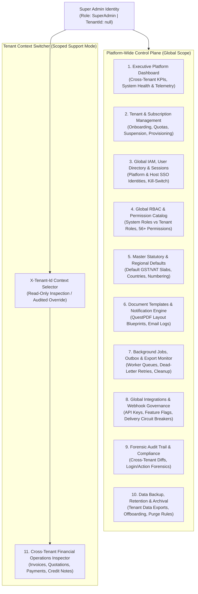
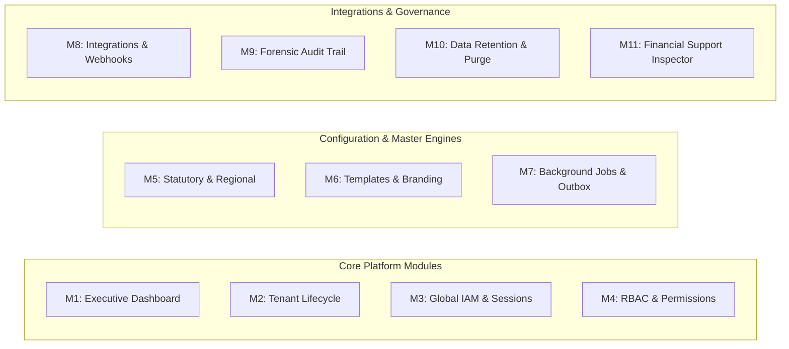
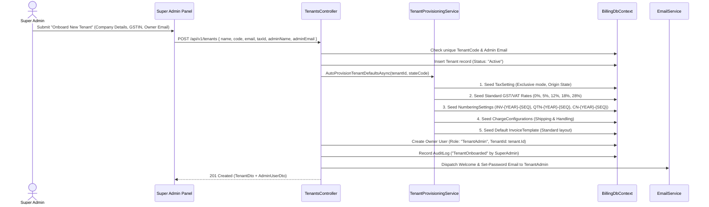
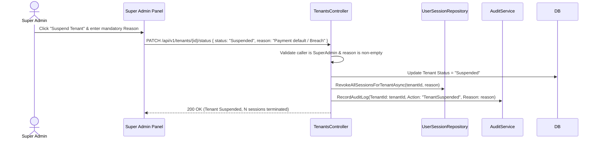
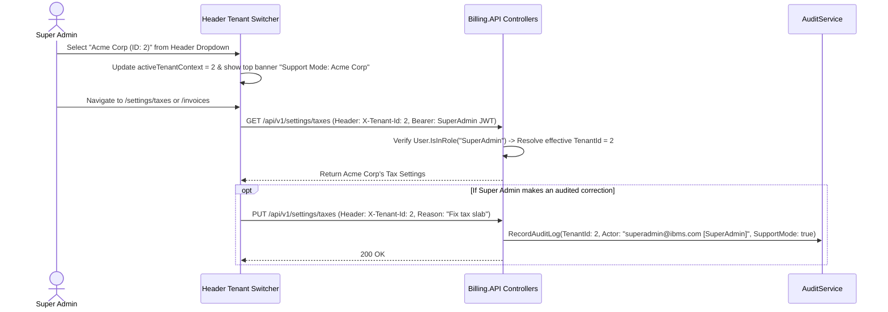
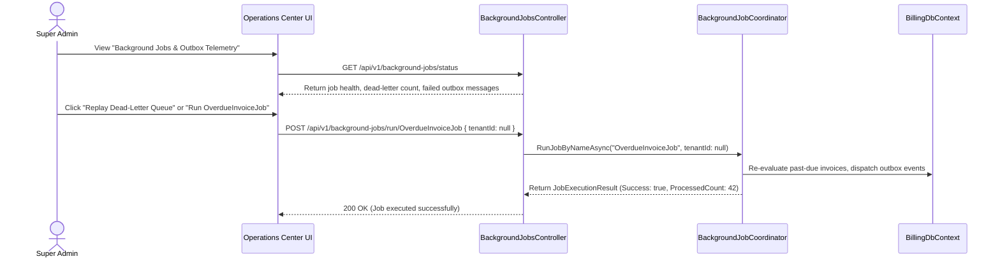

# IBMS — Super Admin Role & Panel: Comprehensive Requirements Specification

**Document Reference:** `IBMS-DOC-2026-SA-01`  
**System:** Integrated Billing & Management System (IBMS)  
**Technology Stack:** .NET 10 (ASP.NET Core Web API), EF Core, MySQL, React 18 SPA, QuestPDF  
**Status:** Research & Requirements Specification (Ready for Team Review)  
**Prepared For:** Engineering, Product, Security, and Architecture Review  

---

## 1. Executive Summary & Role Definition

In a multi-tenant enterprise billing and invoicing platform like **IBMS**, there is a fundamental architectural distinction between **Platform Governance (Super Admin)** and **Workspace Administration (Tenant Admin)**:

| Dimension | **Super Admin (`SuperAdmin`)** | **Tenant Admin (`TenantAdmin` / `Admin`)** |
| :--- | :--- | :--- |
| **Operational Scope** | **Global / Cross-Tenant Platform Level** (`TenantId = null` by default, with ability to inspect or switch into any `TenantId`). | **Single Organization / Workspace Level** (Strictly bound to their assigned `TenantId`). |
| **Primary Responsibility** | Platform governance, tenant onboarding/suspension, tenant quota limits, global IAM & RBAC catalog, cross-tenant security auditing, background job & outbox health, integration governance, and master default blueprints. | Managing their own company's billing operations, customers, products, quotations, invoices, payments, credit notes, company branding, and workspace users. |
| **Financial Data Access** | Governance & troubleshooting access across all tenants (with strict audit logging, support mode, and statutory immutability guardrails). | Full operational CRUD within their own tenant boundary only. |
| **System Role Authority** | Can manage all users across all tenants, assign `SuperAdmin` / `TenantAdmin` roles, and configure global permission definitions. | Can assign workspace roles (`BillingManager`, `Accountant`, `User`, `Viewer`, `Customer`) to users within their own tenant; cannot elevate anyone to `SuperAdmin`. |
| **Context Switching** | Global tenant context switcher allowing support inspection of any organization's data. | None (locked to their single organization context). |

---

## 2. High-Level Architecture of the Super Admin Panel

---

## 3. Core Features & Functionalities Available to the Super Admin

1. **Multi-Tenant Lifecycle & Quota Governance**
   - Onboard new organizations (Tenants) with unique `TenantCode`, statutory tax identifiers (`GSTIN`/`TaxId`), address, contact info, and primary owner (`TenantAdmin`) accounts.
   - Automatically provision baseline master data for new tenants (default GST/VAT rates, standard shipping/handling charges, financial-year numbering sequences, and default invoice templates).
   - Suspend, reactivate, or archive tenant workspaces with immediate session termination for all users under a suspended tenant.
   - Configure tenant operational quotas (maximum users, monthly invoice volume, document storage limits).

2. **Global Identity, Access & Session Management (IAM)**
   - Manage both **Platform-Owned Identities** (email/password with BCrypt) and **Host-Owned / SSO Identities** (external OAuth/OIDC provider, external subject ID, and scopes).
   - Search, filter, and inspect users across all tenants without requiring individual tenant login.
   - Inspect active and historical login sessions (`UserSessions`) across the platform (device info, IP address, user agent, last activity timestamp) and force-revoke compromised or stale sessions (`LogoutAll` / session kill-switch).
   - Administrative password reset: trigger password reset emails/OTPs or assign temporary passwords for locked-out accounts.

3. **Master RBAC & Permission Catalog Administration**
   - Maintain the centralized **System Permissions Catalog** (56+ granular permissions across 15+ functional modules).
   - Govern built-in **System Roles** (`SuperAdmin`, `TenantAdmin`, `Admin`, `BillingManager`, `Accountant`, `User`, `Viewer`, `Customer`) with immutability guarantees.
   - Create, edit, and assign custom system roles and tenant-level role blueprints.

4. **Cross-Tenant Context Switching & Support Impersonation**
   - Select any active tenant from a global **Tenant Context Switcher** in the Super Admin header to inspect or troubleshoot that tenant's configuration, tax rules, templates, or stuck documents without knowing the customer's credentials.
   - Seamlessly inject `X-Tenant-Id` header across backend API requests while retaining the Super Admin's actor token.
   - All actions taken while in a switched tenant context are recorded in `AuditLogs` with the Super Admin's identity and an audit flag indicating support mode.

5. **Master Statutory, Regional & Billing Blueprint Defaults**
   - Maintain global reference data such as **Country & Regional Settings** (`CountrySettings`), supported currencies, and calling codes.
   - Configure master **Tax Slabs** (`GST`, `CGST`, `SGST`, `IGST`, `VAT`) and statutory compliance rules.
   - Define baseline **Document Numbering Engine** schemes (`{YEAR}`, `{MM}`, sequence lengths, and reset periods).
   - Configure default discount policies, approval thresholds, and standard auxiliary charges (`Shipping`, `Handling`, `ConvenienceFee`, `LateFee`).

6. **Document Templates, Custom Branding & Notification Engine**
   - Maintain global and tenant-specific JSON-driven visual PDF layout templates for QuestPDF across styles (`Standard`, `Professional`, `Compact`, `Pirnav Standard`).
   - Create, version, preview, publish, and roll back template revisions (`TemplateVersions`).
   - Manage system-wide notification templates (`NotificationTemplates`) with dynamic placeholder tokens (`InvoiceIssued`, `PaymentReceived`, `InvoiceOverdue`, `QuotationSent`, `CreditNoteIssued`).
   - Inspect platform email delivery logs (`NotificationLogs`), bounce rates, and error payloads.

7. **System-Wide Operational & Background Worker Orchestration**
   - Monitor live execution status (`LastRunAtUtc`, `LastStatus`, `ProcessedCount`, `ErrorMessage`) and manually trigger background jobs globally or per tenant:
     - `OverdueInvoiceJob` (status transitions for past-due invoices)
     - `ReminderJob` (automated payment reminder dispatches)
     - `EmailNotificationJob` (asynchronous email queue processing)
     - `PdfGenerationJob` (high-throughput QuestPDF document rendering)
     - `WebhookDeliveryJob` (outbound webhook event dispatch with exponential backoff)
     - `OperationalCleanupJob` (purging expired sessions, stale export archives, and temporary files)
   - Inspect the transactional **Outbox Queue** (`OutboxMessages`) and dead-letter queue, with manual replay capability.
   - Monitor and download asynchronous bulk **Export Jobs** (`ExportJobs`).

8. **Global Integration, API Key & Webhook Governance**
   - Register, inspect, toggle status, and configure feature flags for third-party **Integration Applications** (`IntegrationApplications`).
   - Issue, rotate, and revoke client credentials and API keys.
   - Monitor platform-wide **Webhook Endpoints** (`Webhooks`) and **Webhook Delivery History** (`WebhookDeliveries`), rotate signing secrets, and replay failed webhook payloads.

9. **Forensic Audit Trail & Statutory Compliance Center**
   - Search, filter, and export immutable field-level `AuditLogs` across all tenants, entities, actions, and actors.
   - Inspect JSON `OldValues` and `NewValues` diffs, IP addresses, user agents, timestamps, and mandatory change reasons.
   - Export compliance packages for external statutory, tax, or security audits.

10. **Cross-Tenant Financial & Commercial Operations Inspector (Support Mode)**
    - Inspect customer profiles, product catalogs, quotations, invoices, payments, and credit notes under any tenant.
    - Execute deterministic tax, discount, and charge calculation simulations via the financial engine.
    - Provide audited administrative overrides (voiding documents, reapplying failed payment allocations) with mandatory change reason logging.

11. **Data Retention, Archival & Tenant Offboarding / Purge**
    - Generate complete tenant data packages (JSON/CSV archives of customers, invoices, payments, audit logs).
    - Safely execute tenant offboarding, data soft-deletion, and statutory retention locks.

---

## 4. Super Admin Panel Modules: Detailed Requirements & Purpose

---

### Module 1: Platform Executive Dashboard & System Health Telemetry

* **Purpose:** Provides the Super Admin with an executive, real-time control center summarizing platform adoption, tenant health, transactional velocity, worker pipeline status, and critical operational alerts.
* **Key Requirements:**
  - **Tenant Adoption KPIs:** Total registered tenants, breakdown by status (`Active`, `Suspended`, `Inactive`), 30-day onboarding trend, and tenant geographic distribution.
  - **Transactional Velocity & Revenue Metrics:** Platform-wide invoice volume, aggregate gross billing amount, collection rates, total payments processed, and credit notes issued.
  - **Asynchronous Worker & Queue Telemetry:** Live heartbeat of all 6 background jobs, total processed records in last 24 hours, and failed job execution count.
  - **Operational Alerts & Bottlenecks:** Real-time counters for dead-letter outbox messages, failed webhook deliveries, bounced email notifications, and active concurrent user sessions.
  - **Quick Action Bar:** One-click shortcuts to "Onboard Tenant", "Trigger Background Job", "Inspect Dead-Letter Queue", and "Search User Sessions".
* **Underlying Data Models:** Aggregations across [`Tenant`](file:///c:/Users/Admin/source/repos/Invoice/Backend/Billing.Domain/Entities/Tenant.cs), [`User`](file:///c:/Users/Admin/source/repos/Invoice/Backend/Billing.Domain/Entities/User.cs), [`Invoice`](file:///c:/Users/Admin/source/repos/Invoice/Backend/Billing.Domain/Entities/Invoice.cs), [`Payment`](file:///c:/Users/Admin/source/repos/Invoice/Backend/Billing.Domain/Entities/Payment.cs), [`NotificationLog`](file:///c:/Users/Admin/source/repos/Invoice/Backend/Billing.Domain/Entities/NotificationLog.cs), [`WebhookDelivery`](file:///c:/Users/Admin/source/repos/Invoice/Backend/Billing.Domain/Entities/WebhookDelivery.cs), and [`OutboxMessage`](file:///c:/Users/Admin/source/repos/Invoice/Backend/Billing.Domain/Entities/OutboxMessage.cs).
* **Current IBMS Codebase Status:** *Partially Implemented* — [`Dashboard.jsx`](file:///c:/Users/Admin/source/repos/Invoice/Frontend/billing-react/src/pages/Dashboard/Dashboard.jsx) and [`LandingPageService.cs`](file:///c:/Users/Admin/source/repos/Invoice/Backend/Billing.Application/Services/LandingPageService.cs) currently calculate single-tenant financial KPIs. A dedicated platform overview endpoint (`GET /api/v1/platform/dashboard-summary`) and Super Admin view must be introduced.

---

### Module 2: Tenant (Organization) Lifecycle & Quota Management

* **Purpose:** The central control plane to onboard, configure, monitor, suspend, quota-limit, and offboard client organizations (`Tenants`) in IBMS.
* **Key Requirements:**
  - **Tenant Directory:** Searchable, paginated registry showing `TenantId`, `Name`, `TenantCode`, `CompanyEmail`, `Phone`, `TaxId` (GSTIN/VAT), `Status` (`Active`, `Suspended`, `Inactive`), User Count, Invoices Count, and `CreatedAtUtc`.
  - **Tenant Onboarding Wizard:**
    - Step 1: Organization Details (`Name`, `TenantCode`, `CompanyEmail`, `Phone`, `TaxId`, Registered Address, State/Province, Country).
    - Step 2: Primary Administrator Account (`AdminName`, `AdminEmail`, temporary password or invite link).
    - Step 3: Automated Master Data Provisioning (seeds default Tax Settings with origin state, baseline GST/VAT slabs, sequential numbering formats for Invoices/Quotations/Credit Notes, default shipping/handling charge configs, and default QuestPDF invoice template).
  - **Tenant Status Lifecycle & Kill-Switch:**
    - Toggle status: `Active` $\leftrightarrow$ `Suspended` $\leftrightarrow$ `Inactive`.
    - Mandatory reason prompt for suspension.
    - Immediate cascade: revokes all active JWT tokens/sessions for all users belonging to the suspended tenant and skips scheduled background jobs for that tenant.
  - **Tenant Resource Quotas & Limits:**
    - Configure max users allowed, monthly invoice generation cap, and API rate limits.
  - **Tenant Data Archival & Export:** One-click trigger for a complete tenant archive export (`ExportJob`) before offboarding.
* **Underlying Data Models:** [`Tenant.cs`](file:///c:/Users/Admin/source/repos/Invoice/Backend/Billing.Domain/Entities/Tenant.cs), [`TaxSetting.cs`](file:///c:/Users/Admin/source/repos/Invoice/Backend/Billing.Domain/Entities/TaxSetting.cs), [`NumberingSetting.cs`](file:///c:/Users/Admin/source/repos/Invoice/Backend/Billing.Domain/Entities/NumberingSetting.cs), [`ChargeConfiguration.cs`](file:///c:/Users/Admin/source/repos/Invoice/Backend/Billing.Domain/Entities/ChargeConfiguration.cs), [`InvoiceTemplate.cs`](file:///c:/Users/Admin/source/repos/Invoice/Backend/Billing.Domain/Entities/InvoiceTemplate.cs).
* **Current IBMS Codebase Status:** *Backend Entity & Repository Exist; Controller & UI Need Exposure* — [`Tenant.cs`](file:///c:/Users/Admin/source/repos/Invoice/Backend/Billing.Domain/Entities/Tenant.cs) and [`TenantRepository.cs`](file:///c:/Users/Admin/source/repos/Invoice/Backend/Billing.Infrastructure/Repositories/TenantRepository.cs) exist (`GetByIdAsync`, `GetByCodeAsync`, `GetAllAsync`, `CreateAsync`, `UpdateAsync`, `ExistsByCodeAsync`). `POST /api/auth/register-company` exists in [`AuthController.cs`](file:///c:/Users/Admin/source/repos/Invoice/Backend/Billing.API/Controllers/AuthController.cs#L236-L247). An administrative `TenantsController` (`/api/v1/tenants`) and a Frontend Tenant Management page (`/tenants`) must be added.

---

### Module 3: Global IAM, User Directory & Session Governance

* **Purpose:** Provides enterprise-grade identity, access, and session management across all tenants, supporting both native platform credentials and external host SSO identities.
* **Key Requirements:**
  - **Global User Directory:** Paginated list of all users across all tenants, filterable by `Search` (name, email, username), `TenantId`, `Role`, `Status` (`Active`/`Inactive`), and `IdentityType` (`Platform`/`Host`).
  - **Dual Identity Management:**
    - **Platform Identity:** Create and manage native users with BCrypt password hashing, email validation, and lockout policies.
    - **Host Identity (SSO):** Map enterprise external identities (`ExternalProvider`, `ExternalSubjectId`, `ExternalScopes`) without storing local passwords.
  - **User Lifecycle & Status Control:** Toggle `Active` $\leftrightarrow$ `Inactive`. Inactivating a user immediately invalidates their active sessions, refresh tokens, and blocks subsequent authentication attempts.
  - **Session Inspector & Kill-Switch:**
    - View active sessions (`UserSessions`) per user: `IpAddress`, `UserAgent`, `DeviceInfo`, `CreatedAtUtc`, and `LastActivityAtUtc`.
    - Revoke individual session or trigger `RevokeAllSessions` (kill-switch) for compromised credentials.
  - **Administrative Password & Security Resets:** Super Admin can trigger a password reset email/OTP or set a temporary password for locked-out administrators.
  - **Tenant & Application Reassignment:** Reassign a user's associated `TenantId` or `ApplicationId` (`PUT /api/users/{id}/assignment`).
* **Underlying Data Models:** [`User.cs`](file:///c:/Users/Admin/source/repos/Invoice/Backend/Billing.Domain/Entities/User.cs), [`UserSession.cs`](file:///c:/Users/Admin/source/repos/Invoice/Backend/Billing.Domain/Entities/UserSession.cs).
* **Current IBMS Codebase Status:** *Implemented in Backend & Frontend* — [`UsersController.cs`](file:///c:/Users/Admin/source/repos/Invoice/Backend/Billing.API/Controllers/UsersController.cs), [`UserAdministrationService.cs`](file:///c:/Users/Admin/source/repos/Invoice/Backend/Billing.Application/Services/UserAdministrationService.cs), and [`UserRoleAdministration.jsx`](file:///c:/Users/Admin/source/repos/Invoice/Frontend/billing-react/src/pages/UserRoleAdministration/UserRoleAdministration.jsx). *Enhancement needed:* Allow Super Admin to search/filter across all tenants in `UserRoleAdministration.jsx` (currently defaults to single tenant context) and expose session list/revoke endpoints in `UsersController`.

---

### Module 4: Global RBAC, System Roles & Permission Catalog

* **Purpose:** Centralized catalog of fine-grained system permissions and role definitions, guaranteeing granular access control and enforcing system role protection.
* **Key Requirements:**
  - **Master Permission Catalog:** Inspect all 56+ granular permissions categorized by functional module: `Administration`, `Billing`, `Invoices`, `Quotations`, `Payments`, `CreditNotes`, `Customers`, `Products`, `Categories`, `Discounts`, `Settings`, `Templates`, `Webhooks`, `BackgroundJobs`, `ExportJobs`, `Reports`, and `Audit`.
  - **System Roles Immutability:** Protect built-in system roles (`SuperAdmin`, `TenantAdmin`, `Admin`, `BillingManager`, `Accountant`, `User`, `Viewer`, `Customer`) with `IsSystemRole = true` from being renamed, deleted, or having core security permissions stripped.
  - **Custom Role Management:** Create, update, and delete tenant-specific custom roles (`Role.TenantId != null`).
  - **Dynamic Permission Mapping:** Assign and synchronize permissions to roles (`POST /api/roles/{id}/permissions`) and propagate updates to user claims and JWT tokens.
* **Underlying Data Models:** [`Role.cs`](file:///c:/Users/Admin/source/repos/Invoice/Backend/Billing.Domain/Entities/Role.cs), [`Permission.cs`](file:///c:/Users/Admin/source/repos/Invoice/Backend/Billing.Domain/Entities/Permission.cs), [`RolePermission.cs`](file:///c:/Users/Admin/source/repos/Invoice/Backend/Billing.Domain/Entities/RolePermission.cs).
* **Current IBMS Codebase Status:** *Fully Implemented* — [`RolesController.cs`](file:///c:/Users/Admin/source/repos/Invoice/Backend/Billing.API/Controllers/RolesController.cs), [`RoleAdministrationService.cs`](file:///c:/Users/Admin/source/repos/Invoice/Backend/Billing.Application/Services/RoleAdministrationService.cs), and [`RoleRepository.cs`](file:///c:/Users/Admin/source/repos/Invoice/Backend/Billing.Infrastructure/Repositories/RoleRepository.cs).

---

### Module 5: Master Statutory Defaults, Tax Engines & Regional Blueprints

* **Purpose:** Governs country-level compliance rules, tax calculation engines, sequential numbering formats, discount caps, and auxiliary charge policies across the entire platform.
* **Key Requirements:**
  - **Country & Currency Registry (`CountrySettings`):**
    - Manage supported countries, ISO alpha-2/alpha-3 codes, default currency codes (`INR`, `USD`, `EUR`, `GBP`), calling codes, and statutory tax terminology (`GST`, `VAT`, `TRN`) via [`CountrySettingsController.cs`](file:///c:/Users/Admin/source/repos/Invoice/Backend/Billing.API/Controllers/CountrySettingsController.cs).
  - **Tax Engine & Statutory Rules (`TaxSettings` & `TaxRates`):**
    - Configure calculation mode (`Exclusive` vs. `Inclusive`).
    - Origin state configuration for Indian GST automated bifurcation (`CGST + SGST` for intra-state vs. `IGST` for inter-state transactions).
    - Manage master tax slabs (`0%`, `5%`, `12%`, `18%`, `28%`, `Exempt`) via [`TaxSettingsController.cs`](file:///c:/Users/Admin/source/repos/Invoice/Backend/Billing.API/Controllers/TaxSettingsController.cs).
  - **Document Numbering Engine (`NumberingSettings`):**
    - Sequential numbering configurations for `Invoice`, `Quotation`, and `CreditNote`.
    - Dynamic token formats (`INV-{YEAR}-{MM}-{SEQ}`, `QTN-{YEAR}-{SEQ}`, `CN-{YEAR}-{SEQ}`).
    - Padding lengths (e.g. 4 to 6 digits) and next sequence counter.
    - Reset frequency policies (`FinancialYear`, `CalendarYear`, `Monthly`, `Never`) via [`NumberingSettingsController.cs`](file:///c:/Users/Admin/source/repos/Invoice/Backend/Billing.API/Controllers/NumberingSettingsController.cs) with pessimistic sequence locking.
  - **Discount & Charge Policies (`DiscountSettings`, `DiscountRules`, `ChargeConfigurations`):**
    - Global maximum discount threshold percentage (e.g. max 20% without manager override).
    - Standard auxiliary charge presets (`Shipping & Handling`, `Express Delivery`, `Late Fee`, `Convenience Fee`) with taxability flags via [`ChargesController.cs`](file:///c:/Users/Admin/source/repos/Invoice/Backend/Billing.API/Controllers/ChargesController.cs).
* **Underlying Data Models:** [`CountrySetting.cs`](file:///c:/Users/Admin/source/repos/Invoice/Backend/Billing.Domain/Entities/CountrySetting.cs), [`TaxSetting.cs`](file:///c:/Users/Admin/source/repos/Invoice/Backend/Billing.Domain/Entities/TaxSetting.cs), [`TaxRate.cs`](file:///c:/Users/Admin/source/repos/Invoice/Backend/Billing.Domain/Entities/TaxRate.cs), [`NumberingSetting.cs`](file:///c:/Users/Admin/source/repos/Invoice/Backend/Billing.Domain/Entities/NumberingSetting.cs), [`DiscountSetting.cs`](file:///c:/Users/Admin/source/repos/Invoice/Backend/Billing.Domain/Entities/DiscountSetting.cs), [`ChargeConfiguration.cs`](file:///c:/Users/Admin/source/repos/Invoice/Backend/Billing.Domain/Entities/ChargeConfiguration.cs).
* **Current IBMS Codebase Status:** *Fully Implemented* across Backend and Frontend (`/settings/*`).

---

### Module 6: Master Document Templates, Branding & Notification Blueprints

* **Purpose:** Governs high-fidelity visual PDF invoice/quotation rendering (`QuestPDF`) and transactional customer email/SMS notifications.
* **Key Requirements:**
  - **Invoice & Quotation PDF Templates (`InvoiceTemplates` & `TemplateVersions`):**
    - Visual layout designer/configurator supporting presets (`Standard`, `Professional`, `Compact`, `Pirnav Standard`).
    - Schema-driven JSON definitions for `BrandingConfig` (primary color, accent color, font family, logo URL), `LayoutConfig` (header, line-item columns, total block), `CompanyDetails`, `PaymentInstructions` (bank account, IFSC, UPI QR placeholder), and `TermsConfig`.
    - Live PDF preview generation using QuestPDF vector rendering.
    - Template versioning and one-click rollback (`/api/v1/templates/invoice/{id}/rollback/{versionId}`).
  - **Transactional Notification Templates (`NotificationTemplates`):**
    - Manage email and message templates for core events: `InvoiceIssued`, `PaymentReceived`, `InvoiceOverdue`, `QuotationSent`, `CreditNoteIssued`.
    - Dynamic placeholder tokens (`{{CustomerName}}`, `{{InvoiceNumber}}`, `{{TotalAmount}}`, `{{DueDate}}`, `{{PaymentLink}}`).
    - Subject line and rich HTML body editors.
  - **Notification Delivery History (`NotificationLogs`):**
    - Global and tenant-filtered telemetry of all dispatched notifications: recipient email, template used, delivery status (`Sent`, `Failed`, `Bounced`), delivery timestamp, and error message.
* **Underlying Data Models:** [`InvoiceTemplate.cs`](file:///c:/Users/Admin/source/repos/Invoice/Backend/Billing.Domain/Entities/InvoiceTemplate.cs), [`TemplateVersion.cs`](file:///c:/Users/Admin/source/repos/Invoice/Backend/Billing.Domain/Entities/TemplateVersion.cs), [`NotificationTemplate.cs`](file:///c:/Users/Admin/source/repos/Invoice/Backend/Billing.Domain/Entities/NotificationTemplate.cs), [`NotificationLog.cs`](file:///c:/Users/Admin/source/repos/Invoice/Backend/Billing.Domain/Entities/NotificationLog.cs).
* **Current IBMS Codebase Status:** *Fully Implemented* across Backend and Frontend (`/templates-branding/*` and `/settings/notifications/*`).

---

### Module 7: Background Jobs, Outbox Queues & Data Export Operations Center

* **Purpose:** Operational control center for asynchronous workers, transactional outbox message processing, dead-letter recovery, and system data export jobs.
* **Key Requirements:**
  - **Background Worker Monitor & Trigger:**
    - Live health telemetry for all platform background workers:
      - `OverdueInvoiceJob`: Evaluates due dates and transitions invoices to `Overdue`.
      - `ReminderJob`: Sends automated payment reminder emails to customers based on schedule.
      - `EmailNotificationJob`: Dispatches queued notifications from `NotificationLogs`.
      - `PdfGenerationJob`: Generates vector PDFs asynchronously via QuestPDF and archives into `GeneratedDocuments`.
      - `WebhookDeliveryJob`: Dispatches outbound webhook payloads with exponential backoff.
      - `OperationalCleanupJob`: Purges expired user sessions, temporary files, and old export packages.
    - Manual Trigger: Super Admin can force-execute any job globally or for a specific `TenantId` via `POST /api/v1/background-jobs/run/{jobName}`.
  - **Transactional Outbox & Dead-Letter Queue Inspector (`OutboxMessages`):**
    - Inspect domain events in the outbox queue: `Pending`, `Dispatched`, and `Failed`.
    - View failure error messages, retry counts, and payload data.
    - Manual replay button to re-queue failed or dead-letter messages.
  - **System Export Jobs (`ExportJobs`):**
    - Monitor status of bulk export requests (`Pending`, `Processing`, `Completed`, `Failed`).
    - Securely download generated export packages (`.zip`, `.xlsx`, `.csv`).
* **Underlying Data Models:** [`OutboxMessage.cs`](file:///c:/Users/Admin/source/repos/Invoice/Backend/Billing.Domain/Entities/OutboxMessage.cs), [`ExportJob.cs`](file:///c:/Users/Admin/source/repos/Invoice/Backend/Billing.Domain/Entities/ExportJob.cs), [`GeneratedDocument.cs`](file:///c:/Users/Admin/source/repos/Invoice/Backend/Billing.Domain/Entities/GeneratedDocument.cs).
* **Current IBMS Codebase Status:** *Implemented* for Background Jobs and Export Jobs (`/background-jobs`, `/export-jobs`); Outbox dead-letter replay endpoint should be added as a Super Admin tool.

---

### Module 8: External Integrations, API Keys & Webhook Governance

* **Purpose:** Governs third-party client integrations (ERP, CRM, eCommerce, payment gateways), developer API keys, feature flags, and outbound event webhooks.
* **Key Requirements:**
  - **Integration Applications Registry (`IntegrationApplications`):**
    - Register external partner and internal client applications.
    - Issue client IDs and securely hash API keys / client secrets.
    - Toggle application status (`Active` $\leftrightarrow$ `Suspended`).
    - Granular feature flag configuration per integration (`PATCH /api/v1/integrations/{id}/feature-flags`).
  - **Webhook Subscriptions (`Webhooks`):**
    - Register destination endpoint URLs, subscribed event types (`invoice.created`, `invoice.paid`, `payment.received`, etc.), and HMAC-SHA256 signing secrets.
    - Enable, disable, or rotate webhook signing secrets.
  - **Webhook Delivery Telemetry & Replay (`WebhookDeliveries`):**
    - Complete delivery log: HTTP response code (e.g. 200, 404, 500), execution duration (ms), request payload, and response body.
    - Circuit breaker: automatically disable endpoints exceeding failure thresholds.
    - Manual redelivery trigger (`POST /api/v1/webhooks/deliveries/{id}/retry`) to re-dispatch failed payloads.
* **Underlying Data Models:** [`IntegrationApplication.cs`](file:///c:/Users/Admin/source/repos/Invoice/Backend/Billing.Domain/Entities/IntegrationApplication.cs), [`Webhook.cs`](file:///c:/Users/Admin/source/repos/Invoice/Backend/Billing.Domain/Entities/Webhook.cs), [`WebhookDelivery.cs`](file:///c:/Users/Admin/source/repos/Invoice/Backend/Billing.Domain/Entities/WebhookDelivery.cs).
* **Current IBMS Codebase Status:** *Fully Implemented* across Backend and Frontend (`/integrations`, `/webhooks`, `/webhooks/deliveries`).

---

### Module 9: Forensic Audit Trail & Statutory Compliance Center

* **Purpose:** Provides an immutable, tamper-evident forensic log of all administrative, financial, and configuration changes across every tenant on the platform.
* **Key Requirements:**
  - **Cross-Tenant Audit Explorer (`AuditLogs`):**
    - Search and filter audit records across all tenants by `TenantId` (or view All Tenants), `EntityName` (`Invoice`, `Payment`, `CreditNote`, `Customer`, `Product`, `TaxSetting`, `User`, `Role`, `InvoiceTemplate`, etc.), `Action` (`Created`, `Updated`, `Deleted`, `StatusChanged`, `Approved`, `Voided`, `Allocated`), `UserId`/`UserName`, and date range.
  - **Field-Level Diff Viewer:**
    - Visual side-by-side comparison of structured `OldValues` vs. `NewValues` JSON snapshots.
    - Actor metadata: user name, email, IP address, user agent, timestamp (UTC).
    - Change reason: mandatory justification recorded for high-risk operations.
  - **Statutory Audit Export:**
    - One-click export of filtered audit logs in CSV/Excel format for external tax or ISO/SOC2 security auditors.
* **Underlying Data Models:** [`AuditLog.cs`](file:///c:/Users/Admin/source/repos/Invoice/Backend/Billing.Domain/Entities/AuditLog.cs).
* **Current IBMS Codebase Status:** *Implemented with 1 Critical Blocker to Resolve* — [`AuditController.cs`](file:///c:/Users/Admin/source/repos/Invoice/Backend/Billing.API/Controllers/AuditController.cs#L28-L58) currently reads `User.FindFirst("TenantId")` and returns `403 Forbid` when `TenantId` is `null` (which is true for the seeded `SuperAdmin`!). Updating `AuditController` to allow `SuperAdmin` to pass an optional `tenantId` query parameter or `X-Tenant-Id` header (and default to all tenants or Tenant 1) is required.

---

### Module 10: Cross-Tenant Financial & Commercial Operations Inspector (Support Mode)

* **Purpose:** Enables the Super Admin to switch into any tenant's workspace context to inspect, diagnose, and troubleshoot commercial entities (`Customers`, `Products`, `Quotations`, `Invoices`, `Payments`, `CreditNotes`) with strict statutory immutability safeguards.
* **Key Requirements:**
  - **Tenant Context Switcher:** A prominent dropdown in the Super Admin navigation bar allowing the Super Admin to select any active tenant. When selected, the frontend sets an active tenant context banner ("*Viewing as Tenant: Acme Corp (ID: 2)*") and sends `X-Tenant-Id: 2` on all subsequent API requests.
  - **Commercial Master Data Inspection:**
    - Customers: view customer master records, addresses, GSTINs, and ledger balances.
    - Products & Categories: inspect pricing, HSN/SAC codes, and tax rate associations.
  - **Transactional Document Diagnostics:**
    - Quotations: inspect quote status (`Draft`, `Sent`, `Approved`, `Converted`), line items, and audit trail.
    - Invoices: inspect invoice calculations, issued PDFs, payment allocations, reminders sent, and communication logs.
    - Payments: verify multi-invoice allocations, transaction reference numbers, and payment modes (`UPI`, `NEFT`, `Card`, `Cash`, `Cheque`).
    - Credit Notes: review credit note line items, linked original invoices, and refund statuses.
  - **Deterministic Financial Engine Sandbox:**
    - Super Admin diagnostic tool to execute test calculations (`POST /api/v1/financial/calculate`) verifying tax splits (CGST/SGST vs IGST), discount caps, and additional charges.
* **Underlying Data Models:** [`Customer.cs`](file:///c:/Users/Admin/source/repos/Invoice/Backend/Billing.Domain/Entities/Customer.cs), [`Product.cs`](file:///c:/Users/Admin/source/repos/Invoice/Backend/Billing.Domain/Entities/Product.cs), [`Quotation.cs`](file:///c:/Users/Admin/source/repos/Invoice/Backend/Billing.Domain/Entities/Quotation.cs), [`Invoice.cs`](file:///c:/Users/Admin/source/repos/Invoice/Backend/Billing.Domain/Entities/Invoice.cs), [`Payment.cs`](file:///c:/Users/Admin/source/repos/Invoice/Backend/Billing.Domain/Entities/Payment.cs), [`CreditNote.cs`](file:///c:/Users/Admin/source/repos/Invoice/Backend/Billing.Domain/Entities/CreditNote.cs).
* **Current IBMS Codebase Status:** *Functional across all entity controllers*, but needs the frontend header tenant switcher and backend `X-Tenant-Id` support verification.

---

### Module 11: Data Retention, Archival & Tenant Offboarding / Purge

* **Purpose:** Handles end-of-lifecycle tenant offboarding, statutory compliance data retention, and scheduled data purging in accordance with data privacy and taxation laws.
* **Key Requirements:**
  - **Comprehensive Tenant Data Export:** Generate complete encrypted zip archives containing tenant records (customers, invoices, payments, credit notes, audit history, generated PDFs).
  - **Statutory Retention Enforcement:** Enforce mandatory 7-to-8 year financial record retention rules (preventing hard purge of issued financial documents even after tenant termination).
  - **Tenant Data Purge Workflow:** Multi-step confirmation with double Super Admin authorization before executing any permanent soft-delete or data purge.
* **Underlying Data Models:** [`Tenant.cs`](file:///c:/Users/Admin/source/repos/Invoice/Backend/Billing.Domain/Entities/Tenant.cs), [`ExportJob.cs`](file:///c:/Users/Admin/source/repos/Invoice/Backend/Billing.Domain/Entities/ExportJob.cs), [`AuditLog.cs`](file:///c:/Users/Admin/source/repos/Invoice/Backend/Billing.Domain/Entities/AuditLog.cs).

---

## 5. Actions & Permissions Matrix for the Super Admin Role

In IBMS, the `SuperAdmin` role is seeded with **all system permissions** (`*` / full catalog in [`DbInitializer.cs`](file:///c:/Users/Admin/source/repos/Invoice/Backend/Billing.Infrastructure/Data/DbInitializer.cs#L67-L86) and [`RoleRepository.cs`](file:///c:/Users/Admin/source/repos/Invoice/Backend/Billing.Infrastructure/Repositories/RoleRepository.cs#L245)). Below is the complete module-by-module breakdown of **Permissions**, **Allowed Super Admin Actions**, and **Scope Differentiation** against `TenantAdmin` and standard users.

### 5.1 Platform & Tenant Governance Permissions

| Module | Permission Code | Super Admin Allowed Actions | `SuperAdmin` Scope | `TenantAdmin` Scope | Standard User Scope |
| :--- | :--- | :--- | :---: | :---: | :---: |
| **Tenant Management** *(New)* | `tenants.view` | View all registered tenants, usage statistics, and subscription quotas | ✅ Global (All Tenants) | ❌ Own profile only | ❌ Denied |
| **Tenant Management** *(New)* | `tenants.create` | Onboard new organizations & auto-provision master blueprints | ✅ Global | ❌ Denied | ❌ Denied |
| **Tenant Management** *(New)* | `tenants.edit` | Modify tenant profile, statutory tax identifiers, and quotas | ✅ Global (All Tenants) | ⚠️ Own tenant only | ❌ Denied |
| **Tenant Management** *(New)* | `tenants.suspend` | Suspend or reactivate tenants with automatic session cascade | ✅ Global | ❌ Denied | ❌ Denied |
| **Platform Support** *(New)* | `platform.impersonate`| Switch active tenant context (`X-Tenant-Id`) for support & troubleshooting | ✅ Global | ❌ Denied | ❌ Denied |
| **User Administration** | `users.view` | View user directory, identity type, roles, and session history | ✅ Global (All Tenants) | ✅ Own Tenant | ❌ Denied |
| **User Administration** | `users.create` | Provision Platform (BCrypt) or Host (SSO) user accounts | ✅ Global (All Tenants) | ✅ Own Tenant | ❌ Denied |
| **User Administration** | `users.edit` | Edit user profile, toggle Active/Inactive status, reset passwords | ✅ Global (All Tenants) | ✅ Own Tenant | ❌ Denied |
| **User Administration** | `users.delete` | Delete or deactivate non-protected user accounts | ✅ Global (All Tenants) | ✅ Own Tenant | ❌ Denied |
| **User Administration** | `users.assign` | Assign roles (`SuperAdmin`, `TenantAdmin`, etc.), `TenantId`, & `ApplicationId` | ✅ Global (Full authority) | ⚠️ Own Tenant & non-SuperAdmin roles only | ❌ Denied |
| **Roles & Permissions** | `roles.view` | View system roles, custom roles, and permission catalog | ✅ Global | ✅ Own Tenant + System | ❌ Denied |
| **Roles & Permissions** | `roles.manage` | Create, edit, and assign permissions to custom roles | ✅ Global | ✅ Custom roles in Own Tenant | ❌ Denied |

---

### 5.2 System Operations, Integrations, Blueprints & Audit Permissions

| Module | Permission Codes | Super Admin Allowed Actions | `SuperAdmin` Scope | `TenantAdmin` Scope | Standard User Scope |
| :--- | :--- | :--- | :---: | :---: | :---: |
| **Dashboard** | `dashboard.view`, `billing.view` | View platform executive overview, tenant volume trends & KPIs | ✅ Global + Per-Tenant | ✅ Own Tenant | ⚠️ Role-dependent |
| **System Settings** | `settings.view`, `settings.manage` | Configure Country Settings, Tax Settings/Slabs, Numbering, Discounts & Charges | ✅ Global Blueprint + Per-Tenant | ✅ Own Tenant | ❌ Denied |
| **Templates & Branding** | `templates.view`, `templates.create`, `templates.edit`, `templates.delete` | Manage QuestPDF invoice templates, versions, rollback, and notification templates | ✅ Global Master + Per-Tenant | ✅ Own Tenant | ❌ Denied |
| **Integrations** | `integrations.view`, `integrations.manage` | Register external apps, manage API keys, toggle status, and update feature flags | ✅ Global + Per-Tenant | ✅ Own Tenant | ❌ Denied |
| **Webhooks** | `webhooks.view`, `webhooks.manage` | Manage endpoints, rotate signing secrets, inspect logs, and retry deliveries | ✅ Global + Per-Tenant | ✅ Own Tenant | ❌ Denied |
| **Background Jobs** | `backgroundjobs.view`, `backgroundjobs.manage` | Monitor job queues and manually trigger worker jobs | ✅ Global + Per-Tenant | ⚠️ View / Trigger Own Tenant | ❌ Denied |
| **Export Jobs** | `exportjobs.view`, `exportjobs.create` | Queue bulk data exports and download tenant archive packages | ✅ Global + Per-Tenant | ✅ Own Tenant | ❌ Denied |
| **Audit & Compliance** | `audit.view`, `audit.export` | Inspect cross-tenant field diffs, actor IPs, and export forensic compliance logs | ✅ Global (All Tenants) | ✅ Own Tenant | ❌ Denied |
| **Reports** | `reports.view`, `reports.export` | Generate and export cross-tenant financial, tax, and operational reports | ✅ Global + Per-Tenant | ✅ Own Tenant | ⚠️ Role-dependent |

---

### 5.3 Commercial & Financial Operations (Tenant-Scoped Support Mode)

When switched into a specific tenant context via the Tenant Context Switcher, the Super Admin operates with full administrative capabilities while adhering to statutory immutability guardrails:

| Module | Permission Codes | Allowed Super Admin Actions (within Switched Tenant Context) |
| :--- | :--- | :--- |
| **Customers** | `customers.view`, `customers.create`, `customers.edit`, `customers.delete`, `customers.manage` | Inspect customer profiles, addresses, tax identifiers, billing contacts, and balance ledgers. |
| **Products & Categories** | `products.view`, `products.create`, `products.edit`, `products.delete`, `products.manage`, `categories.*` | Review and configure product/service master catalog, HSN/SAC codes, base prices, tax categories, and units of measurement. |
| **Quotations** | `quotations.view`, `quotations.create`, `quotations.edit`, `quotations.delete`, `quotations.manage`, `quotations.approve` | Inspect quotation pipelines, verify discount applications, approve pending quotes, and convert quotations to official invoices. |
| **Invoices** | `invoices.view`, `invoices.create`, `invoices.edit`, `invoices.delete`, `invoices.manage`, `invoices.approve` | Review draft/issued/paid invoices, generate QuestPDF previews, verify statutory GST/VAT splits, trigger payment reminders, or void/cancel with mandatory audit reason. *(Hard delete of issued invoices prohibited).* |
| **Payments** | `payments.view`, `payments.create`, `payments.manage`, `payments.refund` | Review payment receipts (`UPI`, `NEFT`, `Card`, `Cash`, `Cheque`), verify multi-invoice allocations, and process authorized refunds. |
| **Credit Notes** | `creditnotes.view`, `creditnotes.create`, `creditnotes.edit`, `creditnotes.delete`, `creditnotes.manage`, `creditnotes.approve` | Review credit notes issued against invoices, verify line-item tax adjustments, approve credit notes, and allocate to invoice balances. |

---

## 6. Additional Features, Validations & Guardrails Required

To guarantee system stability, multi-tenant data isolation, and statutory accounting compliance, the following validations and guardrails **must** be enforced for the Super Admin role:

### 6.1 Identity & Privilege Escalation Validations
1. **Last-Super-Admin Lockout Prevention:**
   - A `SuperAdmin` **cannot** delete their own account, set their status to `Inactive`, or remove the `SuperAdmin` role from themselves if they are the last active `SuperAdmin` in the system.
   - *Validation Rule:* Before executing `DeleteUserAsync`, `UpdateUserStatusAsync("Inactive")`, or `AssignRolesAsync` on any user holding the `SuperAdmin` role, execute:
     $$\text{Count}(\text{Active Users with Role } \texttt{"SuperAdmin"}) > 1$$
   - If count is $\le 1$, reject with `400 Bad Request: "Cannot deactivate or remove the last active Super Admin account."`

2. **Role Elevation Restriction (`TenantAdmin` vs. `SuperAdmin`):**
   - Because `UsersController` is authorized for `[Authorize(Roles = "TenantAdmin,SuperAdmin,Admin")]`, `UserAdministrationService` **must** enforce caller role boundaries:
     - Only an authenticated user holding the `SuperAdmin` role can assign or revoke the `SuperAdmin` role, or create/modify users across different `TenantId`s.
     - A `TenantAdmin` is strictly restricted to `user.TenantId == currentUser.TenantId` and blocked from assigning `SuperAdmin`.

3. **System Role Immutability:**
   - Built-in roles (`SuperAdmin`, `TenantAdmin`, `Admin`, `BillingManager`, `Accountant`, `User`, `Viewer`, `Customer`) have `IsSystemRole = true` and cannot be renamed or deleted (enforced in [`RoleAdministrationService.cs`](file:///c:/Users/Admin/source/repos/Invoice/Backend/Billing.Application/Services/RoleAdministrationService.cs#L83-L122)).
   - In addition, the `SuperAdmin` role must be safeguarded from having its foundational permissions (`users.*`, `roles.*`, `settings.*`, `audit.*`, `tenants.*`) removed.

---

### 6.2 Multi-Tenant Context & Isolation Validations
4. **Super Admin Tenant Context Resolution (`TenantId = null` Handling):**
   - By design, the default `SuperAdmin` user has `TenantId = null` in the `users` table ([`DbInitializer.cs`](file:///c:/Users/Admin/source/repos/Invoice/Backend/Billing.Infrastructure/Data/DbInitializer.cs#L65)).
   - **Resolution Rules:**
     - For **Global Control Plane Endpoints** (`/api/users`, `/api/roles`, `/api/v1/tenants`, `/api/v1/background-jobs`, `/api/v1/integrations`), `TenantId = null` means "return platform-wide records across all tenants" unless filtered by an explicit `?tenantId=` query parameter or `X-Tenant-Id` header.
     - For **Tenant-Scoped Endpoints** (`/api/Audit`, `/api/v1/invoices`, `/api/v1/settings/*`), if the caller is `SuperAdmin`, the backend should resolve `TenantId` in the following priority order:
       1. Query string parameter `tenantId` (if supplied)
       2. Request header `X-Tenant-Id` (supplied by the Frontend Tenant Switcher)
       3. JWT claim `tenantId`
       4. Default fallback tenant (`1`), so `SuperAdmin` never receives an unexpected `403 Forbid` (resolving the current issue in [`AuditController.cs`](file:///c:/Users/Admin/source/repos/Invoice/Backend/Billing.API/Controllers/AuditController.cs#L28-L58)).

5. **Tenant Suspension Cascade Validation:**
   - When a Super Admin transitions a Tenant's status to `Suspended` or `Inactive`:
     - All active `UserSessions` for all users belonging to that `TenantId` are immediately revoked (`RevokeAllSessionsForTenantAsync`).
     - Any subsequent login or token refresh attempt by users of that tenant is rejected with `401 Unauthorized: "Company account is inactive or suspended"` (already supported in [`AuthService.cs`](file:///c:/Users/Admin/source/repos/Invoice/Backend/Billing.Application/Services/AuthService.cs#L152-L159)).
     - Scheduled background jobs (e.g. automated payment reminders, webhook deliveries) for that tenant are skipped while suspended.

---

### 6.3 Financial & Statutory Integrity Guardrails
6. **Statutory Immutability of Issued Financial Documents:**
   - Even as `SuperAdmin`, once an `Invoice`, `CreditNote`, or `Payment` transitions out of `Draft` to `Issued` or `Paid`, it **cannot** be hard-deleted from the database or have its sequential document number altered. This preserves statutory GST/VAT audit integrity.
   - Any correction must follow standard accounting procedures: official `Void` / `Cancel` (with mandatory reason) or issuance of a `CreditNote`.

7. **Concurrency Tokens (`RowVersion`) & Concurrency-Safe Sequence Locks:**
   - Super Admin overrides on tenant settings or documents must respect `RowVersion` optimistic concurrency tokens to prevent race conditions with concurrent tenant user actions.
   - Sequential document number allocations must strictly use database transaction locks (`IncrementSequenceAsync`) to prevent gaps or duplicate numbers.

8. **Mandatory Audit Reason for High-Risk Actions:**
   - High-impact operations (suspending a tenant, killing all user sessions, overriding statutory tax slabs, voiding an issued invoice, or rotating third-party webhook secrets) require a non-empty `Reason` string (minimum 5 characters) that is permanently recorded in `AuditLogs`.

---

## 7. Key Super Admin Workflows

### 7.1 Workflow 1: End-to-End Tenant Onboarding & Auto-Provisioning

---

### 7.2 Workflow 2: Tenant Suspension & Emergency Session Kill-Switch

---

### 7.3 Workflow 3: Audited Support Context Switching (Impersonation Mode)

---

### 7.4 Workflow 4: Outbox Dead-Letter Queue & Worker Recovery

---

## 8. Gap Analysis & Implementation Roadmap for IBMS

To bring the current IBMS codebase to 100% alignment with these Super Admin requirements, here is the prioritized engineering checklist:

| Priority | Item / Gap Identified in Codebase | Target Layer & Files | Scope & Effort |
| :---: | :--- | :--- | :---: |
| **P0 (Blocker)** | **Fix `AuditController` 403 Forbid for `SuperAdmin`:** Allow `SuperAdmin` (`TenantId = null`) to query audit logs across all tenants or specify `?tenantId=` / `X-Tenant-Id`. Default fallback to Tenant 1. | `Backend/Billing.API/Controllers/AuditController.cs` | Small (1 day) |
| **P0 (Security)** | **Enforce Caller Scope in `UsersController`:** Prevent `TenantAdmin` from modifying users of other tenants or assigning the `SuperAdmin` role; enforce Last-Super-Admin lockout prevention. | `Backend/Billing.Application/Services/UserAdministrationService.cs`, `UsersController.cs` | Small (1 day) |
| **P1 (Core Feature)** | **Expose `TenantsController` (`/api/v1/tenants`) & Auto-Provisioning:** Create tenant CRUD and status endpoints using `ITenantRepository`, and extract auto-provisioning logic into a reusable `ITenantProvisioningService`. | `Backend/Billing.API/Controllers/TenantsController.cs` *(New)*, `TenantRepository.cs`, `DbInitializer.cs` | Medium (2-3 days) |
| **P1 (Core UI)** | **Global Tenant Switcher & Tenant Management Page:** Add Tenant selector dropdown in `DashboardHeader.jsx` (visible to `SuperAdmin`) injecting `X-Tenant-Id` into `apiClient.js`, plus a `/tenants` management page. | `Frontend/billing-react/src/components/dashboard/DashboardHeader.jsx`, `apiClient.js`, `TenantsList.jsx` *(New)* | Medium (2-3 days) |
| **P2 (Enhancement)** | **User Session Inspector & Force Revoke Endpoints:** Expose `GET /api/users/{id}/sessions` and `POST /api/users/{id}/revoke-sessions` so `SuperAdmin` can view and terminate active user sessions. | `UsersController.cs`, `UserAdministrationService.cs` | Small (1 day) |
| **P2 (Enhancement)** | **Platform Executive Overview Dashboard Tab:** Add cross-tenant aggregate summary cards (Total Tenants, Active Users, Worker Heartbeats, Failed Deliveries) for `SuperAdmin` on `/dashboard`. | `LandingPageService.cs`, `Dashboard.jsx` | Medium (2 days) |
| **P3 (Tooling)** | **Outbox Dead-Letter Replay Endpoint:** Expose `POST /api/v1/background-jobs/outbox/replay` to re-dispatch failed transactional domain events. | `BackgroundJobsController.cs`, `OutboxMessageRepository.cs` | Small (1 day) |

---

## 9. Key Review & Discussion Questions for the Team

1. **Default Tenant Context on Super Admin Login:**  
   When a `SuperAdmin` logs into the system (`TenantId = null`), should the UI land directly on a **Global Platform Executive Dashboard**, or default the Tenant Context Switcher to `Tenant #1 (Default Organization)` with a prominent top banner allowing one-click switching to any organization?  
   *Recommendation:* Land on the Global Platform Executive Dashboard with a global Tenant Switcher in the top header.

2. **Self-Registration Approval Flow vs. Direct Auto-Activation:**  
   Currently, `POST /api/auth/register-company` immediately creates an active tenant (`Status = "Active"`). Should public self-registered organizations start in a `PendingApproval` state requiring Super Admin review, or remain auto-activated with a trial quota?  
   *Recommendation:* Support configurable onboarding mode: Auto-Activate for self-service SaaS trials vs. Pending Approval for enterprise B2B setups.

3. **Financial Write Access in Support Mode:**  
   When a `SuperAdmin` switches into a client tenant's context (`X-Tenant-Id`), should financial modules (`Invoices`, `Payments`, `CreditNotes`) be **Read-Only by default** with an explicit "Enable Support Write Mode (Audited)" toggle, or allow full write access immediately?  
   *Recommendation:* Read-Only by default in support mode, requiring an explicit "Enable Support Write Mode" checkbox with a mandatory justification reason prompt before saving modifications.

4. **Multi-Tenant Database Architecture Evolution:**  
   Currently, IBMS uses a shared database with a discriminator column (`TenantId`). As tenant volume scales, should high-tier enterprise tenants be supported with dedicated connection strings (Database-per-Tenant) through the same Super Admin panel?  
   *Recommendation:* Maintain discriminator column (`TenantId`) for standard tiers; prepare `Tenant` entity with an optional `DedicatedConnectionString` property for future multi-database routing.
