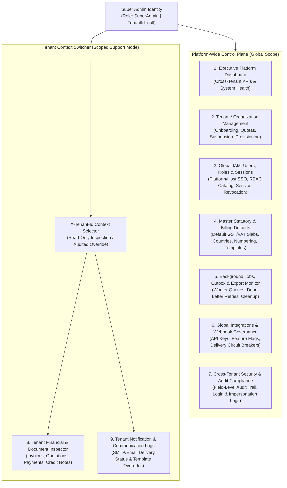
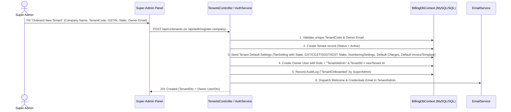
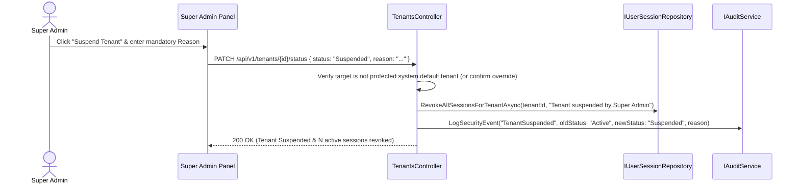
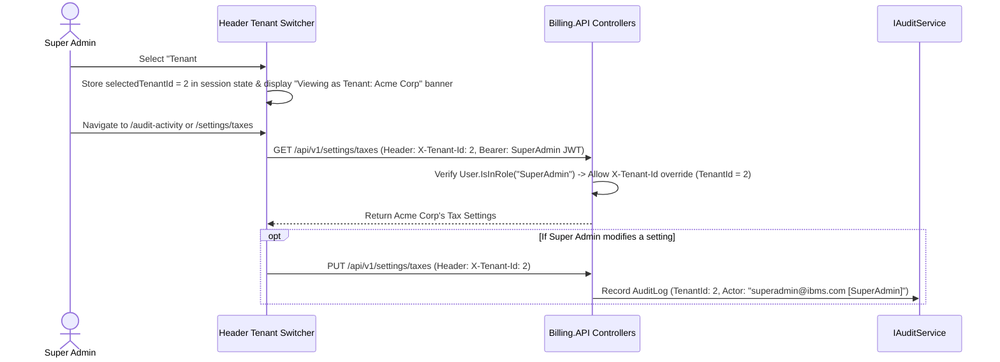

# IBMS — Super Admin Role & Panel: Comprehensive Requirements Specification

**Document Reference:** `IBMS-DOC-2026-SA-01`  
**System:** Integrated Billing & Management System (IBMS)  
**Technology Stack:** .NET 10 (ASP.NET Core Web API), EF Core, React 18 SPA, QuestPDF  
**Status:** Research & Requirements Specification (Ready for Team Review)  
**Prepared For:** Engineering, Product, and Architecture Review  

---

## 1. Executive Summary & Role Definition

In a multi-tenant enterprise billing and invoicing platform like **IBMS**, there is a fundamental architectural distinction between **Platform Governance (Super Admin)** and **Workspace Administration (Tenant Admin)**:

| Dimension | **Super Admin (`SuperAdmin`)** | **Tenant Admin (`TenantAdmin` / `Admin`)** |
| :--- | :--- | :--- |
| **Operational Scope** | **Global / Cross-Tenant Platform Level** (`TenantId = null` by default, with ability to inspect or switch into any `TenantId`). | **Single Organization / Workspace Level** (Strictly bound to their assigned `TenantId`). |
| **Primary Responsibility** | Platform operations, tenant onboarding/suspension, global IAM & RBAC catalog, cross-tenant security auditing, background job & outbox health, integration governance, and master default templates. | Managing their own company's billing operations, customers, products, quotations, invoices, payments, credit notes, company branding, and workspace users. |
| **Financial Data Access** | Governance & troubleshooting access across tenants (with strict audit logging and statutory immutability guardrails). | Full operational CRUD within their own tenant boundary. |
| **System Role Authority** | Can manage all users, assign `SuperAdmin` / `TenantAdmin` roles, and configure global permission definitions. | Can assign workspace roles (`BillingManager`, `Accountant`, `User`, `Viewer`, `Customer`) to users within their own tenant; cannot elevate anyone to `SuperAdmin`. |

---

## 2. High-Level Architecture of the Super Admin Panel

---

## 3. Core Features & Functionalities Available to the Super Admin

1. **Multi-Tenant Lifecycle Governance**
   - Onboard new organizations (Tenants) with unique `TenantCode`, tax identifiers (`GSTIN`/`TaxId`), and primary owner (`TenantAdmin`) accounts.
   - Automatically provision baseline master data for new tenants (default GST/VAT rates, standard shipping/handling charges, financial-year numbering sequences, and default invoice templates).
   - Suspend, reactivate, or archive tenant workspaces with immediate session termination for all users under a suspended tenant.
2. **Global Identity, Access & Session Management (IAM)**
   - Manage both **Platform-Owned Identities** (email/password with BCrypt) and **Host-Owned / SSO Identities** (external OAuth/OIDC provider, subject ID, and scopes).
   - Define and maintain the master **System Permissions Catalog** (56+ granular permissions across 15 modules) and built-in **System Roles** (`SuperAdmin`, `TenantAdmin`, `Admin`, `BillingManager`, `Accountant`, `User`, `Viewer`, `Customer`).
   - Inspect active and historical login sessions (`UserSessions`) across the platform and force-revoke compromised or stale sessions (`LogoutAll` / session kill-switch).
3. **Cross-Tenant Context Switching & Support Impersonation**
   - Select any active tenant from a global **Tenant Context Switcher** in the Super Admin header to inspect or troubleshoot that tenant's configuration, tax rules, templates, or stuck documents without logging in with the customer's credentials.
   - All actions taken while in a switched tenant context are recorded in `AuditLogs` with the Super Admin's actor identity.
4. **System-Wide Operational & Background Worker Orchestration**
   - Monitor and manually trigger background jobs (`OverdueInvoiceJob`, `ReminderJob`, `EmailNotificationJob`, `PdfGenerationJob`, `WebhookDeliveryJob`, `OperationalCleanupJob`) globally or for a specific `TenantId`.
   - Inspect the transactional **Outbox queue** (`OutboxMessages`), **Export Jobs** (`ExportJobs`), and **Generated Documents** (`GeneratedDocuments`) to resolve stuck or failed asynchronous tasks.
5. **Global Integration, API Key & Webhook Governance**
   - Register, inspect, toggle status, and configure feature flags for third-party **Integration Applications** (`IntegrationApplications`).
   - Monitor **Webhook Endpoints** (`Webhooks`) and **Webhook Delivery History** (`WebhookDeliveries`) across tenants, rotate signing secrets, and replay failed webhook payloads.
6. **Master Statutory, Tax & Template Blueprint Management**
   - Maintain global reference data such as **Country & Regional Settings** (`CountrySettings`), baseline **Tax Slabs** (`GST`, `CGST`, `SGST`, `IGST`, `VAT`), and system-wide **Invoice & Notification Template Presets** (`Standard`, `Professional`, `Compact`, `Pirnav Standard`).
7. **Platform-Wide Audit Trail & Compliance Reporting**
   - Search, filter, and export immutable field-level `AuditLogs` across all tenants, entities, actions, and actors, including before/after JSON snapshots and IP addresses.

---

## 4. Super Admin Panel Modules: Detailed Requirements & Purpose

### Module 1: Platform Executive Dashboard & System Health
* **Purpose:** Provides the Super Admin with a real-time, bird's-eye view of platform adoption, tenant activity, transactional volume, and infrastructure health.
* **Key Requirements:**
  - **Tenant KPIs:** Total registered tenants, active vs. suspended tenants, newly onboarded tenants (30-day trend).
  - **Platform Volume Metrics:** Total users across tenants, total invoices generated, PDF rendering throughput, and active user sessions.
  - **Operational Health Alerts:** Failed background jobs count, dead-letter outbox messages, failing webhook endpoints, and failed email notifications (`NotificationLogs`).
* **Current IBMS Codebase Status:** *Partially Implemented* — [`Dashboard.jsx`](file:///c:/Users/ADMIN/Documents/GitHub/IBMS/Frontend/billing-react/src/pages/Dashboard/Dashboard.jsx) and [`LandingPageService.cs`](file:///c:/Users/ADMIN/Documents/GitHub/IBMS/Backend/Billing.Application/Services/LandingPageService.cs) currently focus on single-tenant financial metrics; needs a dedicated Super Admin Platform Overview tab/view.

---

### Module 2: Tenant (Organization) Lifecycle Management
* **Purpose:** Central control plane to onboard, configure, monitor, suspend, and offboard client organizations (`Tenants`) using IBMS.
* **Key Requirements:**
  - **Tenant Directory:** Paginated, searchable list of all tenants showing `Id`, `Name`, `TenantCode`, `CompanyEmail`, `Phone`, `TaxId` (GSTIN), `Status` (`Active` / `Inactive` / `Suspended`), user count, and `CreatedAtUtc`.
  - **Tenant Onboarding Wizard:** Create a new tenant + initial `TenantAdmin` user (extending [`AuthService.RegisterCompanyAsync`](file:///c:/Users/ADMIN/Documents/GitHub/IBMS/Backend/Billing.Application/Services/AuthService.cs#L740-L848)) and automatically seed baseline tenant settings (Tax Settings, Default GST Rates, Numbering Settings, Charge Configurations, Default Invoice Template) just as [`DbInitializer.cs`](file:///c:/Users/ADMIN/Documents/GitHub/IBMS/Backend/Billing.Infrastructure/Data/DbInitializer.cs#L102-L300) does for `TenantId = 1`.
  - **Tenant Profile & Status Management:** Edit organization details (`Name`, `CompanyEmail`, `Phone`, `TaxId`, `Address`) and toggle tenant status (`Active` $\leftrightarrow$ `Suspended`/`Inactive`).
  - **Tenant Offboarding / Data Export:** Trigger a full tenant archive export (`ExportJob`) prior to deactivation.
* **Current IBMS Codebase Status:** *Backend Entity & Repo Exist; Controller & UI Missing* — [`Tenant.cs`](file:///c:/Users/ADMIN/Documents/GitHub/IBMS/Backend/Billing.Domain/Entities/Tenant.cs) and [`TenantRepository.cs`](file:///c:/Users/ADMIN/Documents/GitHub/IBMS/Backend/Billing.Infrastructure/Repositories/TenantRepository.cs) exist (`GetByIdAsync`, `GetByCodeAsync`, `GetAllAsync`, `CreateAsync`, `UpdateAsync`, `ExistsByCodeAsync`), and `POST /api/auth/register-company` exists in [`AuthController.cs`](file:///c:/Users/ADMIN/Documents/GitHub/IBMS/Backend/Billing.API/Controllers/AuthController.cs#L236-L247), but a dedicated `TenantsController` (`/api/v1/tenants`) and Frontend Tenant Management page need to be exposed for the Super Admin panel.

---

### Module 3: Global User, Role & Identity Administration (IAM)
* **Purpose:** Manages all user identities, role definitions, permission mappings, tenant assignments, and active authentication sessions across the entire platform.
* **Key Requirements:**
  - **Global User Directory:** Search and filter users across all tenants by `Search` (name/email), `TenantId`, `Role`, `Status` (`Active`/`Inactive`), and `IdentityType` (`Platform`/`Host`).
  - **Dual Identity Provisioning:** Create/edit **Platform** users (password-authenticated) and **Host/SSO** users (`ExternalProvider`, `ExternalSubjectId`, `ExternalScopes`).
  - **Cross-Tenant & Application Assignment:** Reassign a user's `TenantId` and `ApplicationId` (`PUT /api/users/{id}/assignment`).
  - **Role & Permission Matrix Management:** View and manage the 8 system roles (`SuperAdmin`, `TenantAdmin`, `Admin`, `BillingManager`, `Accountant`, `User`, `Viewer`, `Customer`) and custom tenant roles, mapping them to the 56+ granular permissions across 15 functional modules.
  - **Session Inspection & Force Revocation:** View a user's active device/browser sessions (`UserSessions` — IP, UserAgent, DeviceInfo, LastActivityAtUtc) and revoke individual or all sessions immediately.
  - **Administrative Password Reset:** Allow Super Admin to trigger a password reset email/OTP or set a temporary password for locked-out users.
* **Current IBMS Codebase Status:** *Implemented* — [`UsersController.cs`](file:///c:/Users/ADMIN/Documents/GitHub/IBMS/Backend/Billing.API/Controllers/UsersController.cs), [`RolesController.cs`](file:///c:/Users/ADMIN/Documents/GitHub/IBMS/Backend/Billing.API/Controllers/RolesController.cs), [`UserAdministrationService.cs`](file:///c:/Users/ADMIN/Documents/GitHub/IBMS/Backend/Billing.Application/Services/UserAdministrationService.cs), [`RoleAdministrationService.cs`](file:///c:/Users/ADMIN/Documents/GitHub/IBMS/Backend/Billing.Application/Services/RoleAdministrationService.cs), and [`UserRoleAdministration.jsx`](file:///c:/Users/ADMIN/Documents/GitHub/IBMS/Frontend/billing-react/src/pages/UserRoleAdministration/UserRoleAdministration.jsx) are implemented. *Enhancement needed:* Allow Super Admin in `UserRoleAdministration.jsx` to filter/select across all `TenantId`s (currently `currentTenantId()` reads the logged-in user's single tenant).

---

### Module 4: Master Statutory, Regional & Billing Defaults Configuration
* **Purpose:** Manages regional compliance rules, tax calculation engines, numbering formats, discount policies, and additional charge configurations at both the global blueprint level and per-tenant level.
* **Key Requirements:**
  - **Country & Regional Settings (`CountrySettings`):** Manage supported countries, ISO codes, currencies, calling codes, and default tax regimes (`GET/POST/PUT/DELETE /api/v1/settings/countries` via [`CountrySettingsController.cs`](file:///c:/Users/ADMIN/Documents/GitHub/IBMS/Backend/Billing.API/Controllers/CountrySettingsController.cs)).
  - **Tax Engine & Statutory GST/VAT Rules (`TaxSettings` & `TaxRates`):** Configure tax calculation modes (`Exclusive` vs. `Inclusive`), tax number labels (`GSTIN`, `VAT`, `TRN`), origin state for automatic Indian GST split (`CGST + SGST` vs. `IGST`), and master tax slabs via [`TaxSettingsController.cs`](file:///c:/Users/ADMIN/Documents/GitHub/IBMS/Backend/Billing.API/Controllers/TaxSettingsController.cs).
  - **Document Numbering Engine (`NumberingSettings`):** Configure concurrency-safe sequential numbering prefixes, tokens (`{YEAR}`, `{MM}`), sequence lengths, next number counters, and reset policies (`FinancialYear`, `CalendarYear`, `Monthly`, `Never`) for Invoices, Quotations, and Credit Notes via [`NumberingSettingsController.cs`](file:///c:/Users/ADMIN/Documents/GitHub/IBMS/Backend/Billing.API/Controllers/NumberingSettingsController.cs).
  - **Discounts & Additional Charges Policies (`DiscountSettings`, `DiscountRules`, `ChargeConfigurations`):** Configure max discount caps, approval requirements, and standard charges (`Shipping`, `Handling`, `ConvenienceFee`, `LateFee`) via [`DiscountSettingsController.cs`](file:///c:/Users/ADMIN/Documents/GitHub/IBMS/Backend/Billing.API/Controllers/DiscountSettingsController.cs), [`DiscountsController.cs`](file:///c:/Users/ADMIN/Documents/GitHub/IBMS/Backend/Billing.API/Controllers/DiscountsController.cs), and [`ChargesController.cs`](file:///c:/Users/ADMIN/Documents/GitHub/IBMS/Backend/Billing.API/Controllers/ChargesController.cs).
* **Current IBMS Codebase Status:** *Implemented* across Backend and Frontend (`/settings/*`).

---

### Module 5: Document Templates, Branding & Notification Engine
* **Purpose:** Governs visual PDF rendering templates (`QuestPDF` configurations) and automated customer communication templates (`Email` / `NotificationTemplates`).
* **Key Requirements:**
  - **Invoice & Quotation PDF Templates (`InvoiceTemplates` & `TemplateVersions`):** Create, edit, preview, version, and roll back JSON-driven PDF layout templates (`BrandingConfig`, `LayoutConfig`, `CompanyDetails`, `PaymentInstructions`, `TermsConfig`) across styles (`Standard`, `Professional`, `Compact`, `Pirnav Standard`) via [`InvoiceTemplatesController.cs`](file:///c:/Users/ADMIN/Documents/GitHub/IBMS/Backend/Billing.API/Controllers/InvoiceTemplatesController.cs).
  - **Notification Templates (`NotificationTemplates`):** Manage event-driven email templates (`InvoiceIssued`, `PaymentReceived`, `InvoiceOverdue`, `QuotationSent`, `CreditNoteIssued`) with dynamic placeholder tokens via [`NotificationTemplatesController.cs`](file:///c:/Users/ADMIN/Documents/GitHub/IBMS/Backend/Billing.API/Controllers/NotificationTemplatesController.cs).
  - **Notification Delivery History (`NotificationLogs`):** Inspect sent/failed email logs, recipient details, error messages, and delivery timestamps via [`NotificationsController.cs`](file:///c:/Users/ADMIN/Documents/GitHub/IBMS/Backend/Billing.API/Controllers/NotificationsController.cs).
* **Current IBMS Codebase Status:** *Implemented* across Backend and Frontend (`/templates-branding/*` and `/settings/notifications/*`).

---

### Module 6: Background Jobs, Outbox & Export Operations Center
* **Purpose:** Provides operational visibility and manual control over asynchronous worker pipelines, scheduled jobs, document generation queues, and bulk data exports.
* **Key Requirements:**
  - **Background Job Monitor & Runner:** View live status (`LastRunAtUtc`, `LastStatus`, `ProcessedCount`, `ErrorMessage`) and manually trigger execution (`POST /api/v1/background-jobs/run/{jobName}`) for any tenant or globally via [`BackgroundJobsController.cs`](file:///c:/Users/ADMIN/Documents/GitHub/IBMS/Backend/Billing.API/Controllers/BackgroundJobsController.cs):
    - `OverdueInvoiceJob` (marks past-due invoices as `Overdue`)
    - `ReminderJob` (dispatches automated payment reminders)
    - `EmailNotificationJob` (processes queued email communications)
    - `PdfGenerationJob` (renders and archives vector PDFs via QuestPDF)
    - `WebhookDeliveryJob` (dispatches outbound webhook events with exponential backoff)
    - `OperationalCleanupJob` (purges expired sessions, old logs, and temporary export artifacts)
  - **Export Jobs Monitor (`ExportJobs`):** Track bulk CSV/Excel/PDF archive export requests, status (`Pending`, `Processing`, `Completed`, `Failed`), and download links via [`ExportJobsController.cs`](file:///c:/Users/ADMIN/Documents/GitHub/IBMS/Backend/Billing.API/Controllers/ExportJobsController.cs).
  - **Outbox & Dead-Letter Queue Inspector (`OutboxMessages`):** View pending, failed, or dead-lettered domain event messages in the transactional outbox and trigger manual replay.
* **Current IBMS Codebase Status:** *Implemented* for Background Jobs and Export Jobs (`/background-jobs`, `/export-jobs`); Outbox replay endpoint can be exposed as an enhancement.

---

### Module 7: Integrations, API Keys & Webhook Governance
* **Purpose:** Controls external system connectivity, third-party client credentials, feature flags, and outbound event webhooks.
* **Key Requirements:**
  - **Integration Applications Registry (`IntegrationApplications`):** Register external ERP/CRM/Payment apps, issue client credentials/API keys, toggle active/suspended status, and configure granular feature flags (`PATCH /api/v1/integrations/{id}/feature-flags`) via [`IntegrationsController.cs`](file:///c:/Users/ADMIN/Documents/GitHub/IBMS/Backend/Billing.API/Controllers/IntegrationsController.cs).
  - **Webhook Subscriptions (`Webhooks`):** Manage webhook endpoints, subscribed event types, HMAC signing secrets, and active/disabled states via [`WebhooksController.cs`](file:///c:/Users/ADMIN/Documents/GitHub/IBMS/Backend/Billing.API/Controllers/WebhooksController.cs).
  - **Webhook Delivery Telemetry (`WebhookDeliveries`):** Inspect HTTP response codes, payloads, latency, retry attempts, and manually retry failed webhook deliveries (`/webhooks/deliveries`).
* **Current IBMS Codebase Status:** *Implemented* across Backend and Frontend (`/integrations`, `/webhooks`, `/webhooks/deliveries`).

---

### Module 8: Global Security & Audit Activity Compliance
* **Purpose:** Provides an immutable, tamper-evident forensic trail of all administrative, financial, and security-sensitive operations across the platform.
* **Key Requirements:**
  - **Cross-Tenant Audit Log Explorer (`AuditLogs`):** Filter audit records by `TenantId` (or All Tenants), `EntityName` (`Invoice`, `Payment`, `CreditNote`, `TaxSetting`, `User`, `Role`, `InvoiceTemplate`, etc.), `Action` (`Created`, `Updated`, `Deleted`, `StatusChanged`, `Approved`, `Voided`), `UserId`/`UserName`, and date range via [`AuditController.cs`](file:///c:/Users/ADMIN/Documents/GitHub/IBMS/Backend/Billing.API/Controllers/AuditController.cs).
  - **Field-Level Diff Inspection:** View structured `OldValues` and `NewValues` snapshots, actor IP address, timestamp, and mandatory change reasons (`ReasonRequest`).
  - **Compliance Export:** Export filtered audit logs (`audit.export`) for external statutory or security audits.
* **Current IBMS Codebase Status:** *Implemented with 1 Super Admin Blocker to Fix* — [`AuditController.cs`](file:///c:/Users/ADMIN/Documents/GitHub/IBMS/Backend/Billing.API/Controllers/AuditController.cs#L28-L58) currently checks `User.FindFirst("TenantId")` and returns `403 Forbid` if `TenantId` is `null` (which is true for the seeded `SuperAdmin`!). Updating `AuditController` to allow `SuperAdmin` to pass an optional `tenantId` query parameter or `X-Tenant-Id` header (or view all tenants when omitted) is required.

---

### Module 9: Cross-Tenant Billing & Financial Operations Inspector (Support Mode)
* **Purpose:** Allows the Super Admin (when switched into a specific tenant context) to inspect, troubleshoot, or assist with commercial and financial records while respecting statutory accounting rules.
* **Key Requirements:**
  - **Catalog & Master Data Inspection:** View/manage `Customers` ([`CustomersController.cs`](file:///c:/Users/ADMIN/Documents/GitHub/IBMS/Backend/Billing.API/Controllers/CustomersController.cs)), `Products` ([`ProductsController.cs`](file:///c:/Users/ADMIN/Documents/GitHub/IBMS/Backend/Billing.API/Controllers/ProductsController.cs)), and `Categories` ([`CategoriesController.cs`](file:///c:/Users/ADMIN/Documents/GitHub/IBMS/Backend/Billing.API/Controllers/CategoriesController.cs)).
  - **Transactional Document Lifecycle:** Inspect and manage `Quotations` ([`QuotationsController.cs`](file:///c:/Users/ADMIN/Documents/GitHub/IBMS/Backend/Billing.API/Controllers/QuotationsController.cs)), `Invoices` ([`InvoicesController.cs`](file:///c:/Users/ADMIN/Documents/GitHub/IBMS/Backend/Billing.API/Controllers/InvoicesController.cs)), `Payments` ([`PaymentsController.cs`](file:///c:/Users/ADMIN/Documents/GitHub/IBMS/Backend/Billing.API/Controllers/PaymentsController.cs)), and `CreditNotes` ([`CreditNotesController.cs`](file:///c:/Users/ADMIN/Documents/GitHub/IBMS/Backend/Billing.API/Controllers/CreditNotesController.cs)).
  - **Deterministic Financial Engine Diagnostics:** Test or verify tax, discount, and charge calculations via [`FinancialController.cs`](file:///c:/Users/ADMIN/Documents/GitHub/IBMS/Backend/Billing.API/Controllers/FinancialController.cs) (`POST /api/v1/financial/calculate`).
* **Current IBMS Codebase Status:** *Implemented* across all transactional modules.

---

## 5. Actions & Permissions Matrix for the Super Admin Role

In IBMS, the `SuperAdmin` role is seeded with **all system permissions** (`*` / full catalog in [`DbInitializer.cs`](file:///c:/Users/ADMIN/Documents/GitHub/IBMS/Backend/Billing.Infrastructure/Data/DbInitializer.cs#L67-L86) and [`RoleRepository.cs`](file:///c:/Users/ADMIN/Documents/GitHub/IBMS/Backend/Billing.Infrastructure/Repositories/RoleRepository.cs#L245)). Below is the complete module-by-module breakdown of **Permissions**, **Allowed Super Admin Actions**, and **Scope Differentiation** against `TenantAdmin`.

### 5.1 Platform & Tenant Governance Permissions *(Proposed Additions + Existing IAM)*

| Module | Permission Code | Action / Capability | `SuperAdmin` | `TenantAdmin` |
| :--- | :--- | :--- | :---: | :---: |
| **Tenant Management** *(New)* | `tenants.view` | View all registered organizations/tenants and their usage metrics | ✅ Global | ❌ Own profile only |
| **Tenant Management** *(New)* | `tenants.create` | Onboard new tenant workspaces & seed default master data | ✅ Global | ❌ |
| **Tenant Management** *(New)* | `tenants.edit` | Edit tenant company profile, GSTIN/TaxId, and quotas | ✅ Global | ⚠️ Own tenant only |
| **Tenant Management** *(New)* | `tenants.suspend` | Suspend or reactivate a tenant and revoke all its active sessions | ✅ Global | ❌ |
| **Platform Support** *(New)* | `platform.impersonate` | Switch active tenant context (`X-Tenant-Id`) for support/troubleshooting | ✅ Global | ❌ |
| **Users & Identities** | `users.view` | View and search user accounts and session history | ✅ All Tenants | ✅ Own Tenant |
| **Users & Identities** | `users.create` | Create Platform (password) or Host (SSO) users | ✅ All Tenants | ✅ Own Tenant |
| **Users & Identities** | `users.edit` | Edit user profile, toggle `Active`/`Inactive` status, revoke sessions | ✅ All Tenants | ✅ Own Tenant |
| **Users & Identities** | `users.delete` | Delete non-protected user accounts | ✅ All Tenants | ✅ Own Tenant |
| **Users & Identities** | `users.assign` | Assign roles (`SuperAdmin`, `TenantAdmin`, etc.), `TenantId`, & `ApplicationId` | ✅ Full | ⚠️ Own Tenant & non-SuperAdmin roles only |
| **Roles & Permissions** | `roles.view` | View system roles, custom roles, and the permission catalog | ✅ Global | ✅ Own Tenant + System |
| **Roles & Permissions** | `roles.manage` | Create/edit/delete custom roles and assign permissions to roles | ✅ Global | ✅ Custom roles in Own Tenant |

### 5.2 Operations, Integrations, Settings & Audit Permissions *(Existing in IBMS)*

| Module | Permission Codes | Allowed Super Admin Actions | `SuperAdmin` | `TenantAdmin` |
| :--- | :--- | :--- | :---: | :---: |
| **Dashboard** | `dashboard.view`, `billing.view` | View platform-wide executive metrics & tenant revenue dashboards | ✅ Global + Per-Tenant | ✅ Own Tenant |
| **System Settings** | `settings.view`, `settings.manage` | Configure Country Settings, Tax Settings/Slabs (`GST`/`CGST`/`SGST`/`IGST`/`VAT`), Document Numbering Sequences, Discount Caps, and Charge Configurations | ✅ Global + Per-Tenant | ✅ Own Tenant |
| **Templates & Branding** | `templates.view`, `templates.create`, `templates.edit`, `templates.delete` | Create, edit, preview, publish, and rollback QuestPDF invoice templates, branding configs, and notification email templates | ✅ Global + Per-Tenant | ✅ Own Tenant |
| **Integrations** | `integrations.view`, `integrations.manage` | Register integration apps, manage API keys, toggle app status, and update feature flags | ✅ Global + Per-Tenant | ✅ Own Tenant |
| **Webhooks** | `webhooks.view`, `webhooks.manage` | Create/edit webhooks, rotate signing secrets, inspect delivery logs, and retry failed deliveries | ✅ Global + Per-Tenant | ✅ Own Tenant |
| **Background Jobs** | `backgroundjobs.view`, `backgroundjobs.manage` | View worker statuses and manually trigger `OverdueInvoiceJob`, `ReminderJob`, `EmailNotificationJob`, `PdfGenerationJob`, `WebhookDeliveryJob`, and `OperationalCleanupJob` | ✅ Global + Per-Tenant | ⚠️ View / Trigger Own Tenant |
| **Export Jobs** | `exportjobs.view`, `exportjobs.create` | Queue and download bulk data exports and tenant archives | ✅ Global + Per-Tenant | ✅ Own Tenant |
| **Audit & Compliance** | `audit.view`, `audit.export` | Inspect field-level change logs (`OldValues` $\rightarrow$ `NewValues`), actor metadata, and export audit reports | ✅ Global + Per-Tenant | ✅ Own Tenant |
| **Reports** | `reports.view`, `reports.export` | View and export financial, tax, and aging analytics | ✅ Global + Per-Tenant | ✅ Own Tenant |

### 5.3 Commercial & Financial Module Permissions *(Tenant-Scoped Operations)*

| Module | Permission Codes | Allowed Super Admin Actions (within Selected Tenant Context) |
| :--- | :--- | :--- |
| **Customers** | `customers.view`, `customers.create`, `customers.edit`, `customers.delete`, `customers.manage` | View, create, edit, archive, and print customer profiles and billing/shipping addresses. |
| **Products & Categories** | `products.view`, `products.create`, `products.edit`, `products.delete`, `products.manage`, `categories.*` | Manage product/service catalog, HSN/SAC codes, base prices, tax mappings, and categories. |
| **Quotations** | `quotations.view`, `quotations.create`, `quotations.edit`, `quotations.delete`, `quotations.manage`, `quotations.approve` | Create, edit, approve, send, and convert customer quotations into official invoices. |
| **Invoices** | `invoices.view`, `invoices.create`, `invoices.edit`, `invoices.delete`, `invoices.manage`, `invoices.approve` | Create draft invoices, issue/approve official invoices, generate QuestPDF documents, send reminders, and void/cancel with reason. |
| **Payments** | `payments.view`, `payments.create`, `payments.manage`, `payments.refund` | Record B2B payments (`Cash`, `UPI`, `NEFT`/`RTGS`, `Cheque`, `Card`), allocate across multiple invoices, and process reversals/refunds. |
| **Credit Notes** | `creditnotes.view`, `creditnotes.create`, `creditnotes.edit`, `creditnotes.delete`, `creditnotes.manage`, `creditnotes.approve` | Issue line-item credit notes against invoices, approve credit notes, apply to invoice balances, or record refunds. |

---

## 6. Additional Features, Validations & Guardrails Required

To ensure enterprise security, multi-tenant isolation, and statutory accounting compliance, the following validations and guardrails **must** be enforced for the Super Admin role:

### 6.1 Identity & Privilege Escalation Validations
1. **Last-Super-Admin Lockout Prevention:**
   - A `SuperAdmin` **cannot** delete their own account, set their own status to `Inactive`, or remove the `SuperAdmin` role from themselves if they are the last active `SuperAdmin` in the database.
   - Validation Rule: Before executing `DeleteUserAsync`, `UpdateUserStatusAsync("Inactive")`, or `AssignUserRolesAsync` on a user holding `SuperAdmin`, verify `Count(Active SuperAdmins) > 1`.
2. **Role Elevation Restriction (`TenantAdmin` vs `SuperAdmin`):**
   - Because `UsersController` is accessible to `[Authorize(Roles = "TenantAdmin,SuperAdmin,Admin")]`, `UserAdministrationService` **must** validate the caller's role:
     - Only a caller with the `SuperAdmin` role may assign or revoke the `SuperAdmin` role, or create/modify users belonging to a different `TenantId`.
     - A `TenantAdmin` must be strictly restricted to `user.TenantId == currentUser.TenantId` and prohibited from assigning `SuperAdmin`.
3. **System Role Immutability:**
   - Built-in roles (`SuperAdmin`, `TenantAdmin`, `Admin`, `BillingManager`, `Accountant`, `User`, `Viewer`, `Customer`) have `IsSystemRole = true` and cannot be renamed or deleted (already enforced in [`RoleAdministrationService.cs`](file:///c:/Users/ADMIN/Documents/GitHub/IBMS/Backend/Billing.Application/Services/RoleAdministrationService.cs#L83-L122)).
   - Additionally, the `SuperAdmin` role must be protected from having its core administrative permissions (`users.*`, `roles.*`, `settings.*`, `audit.*`) stripped.

### 6.2 Multi-Tenant Context & Isolation Validations
4. **Super Admin Tenant Context Resolution (`TenantId = null` Handling):**
   - By design, the seeded `SuperAdmin` has `TenantId = null` in the `users` table ([`DbInitializer.cs`](file:///c:/Users/ADMIN/Documents/GitHub/IBMS/Backend/Billing.Infrastructure/Data/DbInitializer.cs#L65)).
   - **Required Validation & Fallback Rule:**
     - For **Global Endpoints** (`/api/users`, `/api/roles`, `/api/v1/tenants`, `/api/v1/background-jobs`), `TenantId = null` means "return across all tenants" unless an explicit `?tenantId=` filter or `X-Tenant-Id` header is supplied.
     - For **Tenant-Scoped Endpoints** (`/api/Audit`, `/api/v1/invoices`, `/api/v1/settings/*`), if the caller is `SuperAdmin`, the backend should resolve `TenantId` from:
       1. Query parameter `tenantId` (if applicable), else
       2. Request header `X-Tenant-Id` (set by the Frontend Tenant Context Switcher), else
       3. JWT claim `tenantId`, else
       4. Default tenant (`1`) so `SuperAdmin` never receives an unexpected `403 Forbid` (fixing the current issue in [`AuditController.cs`](file:///c:/Users/ADMIN/Documents/GitHub/IBMS/Backend/Billing.API/Controllers/AuditController.cs#L28-L58)).
5. **Tenant Suspension Cascade Validation:**
   - When a Super Admin changes a Tenant's status to `Inactive` or `Suspended`:
     - All active `UserSessions` for every user belonging to that `TenantId` must be immediately revoked (`RevokeAllTenantSessionsAsync`).
     - Any subsequent login or token refresh attempt by users of that tenant is rejected with `401 Unauthorized: "Company account is inactive or suspended"` (already supported in [`AuthService.cs`](file:///c:/Users/ADMIN/Documents/GitHub/IBMS/Backend/Billing.Application/Services/AuthService.cs#L152-L159)).
     - Scheduled background jobs (reminders, webhook deliveries) for that tenant should be skipped while suspended.

### 6.3 Financial & Statutory Integrity Guardrails
6. **No Hard Deletion of Issued Financial Documents:**
   - Even as `SuperAdmin`, once an `Invoice`, `CreditNote`, or `Payment` transitions out of `Draft` to `Issued` / `Paid`, it **cannot** be hard-deleted from the database or have its sequential document number altered, preserving GST/statutory audit continuity. Corrections must use `Void` / `Cancel` (with a mandatory `ReasonRequest`) or a `CreditNote`.
7. **Optimistic Concurrency (`RowVersion`) & Pessimistic Sequence Locking:**
   - Super Admin overrides on tenant settings or documents must still honor `RowVersion` concurrency tokens and `IncrementSequenceAsync` locks to prevent race conditions with active tenant operators.
8. **Mandatory Audit Reason for High-Risk Super Admin Actions:**
   - High-impact actions (suspending a tenant, force-revoking sessions, overriding tax settings, voiding an invoice, or rotating integration secrets) must require a non-empty `Reason` string (minimum 5 characters) and write a permanent entry to `AuditLogs`.

---

## 7. Key Super Admin Workflows

### 7.1 Workflow 1: End-to-End Tenant Onboarding & Auto-Provisioning

### 7.2 Workflow 2: Tenant Suspension & Emergency Session Kill-Switch

### 7.3 Workflow 3: Audited Tenant Context Switching (Support Mode)

---

## 8. Gap Analysis & Implementation Roadmap for IBMS

To bring the current IBMS codebase to 100% alignment with these Super Admin requirements, here is the prioritized engineering checklist:

| Priority | Item / Gap Identified in Codebase | Target Layer & Files | Effort |
| :---: | :--- | :--- | :---: |
| **P0 (Blocker)** | **Fix `AuditController` `403 Forbid` for `SuperAdmin` (`TenantId = null`):** Allow `SuperAdmin` to query audit logs via `?tenantId=` / `X-Tenant-Id` header or default tenant fallback. | `Backend/Billing.API/Controllers/AuditController.cs` | Small |
| **P0 (Security)** | **Enforce Caller Scope in `UsersController` & `RolesController`:** Prevent a `TenantAdmin` from querying/modifying users of other tenants or assigning the `SuperAdmin` role; prevent Last-Super-Admin self-deletion/deactivation. | `Backend/Billing.Application/Services/UserAdministrationService.cs`, `UsersController.cs` | Small |
| **P1 (Core Feature)** | **Expose `TenantsController` (`/api/v1/tenants`) & Auto-Provisioning:** Create CRUD + status toggle endpoints using existing `ITenantRepository`, and extract `DbInitializer`'s tenant seeding logic into a reusable `ITenantProvisioningService`. | `Backend/Billing.API/Controllers/TenantsController.cs` *(New)*, `TenantRepository.cs` | Medium |
| **P1 (Core UI)** | **Global Tenant Switcher & Tenant Management Page in React:** Add a Tenant selector dropdown in `DashboardHeader.jsx` (visible only to `SuperAdmin`) that injects `X-Tenant-Id` into `apiClient.js`, plus a `/tenants` management view. | `Frontend/billing-react/src/components/dashboard/DashboardHeader.jsx`, `apiClient.js`, `UserRoleAdministration.jsx` | Medium |
| **P2 (Enhancement)** | **User Session Inspector & Force Revoke Endpoint for Admins:** Expose `GET /api/users/{id}/sessions` and `POST /api/users/{id}/revoke-sessions` so `SuperAdmin` can view and kill active sessions of any user. | `UsersController.cs`, `UserAdministrationService.cs` | Small |
| **P2 (Enhancement)** | **Platform Executive Overview Tab:** Add cross-tenant summary cards (Total Tenants, Active Users, Background Job Health, Failed Deliveries) for `SuperAdmin` on `/dashboard`. | `LandingPageService.cs`, `Dashboard.jsx` | Medium |

---

## 9. Discussion Questions for Team Review

1. **Default Tenant Context for Super Admin:** When `SuperAdmin` logs in (`TenantId = null`), should the UI land on a **Global Platform Dashboard** first, or default the Tenant Context Switcher to `Tenant #1 (Default Organization)` with a top banner allowing one-click switching to any tenant?
2. **Tenant Self-Registration vs. Super Admin Approval:** Currently, `POST /api/auth/register-company` activates a new tenant immediately (`IsActive = true`). Should self-registered companies start in a `PendingApproval` state until approved by a `SuperAdmin`, or remain auto-activated?
3. **Financial Write Access in Support Mode:** When `SuperAdmin` switches into a client tenant's context (`X-Tenant-Id`), should financial modules (`Invoices`, `Payments`, `CreditNotes`) be **Read-Only by default** with an explicit "Enable Support Write Mode (Audited)" toggle, or full write access immediately?
